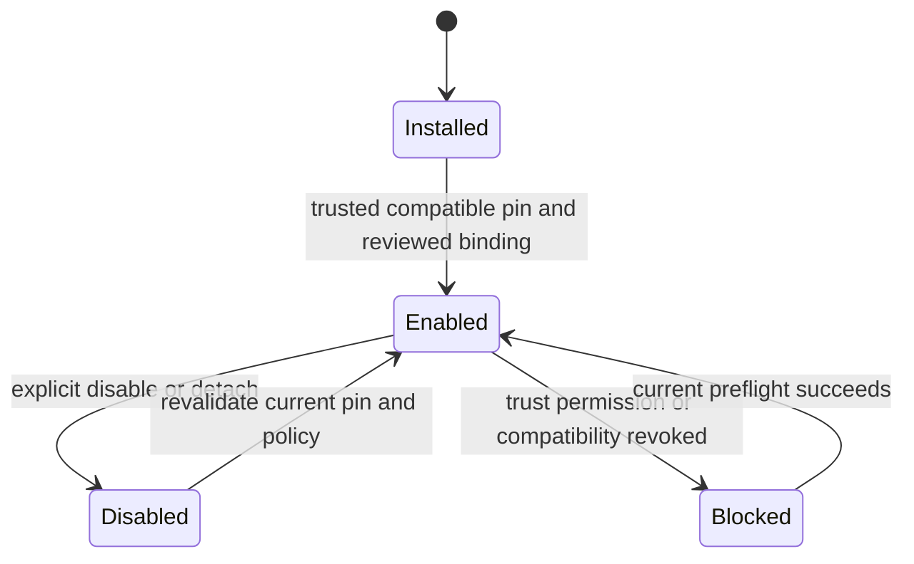
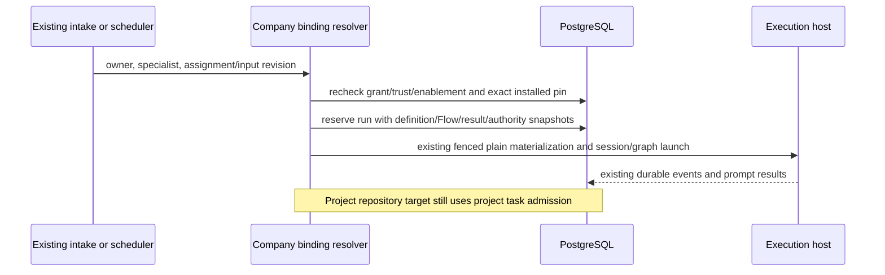

# Specialist role and company execution runtime

## Purpose

**Implemented: specialist metadata, company bindings, standalone/result-only graph lifecycles and node knowledge identity; Designed: governed cooperation and stand qualification — ADR-203.** Reusable specialist roles extend existing package agents and installed Flow bindings. This domain owns company execution and invocation scope; [assignments](specialist-assignments.md) owns durable work and [cooperation](specialist-cooperation.md) owns delegation/acceptance.

## Domain entities

- Specialist: existing package-qualified agent ID with responsibilities, tools, execution policy and applicable target classes.
- Company agent binding: trusted/enabled exact package/definition pin, config, grants, runner policy and optional coordinator Flow binding.
- Company Flow binding: installed `flow_revisions` pin plus reviewed enablement and execution declaration.
- Execution owner: discriminated company/project identity, never empty project slug.
- Trigger binding/attempt: existing scheduler entities with explicit ownership and immutable scheduled request.
- Run/session/attempt: existing `runs`, `run_sessions`, `node_attempts`, results and prompt owners; see [persistence](../db/specialist-assignments-domain.md).

## State machine

Binding readiness is independent of run/assignment state and current permission.

## Process flows

Company execution resolves an installed revision directly and uses existing graph/session ownership.

### Definition and declaration

Implemented additive agent metadata is `specialist: {responsibilities: string[], targetClasses: string[]}`; each list has 1–32 distinct, nonblank entries of 1–256 characters. Parser/rendering, explicit package validation and the catalog share the declaration. Generated main `0235_specialist_metadata` adds nullable `agents.specialist`; old rows stay NULL. Catalog SET/CLEAR/re-SET follows the selected package source, while effective project definitions continue to resolve their own immutable attachment pin. Absence remains absent in serialized definitions, preserving legacy hashes and frozen snapshots. Existing `kind=operational|code_delivery`, workspace, capabilities and execution-policy fields retain their meanings. Metadata never grants authority.

Company binding configuration uses a stable head and immutable version-1 configuration receipts in main migration `0236_company_specialist_bindings`. An explicitly authorized user selects an installed, trusted package revision and its exact professional-role digest; the newest catalog projection cannot retarget the selection. The frozen configuration retains the full role, raw overrides, resolved defaults, action limits, runner/execution policy, optional coordinator Flow revision and server-recorded authority witness. These are configuration/history records, not a second execution ledger.

Native session routes list company bindings, create a binding, inspect its current configuration, replace it and detach it. Creation and full replacement require current `specialists:manage` and `specialists:read`; inspection requires current `specialists:read`. Full replacement requires the current revision and explicit nullable/empty values to clear configuration, runner, Flow and action limits. Each mutation requires a content-guarded delivery key. Replaying an older accepted key returns its original configuration receipt under current authority; changed content conflicts. Parent locking serializes competing revisions, and concurrent creation cannot duplicate a live role. List cursors bind the authenticated user and exact current read grant.

Accepted revisions are immutable and retain exact configuration and attribution after catalog changes or provider retirement. The history service validates retained structure, digest, role and owner without reading provider files. Snapshot and authority bounds are checked before commit, with no partial binding on refusal. Detach needs current management authority and returns only a content-free receipt; it records its reason, disables admission and releases the current package foreign key while retaining historical pin identity and frozen definition. A retired binding cannot be reactivated; a new reviewed binding has a new identity. A disabled live binding still protects its current installed pin. The existing Flow removal and revision GC services also preserve exact coordinator Flow revisions referenced by live bindings; retirement releases those current references. Binding capture takes the shared Flow lock used by removal/GC, so the reference check and admission cannot race. Neither binding ownership nor action limits create a company grant. The native company launch and human-action paths below enforce current authority; bounded cooperation and complete assignment recovery remain their later slices.

Company Flow binding storage freezes a closed version-1 configuration: company, exact installed Flow/package and manifest digest, exact responsible specialist binding/revision with its frozen configuration, reviewed `workspace:none/completion:result` intent, enablement and explicit human role mappings. It retains immutable configuration/authority/request receipts separately from execution history. A live company/Flow reference is unique; replacing it requires CAS and explicit mappings, and retirement preserves accepted history. Each mapped user must currently hold `assignments:answer`; labels only route existing authority. Main `0237_company_flow_bindings` persists stable heads and immutable configuration/authority/routing receipts. Current Flow/package/specialist foreign keys protect providers; retirement releases those current keys while retained snapshots keep their logical identities. The existing removal/GC services check both direct Flow bindings and specialist pins under the Flow revision lock. A staged disabled binding may review a legacy installed Flow, but enablement requires the actual company execution declaration and capability floor 3.12.0. Internal create, full replacement, current/history inspection and content-free retirement services are implemented. The native runtime preflight and declaration grammar are implemented below; public Flow-binding interfaces remain their later UI slice. Storage alone does not activate execution. Existing v1 scheduled request snapshots remain unchanged.

Existing `agent_schedules` and `agent_trigger_attempts` now support explicit exclusive company/project owners in migration `0238_company_trigger_scope`. Company cron source configuration uses the existing cron validator and request normalizer, server creation identity/content key and a separate configuration revision. Exact replay returns the original source receipt; another key creates independent configuration. Old project attribution remains unknown. A v2 binding snapshot captures exact accepted professional/coordinator configuration references; the protected scheduled request remains v1. References are server-generated configuration witnesses and carry no grants. The project dispatcher and legacy backfill still exclude company rows, and project-only settlement explicitly refuses them. The registered agent tick now includes a separately bounded native company cron selection. Shared reconciliation resolves the explicit owner before receipt lookup; company settlement cannot enter the project incident namespace. Native company cron source creation can enable qualified standalone or coordinator work under current authority; native company event creation and registered dispatch are also qualified below, and authenticated company webhook admission is qualified below. No parallel scheduler or invocation ledger is introduced.

### Company agent admission preflight

**Implemented native standalone preflight, reservation and controlled-ACP lifecycle qualification (T20); full Phase 4 compatibility is qualified in T21.** The server-internal company agent preflight receives company/assignment/binding IDs, exact positive 32-bit business/input/binding revisions and a declared trigger (`manual`, `cron`, `domain_event` or `webhook`). The authenticated initiating user is a separate server argument. No request-supplied role, attribution, authority snapshot, package, runner, workspace or confirmation is accepted by this grammar.

Before reading assignment content it checks current `assignments:read` and `assignments:update` for the selected company and active user. The preflight locks the assignment before the specialist binding, checks its company owner and queued state, business/input revision, responsible binding/role and retained source access. It requires a current enabled, non-retired specialist configuration and enabled, non-quarantined catalog identity. It resolves the actual immutable trusted installed package, compares the retained definition/package witness and effective configuration to the assignment's frozen standing input, and validates the selected trigger. A first standalone company operational session requires `workspace:none`, no repository qualification, no coordinator Flow and the exact required operational result descriptor captured by the assignment. Coordinator Flow admission is the distinct T20.1 path; this preflight never substitutes a standalone session for a declared Flow.

The result contains typed current binding, effective definition/configuration/execution policy, immutable assignment/input and current initiating authority. Resolving it creates no run, session, token, workspace or assignment transition. The launch transaction must rerun the preflight immediately before reserving its existing run and assignment link; an earlier result is not an authorization ticket. Stale business/input/configuration revisions or non-queued work return actionable `CONFLICT`; missing/foreign assignment uses the existing unavailable-assignment response; disabled/retired/quarantined/untrusted/mismatched provider or unsupported workspace/trigger/result refuses before effects. Source checks retain current resource authority independently of the historical input snapshot. Actual tool actions also require the current role's explicit action limits, current agent/user authority and source/target restrictions.

### Company Run reservation

The internal `reserveCompanyAgentRun` service admits one exact queued assignment through the existing `runs`, default `run_sessions`, execution-host placement and `specialist_run_links`. It rechecks current preflight under the assignment lock, freezes the reviewed configuration, policy, result and scheduled request, and classifies the exact assignment input before commit. Its assignment becomes `active` while the Run waits in the existing `Pending` queue; no process or credential is created by reservation. Competing admissions using the same business revision yield one committed Run and a conflict. Source denial rolls back the Run, session, placement, link, assignment transition and transactional outbox changes together.

Company runner selection uses the shared standalone resolver: exact binding runner, declared agent default, then platform default. There is no project tier. An explicit binding/agent runner does not require a configured platform-default row; when every tier is absent, admission refuses without allocating a Run/session/link. A selected missing, disabled, unready or read-only-incompatible runner refuses admission; it never silently chooses a different configured runner. Required read-only diagnostics come from the selected execution-host boundary. Assignment and reviewed execution policies must have equal normalized axes; changing requested authority requires explicit review. Native input references are re-inspected under current initiating-user and executing-specialist authority, including exact available version witnesses. Declared private project memory or project MCP bindings are refused until their actual project admission is provided. Native standalone dispatch uses the shared owned-session path below. Native permission continuation and parked-host restart are qualified below; full Phase 4 compatibility is qualified in T21 and company graphs use their separate explicit context below.

### Company Flow node knowledge authority

Company graph launch captures use the explicit v2 grammar. Current execution authority requires the exact enabled coordinator revision/digest, pinned trusted Flow and responsible specialist/input witnesses. Historical content inspection instead uses the receiving user's current company read and exact input/source closure; disabling execution does not erase authorized history.

Before a company ACP node receives knowledge, the existing `node_attempts.knowledge_actor` freezes the server-resolved professional/package/definition identity. That role must have its own current enabled company specialist binding to the same trusted package and definition. Session/workspace-none policy is checked from the reviewed role. A role named in the manifest does not acquire authority from the coordinator. Its action limits are the intersection of the responsible coordinator's limits and its own reviewed binding; each knowledge action also requires current initiating-user and executing-agent grants and source access. Missing attestation, a different definition, disabled role/provider, stale node or newer attempt refuses. The original v2 capture is retained in knowledge authority metadata, and originating attribution includes the exact node attempt. A successful node does not confirm knowledge or complete the assignment.

The standalone token issuer refuses graph issuance. Company graph dispatch uses the separately qualified exact-node extension of the existing token contract. No project, fabricated node, ambient role or personal memory supplies missing authority.

### Native company cron intake checkpoint

The existing registered `agent_tick.dispatcher` invokes project and company cron
selection separately, each bounded to 25 due rows. Company ordering uses due time
and ID. A domain refusal while capturing one source records its safe error and a
five-minute retry time under the source configuration CAS; it cannot continuously
occupy the due head or select a substitute cron expression. Database/infrastructure
failures remain explicit scheduler failures.

The existing claim retains its fence, reserved Run ID, v2 reviewed configuration
references and unchanged v1 scheduled request. The immutable company source
retains its actual creating user; dispatch checks that user's current company
assignment authority. No unknown project authorship is backfilled or inferred.
Canonical schedule intake creates one assignment/input and its exact preallocated
native Run in the same transaction. Standing role/configuration, complete recurring
request and current permission snapshot remain separate. The objective labels the
exact invocation; the original Unicode request remains unmodified in its v1 plane.

The constructor locks and validates the current enabled source/configuration,
professional/coordinator revision and content witnesses, server creator, exact
assignment origin/input, scheduled request and reserved Run ID. A model cannot
choose that Run identity. Both native constructors refuse cron admission without
the source appointment and refuse an appointment attached to another trigger.
Replay resolves the same canonical receipt before host
or mutable provider preflight. Post-commit dispatch uses the existing pool; a wake
failure cannot reinterpret a committed reservation as a refused admission.

Shared trigger recovery adopts only the exact company-owned reserved Run and
matching scheduled request. A claim with no receipt becomes durably unknown; it
is not blindly dispatched again. Existing project event-receipt recovery and
incident routing remain project-owned. Company failures retain existing source
telemetry; company incident grouping remains T39. The controlled-ACP standalone
checkpoint covers actual scheduler registration, concurrent ticks, one create/prompt,
independent fires, replay, lost settlement adoption and unknown refusal. The native
coordinator checkpoint also reaches its required structured result through the
registered tick and default Flow driver. Early current-authority refusal terminalizes
the stale Run and wakes the existing pool after the terminal CAS, preserving the
host seam while binding a new execution for the next Run. Host-pressure qualification
retains the original Pending reservation with no ACP create/prompt, then dispatches
the same Run after admission is re-signalled. A damaged earlier source receives the
CAS retry deadline while later valid work is reserved. Revoking the creating user
after reservation refuses initial dispatch without ACP effects and leaves business
acceptance outstanding.

Enabled source creation requires a current enabled reviewed specialist declaring
`cron`, its enabled reviewed coordinator when configured, a nonempty normalized
recurring request, current source-management/read authority and current
`assignments:read`, `assignments:submit` and `assignments:update` grants for its
server-recorded creator. Unsupported trigger is CONFIG, disabled role/coordinator
is PRECONDITION, absent request is NEEDS_INPUT (`company_scheduled_request_missing`)
and missing current grants is UNAUTHORIZED. Disabled drafts retain the existing
configuration contract. Each fire rechecks current authority and exact binding
witnesses; source creation grants no execution permission. Native create/dispatch
is qualified through the registered scheduler. Native event and authenticated
webhook admission are qualified below; public source settings/routes remain T37.

### Company event intake — native creation and registered dispatch (T22.1)

Company event subscriptions reuse `agent_schedules` with `trigger_type=event`,
an explicit company owner, reviewed specialist/coordinator bindings and a nonempty
set of supported agent-trigger event kinds. Internal projection/invalidation facts
cannot invoke agents. Event sources carry no recurring request text; their event
input and standing instructions stay separate. Existing project event behavior and
cron v1 request snapshots remain unchanged.

The registered `agent_triggers` consumer processes authorized company events
through the existing event claim/fence/reserved Run and canonical assignment
receipt. Its source identity is `{kind:event,eventId,subscriptionId}`. Distinct
subscriptions are independent work even for the same professional; redelivery of
one subscription/event adopts its original receipt. Company event uniqueness must
include the subscription identity without weakening the historical project event
uniqueness constraint. No additional invocation ledger or clock is introduced.

The adapter validates the actual company event and current source configuration,
creator authority, exact provider/role witnesses and declared `domain_event`
trigger. A Run-producing event requires current source-Run access; its inherited
source restrictions propagate into the assignment/input and new Run. The recipient
must also have current access before dispatch. Missing/unknown source access
refuses rather than dropping restrictions. Input contains only the validated event
identity, kind and producing Run reference; raw event payload is not copied into
the assignment or logs. Findings still require their own evidence and may explicitly
report missing evidence.

Sharing an inherited assignment input additionally requires `assignments:read`
in the receiving reviewed action limits and a current agent grant. The native
event appointment authorizes only references already present in its actual
producing Run's complete source capture, including that capture's inherited
closure. It never grants general access to another assignment, project, private
agent memory or personal librarian memory. Current source checks still apply at
dispatch and later disclosure. The ordinary exact-own-input rule is unchanged.

Processing uses keyset batches of 25 source IDs and the existing bounded event
dispatcher. Only sources created before the event are eligible. A source refusal
settles that source's existing claim without poisoning other subscriptions or
fabricating a claim from malformed event-kind metadata. Malformed kinds receive
CONFIG source telemetry under the configuration CAS while valid subscriptions
continue. Self-authored events and exhausted event
chains do not create work; producing native coordinator events retain the actual
chain budget. Missing historical trigger provenance or an unqualified inherited
event chain is explicitly refused as `company_event_chain_unclassified`; a default
zero counter alone never establishes a known chain root. After reservation, existing current-authority dispatch, capacity,
quiescence and unknown-outcome reconciliation apply. Qualification must drive the
registered consumer, distinct subscriptions, replay and inherited-access refusal
before native event creation is qualified. The native standalone and coordinator
paths now pass this qualification through actual enabled source creation, the
registered consumer, default drivers, a real supervisor and controlled ACP processes.
The coordinator producer and recipient retain the inherited source closure and chain
depth, reach a valid required findings export and adopt the same work on replay.
This is platform qualification; no real-model or stand-pilot readiness is inferred.

Generated main `0255_company_event_admission` preserves historical null trigger
values and project event uniqueness. Company event uniqueness includes company,
professional, source subscription and event. Its insertion/reference
guard binds the Run to the existing immutable invocation's reserved identity,
actual owned event and exact assignment origin; source identity is immutable
after insertion. Existing owner CHECKs remain unchanged; unclassified historical
event provenance does not acquire invented identifiers or block lifecycle updates. No existing Run/input bytes are backfilled and no Brain table
is referenced by the migration.

### Native event source creation contract — Implemented (T22.1)

The closed event source input contains company owner, specialist binding ID,
optional coordinator binding ID (default null), 1–32 distinct supported company
Run event kinds, enabled (default false) and the existing bounded delivery key.
Accepted kinds are done/failed/crashed/abandoned, needs-input/escalated and the
existing operational attention/cleanup facts. Project facts, internal projection
facts, unknown kinds, recurring text, payload, actor and permission overrides
refuse CONFIG. Kind order is normalized on a copied array before content guarding.

Creation uses the same existing schedule source creation key, server creator,
configuration revision and immutable receipt as cron. One shared lock namespace
serializes same-key cross-kind races. Exact replay returns the original receipt
under current manage/read authority before mutable provider preflight; changed
content under the same key conflicts. A separate key creates independent work.
No draft cron record is synthesized to create an event source.

Reviewed role/coordinator ownership, package pin/trust, configuration and retirement
checks are shared with cron. Enabled sources additionally require a declared
`domain_event` trigger, enabled reviewed bindings, current creator assignment
read/submit/update authority, and an explicit current professional assignment-read
grant within its reviewed action limits. Missing sharing authority refuses
UNAUTHORIZED; disabled/retired configuration refuses PRECONDITION. Actual receiving
node/source authority is rechecked at invocation and disclosure. Disabled event
drafts remain reviewable; their creation grants no permission. Public settings and
source configuration routes remain T37, independently of native service qualification.
Concurrent exact deliveries create one source; order-only changes to event kinds
reuse the original receipt, changed content and cross-kind reuse conflict. Runtime
and OpenAPI validation reject malformed kinds, extra fields and permission overrides.
Disabled drafts preserve null recurring/cron/next-fire fields without an agent grant;
enabled sources refuse either a missing current grant or a missing reviewed limit.

### Company inbound webhook contract — Implemented (T22.1)

The existing `POST /api/agents/{agentId}/event` admits a company branch only with
`X-Maister-Owner-Kind: company`. It requires a global personal user bearer token
with both `agents:trigger` and `assignments:submit`; project, agent and librarian
tokens cannot impersonate that user. Existing project webhook behavior is retained.
The company body is the closed version-one envelope `{schemaVersion:1, assignment}`
using the canonical bounded objective input and explicit company/binding owner.
The literal route professional must match that owned binding. Caller origin,
requester, permissions, result contract and arbitrary reply URLs are refused.

`Idempotency-Key` supplies the bounded delivery identity. The server derives the
endpoint identity from version, company, authenticated user and route professional,
so rotating that user's token cannot repeat a delivery. Same identity/content
returns the original assignment and Run; changed content conflicts, and a distinct
key is independent queued work. No client numeric domain-event header is accepted
for the company branch. A 32 KiB streaming body bound applies before parsing.
New intake is 201, exact replay 200, malformed body/key 422, oversized body 413,
missing/invalid token 401, missing scope/current authority 403, missing owned role
404 and changed content 409. Responses are private/no-store and token use is audited.

Canonical receipt, assignment/input and the existing native standalone or result-only
Flow reservation commit atomically before post-commit scheduler wake. Provider
preflight occurs only for new work; authorized replay survives a stopped supervisor
or changed provider. Source attribution remains the authenticated user, invocation
is webhook, destination is that user's existing Inbox and current authority is
rechecked at admission. No arbitrary external reply destination is introduced.

Qualification drives the actual authenticated route into the default standalone
scheduler and result-only Flow driver with a real supervisor and controlled ACP
processes. Concurrent deliveries across two personal tokens create one assignment
and one native Run, with one create/prompt pair. Changed payload conflicts;
independent keys retain separate Pending work under host pressure and resume the
same reservation. Missing scopes, unknown owned binding, actor injection, oversized
streamed input, revoked token and revoked current company read authority refuse
explicitly. Legacy project webhook cases remain green; a project token cannot use
the company branch, and an unknown owner header refuses before project launch.
This qualifies platform intake, not the real-model or stand-package pilot.

### Company agent credentials

**Implemented native credential/session lifecycle (T20); full Phase 4 compatibility is qualified in T21.** Company standalone sessions use the existing ephemeral `agent` token kind and existing deterministic `agent-run:<runId>` terminal revocation. New `project_tokens.company_id/company_run_id` identify the exact company execution; `project_id` is null. A current assigned run, source role, initiating user and immutable launch capture are resolved by the server. Only an active operational company run may receive a credential. The initiating account must remain active, hold current `assignments:read/update`, and match the retained server actor; the current role/configuration/provider and exact assignment input/link must remain available. Minting locks the run, revokes any previous live token for that run and stores only the normal secret hash. One live company credential per run is enforced by a partial unique index. The credential cannot be retargeted, have its scopes widened in place or be reactivated after revocation.

Initial company agent token scopes are the explicitly configured intersection of `knowledge:read/propose` with the reviewed role action limits. No wildcard, repository mutation, human confirmation or management scope is inferred. The domain still checks current agent/user knowledge and source grants for each operation; possession of a scope is insufficient. Later assignment/delegation/target tools add their exact scopes in the owning slices. Verification additionally rechecks current run/company/assignment/configuration/provider/account and `assignments:read`, so a Pending or terminal run, disabled/retired/retargeted role, revoked content grant or removed account cannot use a retained credential. Action-specific mutation authority remains separate. Legacy project/user/librarian token shapes and the personal-user actor rules remain unchanged.

### Company graph node credentials

The graph credential extends the existing ephemeral `agent-run:<runId>` token with its exact `knowledge_node_attempt_id`. Company ownership, Run, initiating account and professional agent remain server-bound; project ownership stays null. The shared one-live-company-token-per-Run index, hash-only secret storage, expiry, rotation and terminal revocation remain unchanged. Version-1 standalone tokens require a null node; version-2 graph tokens require an attested current ACP node, its own exact current professional binding, and both coordinator/persona action limits. Credential minting also checks current initiating `assignments:update` and the complete input/source closure. Runtime verification and knowledge authorization recheck the node, coordinator, role, provider and current permissions. A newer attempt or cursor transition fences an old token even before rotation. A token's node binding cannot be retargeted, and a lost/rotated credential is never reactivated.

Generated main migration `0249_company_flow_node_credentials` extends the existing company/native-node CHECK and reference guards without rewriting retained token bytes or changing non-company credential branches. The existing standalone issuer continues to refuse graph issuance. Graph minting, rotation, current-node verification and knowledge principal authorization have owning PostgreSQL qualification. The existing native graph driver and terminal integration are qualified at engine 3.12.0.

### Company execution knowledge identity

**Implemented native identity/read/proposal and standalone runtime services (T20–T21); real companion-package/pilot qualification remains separate.** A company standalone execution resolves the server-only `company_agent` principal from its exact current assignment/input/configuration/provider, retained professional role attestation and initiating active user. Its Brain actor remains the professional agent and originating run; the initiating user is an additional authority boundary, never a replacement author. API token verification still requires an active execution; server-only read inspection may validate a Pending reservation before its first prompt. Neither path can accept a model-supplied role, grant or confirmation.

Initial company-agent knowledge authority is confined to its bound company. Project-owned records, repository/context and private agent-memory sources remain unavailable on this path; actual project work and authorized evidence sharing use the existing project admission/cooperation slices. Existing project-agent knowledge behavior is unchanged. Native company read/propose requires all of: the reviewed role action limit, the agent's current explicit company action grant, the initiating user's current matching company action grant and current source closure. Restricted records additionally require the corresponding record grant for both recipients. Search applies both policies before LIMIT and cursors bind both current grant sets; record/evidence lookup and proposal/correction use the same intersection. No retrieval score or source repetition supplies a grant.

Company-agent authorization uses internal policy snapshot version 2: the existing primary agent authority ID/revision and empty confirmation classes, plus `initiator` (server user actor and current matching knowledge-grant ID/revision) and `execution` (server run ID and exact version-1 `launchSnapshot` company capture). Existing v1 policy bytes remain unchanged. Proposals retain the agent/run attribution and both current authorities; acceptance and confirmation remain independent human/governed actions. Company execution cannot acquire review, confirmation or management through its proposed content or a wider action list. The same native source capture, disclosure, proposal and evidence validators remain authoritative; missing evidence stays explicit.

### Retained retry scope

The existing `agent_retry_intents` stores project retry and native company replacement. Project rows have a non-null project and null company. Company rows have the reverse. Project v1/v2 recipes retain their original JSON and use the existing project admission, source claim and request key rules.

Company recipes use version 3 with `strategy:pre_work_retry`, explicit company `owner`, null `projectId`, `taskId`, `taskRevision` and `project`, exact `specialistBinding` and nullable `coordinatorFlowBinding` configuration references (`id`, positive 32-bit `revision`, 64-character lowercase SHA-256 `snapshotSha256`), and an `assignment` reference (`id`, positive 32-bit `inputRevision`, 64-character `inputSha256`). They retain the existing agent definition, effective configuration, trigger, runner, execution policy and context digest, plus an optional unchanged v1 scheduled-request snapshot. Configuration references identify accepted immutable bytes; they grant no authority. The assignment reference identifies the input used for this retry, not necessarily the current input. The complete recipe remains bounded to 1 MiB in PostgreSQL. Company recipes cannot request repository qualification or carry project workspace configuration. The insert guard validates exact company-owned specialist/coordinator history digests, the responsible binding and immutable assignment/input digest, the frozen role/package/configuration and unchanged scheduled input. Accepted recipe/owner identity remains immutable; current authority and execution safety are admission concerns, separately rechecked before effects.

Migration `0286_company_replacement_retry` implements replacement for manually invoked standalone company specialists with a settled, proven pre-dispatch failure. The v3 replacement witness records the original Run, current business and context revisions, owner epoch, and digests of the original source and result contract. The acceptance transaction rechecks current grants, source disclosure, runner, binding, budget and unsettled work. It commits the immutable retry receipt and one Pending continuation under the same assignment. The existing agent scheduler promotes that Run. The project retry sweep continues to exclude company intents. Historical company recipes without a replacement witness retain their original bytes.

Migration `0288_project_specialist_replacement_retry` adds an optional v2 `replacement` witness for manually invoked taskless standalone project specialists with `workspace:none`. It records `sourceRunId`, `assignmentId`, `inputRevision`, `inputSha256`, `assignmentRevision`, `contextRevision`, `ownerEpoch`, `resultSha256`, and `sourceSha256`. A settled failure needs positive before-dispatch evidence and an unambiguous current root. The original requester needs current project launch, recovery and source access. The existing retry sweep carries the frozen input, role, result contract, and sole retained runner into project admission. The admission transaction links one continuation and settles the receipt. Assignment contention defers the sweep without using an admission attempt. Source and recovery authority are checked again before prompt dispatch. Historical project v1/v2 recipes are retained as stored. Automated-source, repository-workspace and Flow replacements remain open.

Company-capable Flow declaration is `execution: {workspace: "none", completion: "result"}`. It requires engine capability floor `3.12.0`; native company result-only execution, binding preflight and existing driver lifecycle are implemented and qualified in T21. Earlier native evidence findings do not authorize company execution. The same result-only Flow can be enabled for a project; owner comes from the server binding, never a model field. Its required result export is frozen at launch.

A company graph admission refusal records `failurePhase: before_dispatch` on the terminal event only when the Run is still in its initial Running phase and the finalizer verifies that traversal, child work, host commands, sessions, results and HITL have no recorded start under the Run fence. A resumed graph can also fail admission. Any retained execution evidence leaves it outside this pre-dispatch classification. Main `0289_company_flow_replacement_retry` uses that witness for manually invoked company coordinator Flows. The v3 receipt adds `sessionsSha256`, a digest of every retained session name, runner and resolution witness. The retry preserves the exact coordinator pin and result export. A changed session set rolls back the entire reservation. Current recovery authority is checked again when the graph loads.

Main `0290_company_cron_replacement_retry` extends the company retry contract to one replacement of the original cron Run. The original invocation stays linked to that Run and keeps its outcome. The continuation retains the original schedule and exact v1 request. Admission and dispatch require the still-enabled source at its retained configuration revision, with the same owner and reviewed specialist or coordinator pin. An unresolved or changed invocation cannot authorize a replacement.

Main `0291_company_event_replacement_retry` retains the original event, subscription, and chain depth for one replacement of a settled company event Run with a proven pre-dispatch failure. Initial delivery retains its existing uniqueness. A successor needs the exact retry receipt, unchanged reviewed subscription, current source-sharing grant and access to the producing Run. Input source authorization uses the original invocation and rechecks its current authority. Event replay continues to resolve the original delivery.

The declaration is now typed in the shared client-safe manifest schema used by filesystem loading, Studio diagnostics and authored validation. It rejects malformed/authority-bearing declarations, a missing or lower floor, and absent/optional result export. Initial capability validation refuses shell setup/probes, pre-finish gates, repository context and writable workspace access. Explicit retry/rework workspace policies must be `keep`; unchanged repository rewind defaults refuse. Human takeover and further-track settings refuse. Absence remains absent for historical manifests. This authoring validation does not activate the 3.12.0 runtime or company binding enablement.

Permitted nodes are `orchestrator`, `ai_coding` for structured result production, `human`, and `form`. All ACP nodes use the run-owned plain workspace, strict declared tools/MCP capabilities and existing supervisor enforcement. Repo mounts, repository CLI/check nodes, worktree writers, promotion/merge and implicit coding delivery refuse on the launch action path. A company Flow cannot acquire repository access by naming a project in its prompt. An explicit repo target must become governed work admitted by that actual project's rules; automated cross-repository delivery is not added here.

The company graph prompt context has an explicit `assignment` namespace: `id`, `inputRevision`, `inputSha256` and the exact frozen objective input (`objective`, `expectedOutcome`, `input`, `targetIds`, `inputRefs`, `constraints`, `expectedResult`, `verification`). Its `run` namespace contains the real Run `id` and server-owned company `owner`. It exposes no `task`, task attempt number or `run.projectSlug`; strict references to those repository-only paths fail rather than synthesizing identities. Shared executor, ledger steps, artifacts, filtered environment and injected rework variables retain their existing semantics. Reserved task/assignment/run/executor/steps/env/artifact namespaces cannot be introduced or replaced by injected variables. Standing role instructions, scheduled request and authority snapshots stay separate from objective input. Historical project prompt namespaces remain unchanged. The same result-only Flow used from a project must receive the real assignment namespace through its admitted assignment; generic repository launches must not fabricate one. Controlled ACP company prompt dispatch is locally qualified below; project-assignment wiring and the remaining lifecycle qualification retain their owning gates.

Reviewed disabled Flow configuration uses the existing graph-shape parser without treating the manifest as executable. An otherwise valid future-engine configuration can be inspected or disabled on an older host; exact provider, source digest, role mappings and current configuration authority are still required. Enabling or preparing execution uses the executable stored-manifest parser and full engine range. A refused enablement does not advance configuration revision. This distinction does not default or reinterpret historical manifests and does not activate an unsupported execution capability.

Company graph preflight locks current business assignment, then coordinator binding, then specialist/provider state, matching Flow configuration's coordinator-before-specialist order. It reuses standalone admission's shared owner, current user read/update, exact queued assignment/input, role/provider pin, policy and standing-input/source checks; only the final execution contract differs. The existing stored-manifest parser checks the complete declared engine range and returns `CONFIG` with `flowManifestIncompatibility.kind=engine_incompatible` on an unsupported host. Missing/disabled configuration is `PRECONDITION`, stale revisions or mismatched responsible pins are `CONFLICT`, missing current authority is `UNAUTHORIZED`, and a changed/unavailable required result schema is `CONFIG`. The existing export resolver reads actual pinned schema bytes; their exact schema reference/version/digest must match the assignment's expected result. Preparation and capture create no Project, Task, Run, session or run link. They never complete business work. Native reservation must repeat preparation in its own transaction before allocating execution.

Native company graph reservation (`reserveCompanyFlowRun`, T20.1) repeats exact coordinator preflight inside the Run insert transaction after resolving the existing local execution host. It uses the shared Flow session inspector with no project/project-Flow runner defaults: reviewed specialist runner, then declared specialist default, supplies the primary-session override; declared session profiles and installed Flow/platform defaults retain the shared resolver's precedence. An absent platform-default row is allowed when the declared/reviewed runners resolve every session. A selected missing, disabled, unready, unsafe-permission or non-read-only-capable runner refuses rather than substituting another; every resolved session also satisfies the current host's read-only evidence gate. Primary and named session runner snapshots are frozen in the existing `run_sessions` rows. Reviewed binding and declared specialist overrides retain their actual provenance (`binding` / `company-specialist-binding`, or `agentDefault` / `specialist-definition`), rather than pretending that a launch dialog selected them.

The transaction inserts one Pending Flow Run, all session rows, existing execution-host placement and exact coordinator/input link, then advances the assignment to active and emits its existing state fact. Standalone and Flow launchers use the same queued-only initial-link/activation transaction helper; already linked, non-queued or exhausted-revision work refuses. Concurrent admissions against one business revision produce one reservation and one conflict. It freezes actual Flow version labels, v2 owner/configuration authority, required result, reviewed policy/configuration, unchanged scheduled request and exact assignment-input source restriction. It creates no Project, Task, repository workspace row, process, token or session command. Current user source checks precede reservation; professional/node source authority is separately required before any prompt/context disclosure or capability action. Failed preflight or runner admission leaves the execution/session/link/placement/state/outbox set unallocated. This reservation alone does not activate graph dispatch, complete business work or confirm knowledge.

The retained company graph launch capture is an explicit closed version 2 in the existing `runs.company_execution_snapshot`: `schemaVersion:2`, `executionKind:"flow"`, company `owner`, positive 32-bit `assignmentRevision`, exact `assignment:{id,inputRevision,inputSha256}`, `specialistBinding:{id,revision,snapshotSha256}`, `coordinatorFlowBinding:{id,revision,snapshotSha256}` and the same server user/current `assignments:update` authority witness as v1. Identity lengths, revision bounds, SHA-256 syntax and 32 KiB maximum match v1. Owner and witness company must agree. Version-1 standalone captures remain byte-identical and are never upgraded by a reader. Unknown versions, extra keys and cross-owner witnesses refuse. This capture is historical provenance, never current execution authority.

Generated main `0248_company_flow_execution` extends the existing Run owner CHECK and insert/reference trigger to admit the v2 branch only for finite `run_kind=flow`, workspace-none, null project/task/project-Flow/local-package owners, a pinned installed `flow_revision_id`, the responsible source specialist and a mandatory `flow_export` result contract naming that revision. `agent_kind` is null; a graph result is not an operational-agent result. Insert locks/checks current assignment/input, exact reviewed specialist and coordinator binding history, installed/trusted provider and Flow witnesses, initiating current user/grant and expected result identity. It requires the exact existing `specialist_run_links` coordinator/input link in the same transaction. Source version labels are taken from `flow_revisions.version_label` and `resolved_revision` and are immutable for v2. Stored result `producerNodeIds` and optional `nativeContract` must match the pinned manifest export exactly. The immutable ownership/launch guard retains both versions. No Task, workspace row or new execution ledger is created. Storage alone cannot activate company graph dispatch or engine 3.12.0. Historical read authorization uses current reader/source authority; new actions additionally require exact current provider/binding/initiator authority.

Company runs retain `runs.flow_revision_id`, binding snapshot and required result contract; `project_id`, `task_id`, and project `flow_id` are null. Existing project `flows.project_id NOT NULL` remains unchanged. Runner/session/prompt/result/finalization readers use the frozen revision, not newest catalog or mutable `flows.manifest`.

Company graph execution loading restores the exact retained assignment input and standing role independently of the queued-admission constructor. Current read/update, coordinator/provider and installed definition witnesses must still match. The executable parser enforces the actual engine range; the real pinned export schema, input expected-result identity and retained Run contract must agree. Frozen session names/runners come from the existing `run_sessions` rows and must match the compiled graph, with current readiness/read-only compatibility checked for each exact runner. No new default is selected on resume. Loading allocates no Project, Task, workspace, token or host command and does not disclose input to an agent; current node professional/source checks remain mandatory before prompt admission. Company graph traversal must consume this explicit owner/input context rather than manufacture repository records.

The existing Flow persona resolver must also resolve company sessions from current reviewed specialist providers. A company node requires its exact current attempt and session-only workspace-none role; installed bytes must match the role's retained definition and package revision. The driving-persona trigger exception applies only to the responsible launch role. A separately bound node role still declares the Flow trigger and supplies its own binding identity/configuration. The resolver freezes the actually resolved professional on the existing attempt before returning persona prompt bytes. Effective specialist configuration remains a separate structured prompt plane. Project attachment/persona/subagent behavior keeps its existing path; company resolution creates no repository attachment, hidden project or materialized subagent.

Initial company graph tool execution is MCP-only. The existing `MAISTER_MCP_TOOLSET=company` facade exposes knowledge search/get/evidence/conflicts/witness/proposal inspection and bounded source capture/proposal submission; review queues, decisions, confirmation, repository actions and both private memory stores are absent. The current node credential's read/propose scope selects the supervisor's exact allowed tool names. The server-only policy resolver requires the current attested node and reviewed role; `platform_mcp:false` and empty scopes produce tool-less execution. Built-in file/shell/web calls and other MCP namespaces are denied by the existing capability guard even under automatic permission approval; the existing consecutive-denial breaker remains active. Company graph sessions must not use the older `readOnlySession` auto-allow shortcut, which arbitrates reads before this guard. This is native tool policy, not prompt advice or a grant of factual confirmation. Configured target tools/delegation add exact owned scopes in their later tasks. Actual graph materialization must apply this same policy before any node effect; toolset/profile qualification alone does not enable dispatch. MCP integration now builds and executes the actual bundled facade entrypoint before validating stdio discovery, requests and pre-REST refusals.

### Scope and launch refusals

| Surface | Required company extension | Refusal/compatibility |
| --- | --- | --- |
| Effective agent/Flow | Explicit company binding and installed/trusted/enabled revision | Missing/disabled/untrusted/incompatible pin refuses before run/session/effect |
| Agent token | Verified company owner, agent/run/principal and current grants | No empty project ID; old project-token CHECK/reads remain explicit union arms |
| Scheduler | Owner-aware existing schedule/attempt claim, same fences/reserved run/request snapshot | New owner-aware binding snapshot version; existing v1 scheduled request retained exactly; old v1/v2 retry recipes read by version |
| Company actors/HITL | Current company principals and company binding's human role mappings | Extend existing human assignment/actor owner shape; no dummy project roles or new human ledger |
| Workspace | Existing opaque run-owned plain materialization and lifecycle cleanup | No repo/worktree inferred from missing project; current non-company scratch/librarian behavior unchanged |
| Resume/terminal | Exact stored definition/Flow/result and current actor grants | Revoked capability blocks new action; historical snapshot remains read subject to current content access |
| UI/history/Inbox | Owner-aware direct reads and scope predicates | Company rows do not disappear through project INNER JOIN or leak to platform viewers |

Company human role labels map in the reviewed Flow binding to explicit current user IDs with `answer_assignment` authority. Labels route work, never grant permission. Project role routing remains unchanged. Company cron/event sources use existing `agent_tick`/domain-event dispatch; source receipt resolves the pinned specialist entry as agent or result-only Flow. A selected row's owner, enabled/trust state and input are rechecked under claim. Native company cron sources can be created enabled under the qualified policy above; engine 3.12.0 alone never grants execution authority. Authenticated company webhook admission reuses the same canonical reservation; public source configuration surfaces remain T37.

### Authority vocabulary

Stored company grants are domain-qualified, never an unqualified company-wide `read` or `write`: `specialists:read/manage`, `assignments:read/submit/update/answer/accept/cancel/recover/delegate`, `targets:read/logs/restart/recover/manage`. Knowledge uses `knowledge:read/propose/review/confirm/manage`. Company binding permissions intersect these grants, the initiating current principal and exact assignment/target/source restrictions; configuration cannot mint a grant. `answer_assignment` in routing means `assignments:answer`. The target helper service principal can check only its configured operation authority and submit/read exact receipts; it is not an agent and cannot nominate another user, create assignments or issue a new restart intent. No ordinary agent receives management or human-confirmation authority by default.

### Recovery matrix

Both company agent and result-only Flow paths derive the following actions from the shared run-status enum; each status is explicit. Slot accounting remains owned by the existing scheduler predicates.

| Run status | Runtime recovery action | Durable owner/wake |
| --- | --- | --- |
| Pending | Admit reserved run only once under pool cap; repeat input does not mint another run | Existing scheduler claim/trigger receipt |
| Running | Live session retains fenced ownership; lost session follows existing crash/prompt-application reconciliation | Host projection/prompt owner, then assignment owner reconciliation |
| NeedsInput | Preserve existing permission/form request and current answer authority; no generic relaunch | HITL response and existing checkpoint policy |
| NeedsInputIdle | Restore exact snapshot/session handle through proper idle resume claim, cap-gated | Existing agent or graph idle resume, not other-kind dispatcher |
| HumanWorking | Preserve explicit human takeover/claim; do not auto-accept or replace its work | Existing human work owner; current authorized recovery |
| WaitingOnChildren | Preserve child IDs/results and durable wake intent; reacquire slot only on continuation | Existing child event consumer/prompt owner |
| Review | Review result according to exact Flow finish contract; no implicit repo promotion for result-only Flow | Existing graph review/HITL decision and assignment acceptance |
| Crashed | Retain work/effects and diagnose; explicit current-authority replacement, not replay from prompt prose | Existing retry/recovery plus assignment epoch |
| Done | Preserve exact published result/receipt; only assignment acceptance may settle business work | Child-settle wake and assignment acceptance |
| Abandoned | Preserve cancellation/effects and close owned waits; no unattended relaunch | Terminal outbox and independent operation reconciliation |
| Failed | Keep classified diagnostics/results; no success inference; explicit bounded retry where contract permits | Existing retry recipe and assignment revision |

## Expectations

- **CBS-01:** Specialist metadata retains agent identity/kind and config symmetry across lifecycle gates, enforced by the common definition/package/binding validator (`IT-CBS-01`).
- **CBS-02:** Company agent runs resolve pinned trusted bindings, owner-bound tokens and plain workspaces with current revocation, enforced by company launch/resume and frozen contracts (`IT-CBS-02`).
- **CBS-03:** Company result-only graph execution works without project/carrier task and refuses repo-only capabilities before effects, enforced by declaration preflight and graph lifecycle (`IT-CBS-03`).
- **CBS-04:** Company scheduled/event invocation uses existing claim/dispatch and immutable source request with one reserved run, enforced by scoped trigger persistence/dispatcher (`IT-CBS-04`).
- **CBS-05:** Repository targets retain actual project qualification/workspace admission, enforced by existing project launch gates at delegation and action paths (`IT-CBS-05`).

## Edge cases

- **EDGE-CBS-01:** Trust/pin/permission changes between reservation and launch refuse or park the reserved intent, never select newest revision (`IT-CBS-02`).
- **EDGE-CBS-02:** Repo-only node declared in company result-only Flow returns `CONFIG` before any session/workspace/effect (`IT-CBS-03`).
- **EDGE-CBS-03:** A permanently ineligible first cron row cannot starve later rows; bounded keyset/retry state is persisted by existing dispatcher (`IT-CBS-04`).
- **EDGE-CBS-04:** Company flow with a project locator cannot bypass project admission (`IT-CBS-05`).

## Linked artifacts

- [ADR-203](../decisions.md#adr-203-durable-specialist-assignments-and-company-coordinator-flows), [persistence](../db/specialist-assignments-domain.md), [agents](agents.md), [scheduled requests](scheduled-agent-requests.md).
- [Flow DSL](../flow-dsl.md), [web API](../api/web.openapi.yaml), [supervisor](../supervisor.md), [execution prompt lifecycle](execution-prompt-lifecycle.md).
- Implementation: `web/lib/agents/`, `web/lib/services/runs.ts`, `web/lib/flows/graph/`, `web/lib/tokens/`, existing scheduler and execution-host services.

Company operational workspace ownership uses an opaque company/run digest below
`worktreesRoot()/.company/`, with a separate adapter runtime directory. The
existing integrity baseline retains the explicit company and run identities and
both managed paths. Inspection refuses a different owner, moved/retargeted
baseline, missing company execution capture or repository workspace before
probing source bytes. Company runs have no repository reference history.
Legacy project baseline owner JSON remains unchanged. The shared disposition
uses the resolved runtime path and refuses repository allocation for a company
owner. Native company terminal result/token/outbox application and clean directory
release and native session/host recovery are qualified separately below; full Phase 4 compatibility is qualified in T21.

Company operational finalization uses the existing Run result ledger, terminal
transaction, token revoker and cleanup disposition. A terminal preparation
validates the retained company execution/workspace owner; historical capture
never supplies action authority. A result, terminal state, credential revocation
and company outbox fact commit together. Rollback leaves all four unchanged;
replay cannot publish a second result. A missing required result produces a
failed Run with the existing typed `CONFIG/result_missing` cause. Task
qualification remains project-only and cannot be attached to company work.

Main `0242_company_run_terminal_events` admits the existing `run.done`,
`run.failed`, `run.crashed`, `run.abandoned` and
`run.operational_cleanup_changed` kinds for an exact company-owned operational
Run with no task. Company event identities cannot be retargeted. Existing
project consumers continue to skip company facts, and outgoing project webhook
subscriptions receive only project-owned terminal events. Company result
delivery and cooperating-agent consumers remain their later owning slices.

A clean terminal directory releases through the same leased disposition and
managed-path remover, including its separate adapter runtime directory. Failed
source bytes require the existing host evidence transport before removal;
missing transport retains the bytes and a durable actionable retry reason.
Finishing a Run never accepts or completes the durable specialist assignment.
These native service/PostgreSQL/filesystem qualifications do not establish
actual company ACP launch, interrupted-host recovery or stand-pilot readiness.

Company standalone runs use the existing global agent pool, advisory admission
lock and Pending queue. A project run can hold the same slot; racing company
candidates cannot exceed the cap, and a slot freed through terminal application
promotes queued work through the existing dispatch callback. Direct starts,
queue promotion and queued resume emit project `run.started` webhooks only
when an actual project owner exists. The native company cap qualification
covers admission/queue/terminal release with a bounded dispatch seam; real
company ACP sessions, permission idle-resume and retained-host restart are
qualified below. Full Phase 4 lifecycle compatibility is qualified in T21.

Assignment prompt-source contract (T20 source resolution and native launch
capture Implemented): the native restriction
`{kind: "assignment_input", assignmentId, inputRevision, inputSha256}` names
an exact immutable input and content witness. It is a source restriction,
separate from model evidence references and confirmation. An initiating user
needs current assignment read authority and the input's inherited source
permissions. A company execution receives only its server-bound assignment and
exact retained input; appointment to one assignment grants no other assignment
or Company Brain record access. Existing project-agent sharing remains denied
until its explicit assignment/delegation binding is implemented.

Source closure follows the retained input's own restrictions. Direct reads,
search filtering before LIMIT, proposal review and outward results must apply
the same closure and current grants. A wrong revision/digest, missing input,
foreign execution or revoked reader is unavailable. This is a logical source
reference with no Brain-to-project foreign key. Current assignment head
changes do not rewrite a previously captured input. Company prompt capture
must commit this classification with the Run/input link before any prompt or
external effect; a model cannot supply or widen it.

The native source resolver validates and locks an execution's exact appointment
before evaluating `assignment_input`. Human readers use current company
`assignments:read` grants or the existing project assignment read policy; company
ownership has no administrator shortcut. A company execution matches only the
input already validated in its server identity. Inherited record, repository and
memory restrictions remain independently binding. Source-only project
references are logical: deleting a source project succeeds and makes its source
unavailable while retaining the company's immutable assignment input.

Retrieval computes accessible record/revision dependencies once for the source
closure and then tests membership, preserving exact versus current-version
checks before LIMIT. Company grant checks are fixed to the execution's bound
company. The small native integration fixture has a 500 ms database execution
budget; EXPLAIN-based qualification caught and removed repeated grant planning
that previously spent about one second in JIT compilation per query. This is a
fixture regression bound, not a production latency guarantee. Existing stored
source arrays and legacy capture bytes are unchanged; the source kind itself requires no data rewrite or invented
historical attribution. Main `0243_native_source_array_planning` adds only a pure
JSON iterator with a four-row planner estimate, which returns every source entry.
Native source, owner, context, memory and record/revision checks use bounded
authorized sets to avoid repeating grant plans per recursive edge. Its 256-entry
Unicode/ordering check and actual built MCP workflow retain their original
semantics and process deadline.

Company graph plain-directory qualification extends the same owner/path witness and fenced host adoption used by standalone company work. A v2 Flow requires its explicit finite workspace-none/result-only capture; the internal adoption specification must identify `executionKind:flow`, while v1 agent specifications identify `agent`. Changing only a run-kind label cannot reinterpret an agent owner as a Flow. Existing opaque company/run paths, directory baseline generation and host workspace handles are reused without creating a repository workspace row. Generated main `0250_company_flow_workspace_witness` admits this explicit graph baseline branch without changing operational-agent terminal or cleanup contracts. This resource witness proves directory integrity only; result validity, business acceptance and external operation verification remain separate. Native graph driver/source-generation/terminal disposition are locally qualified below; human/form and restart qualification remain open.

Native company capability materialization restores current exact company context and the node's declared frozen session, requires its server-attested professional policy, verifies the managed owner/run path and passes the existing capability-enforcement diagnostics gate before writing files. Missing or pending enforcement evidence and unsafe permission policy refuse even for an empty tool allow-list. The shared capability materializer now accepts an explicit company owner with `projectId:null`, preserving the project profile shape and digest behavior. No project catalog, default MCP, binding overlay or imported capability is loaded. The initial declaration refuses unsupported capability selections and permission overrides at the shared loader/Studio schema boundary, rather than silently dropping them.

The returned plan contains the exact effective server-owned enforcement profile and digest and uses the existing write-once node materialization ledger. The existing file lease, Claude local settings ownership and cleanup protocol remain authoritative. Adapter settings retain `default` permission mode; the supervisor's MCP-only guard supplies the physical restriction, without `readOnlySession` auto-approval. Profile creation/persistence is locally qualified with real package/PostgreSQL and adapter files; controlled diagnostics are not an actual runner smoke. The existing graph now applies this profile through its selected execution-host diagnostics, actual node dispatch and shared terminal/resource paths as described below. Human/form and restart qualification remain T20.1 gates before engine activation.

### Native company graph traversal

The existing `loadRun` returns an explicit company branch with exact assignment input, installed graph and frozen sessions, and null Task/project-Flow/workspace records. The same `runFlow` lease, graph traversal, node attempts, prompt application, result ledger and execution-host command owners execute it. `_company` remains only the reserved wire/runtime namespace. No repository identity, source checkout, Git checkpoint, private memory recall, project capability default or project run-context file is supplied. Repository takeover/rework routes and gate/consensus internals require their admitted project branch.

The node's actual reviewed professional is resolved and attested before its capability profile or token. Capability evidence comes from the selected execution host; the current probe-version receipt must be acceptable. Physical confinement is MCP-only, with exact knowledge scopes and the company facade subset; tool-less roles receive no facade credential. The profile and effective policy use existing materialization/prompt records. Standing role instructions/configuration, scheduled request and frozen assignment input remain separate prompt planes.

The managed company directory starts with a verified empty source generation before platform writes or the first human/form wait. Generation zero remains unverified; an empty admitted directory is checked through the existing generation-capture protocol rather than weakening integrity validation. An existing baseline must still match before continuation; an unwitnessed nonempty directory refuses. Only paths in the existing Run-owned file lease and ownership journal may extend a generation. Profiles remain leased until terminal disposition. A required valid public Flow result, observed session teardown and clean source integrity are all necessary for technical Done. Failure or missing/invalid/stale output cannot enter project Review or automatic repository delivery. Result and driver-generation witnesses are rechecked under the Run lock; current credentials revoke and placement releases with the terminal fact. Business assignment completion and fact confirmation remain separate.

Main `0251_company_flow_runtime` extends existing company lifecycle facts and bounded resource cleanup without reinterpreting `operational_v1` or populating `operational_terminal` for a graph. Shared disposition preserves failed/uncertain source evidence before removal and retains its existing retry/lease/release protocol. A queued company graph whose current binding/authority admission fails is durably Failed before any session effect. It cannot settle another live graph driver's preparation.

Released execution assignments may seal bounded run-owned diagnostic archives
only while their exact terminal resource is in `preserving`. The existing
command admission exception accepts either an operational-agent owner or the
same exact native company Flow resource predicate used by disposition. Diagnostic
kind, run retention, name, maximum size, original assignment/epoch and immutable
upload declaration must still match. This permits preservation after native
integrity refusal without reopening execution or reclassifying the Flow as an
operational agent. Source-integrity failure does not erase its retained technical
result or complete the business assignment.

Qualification currently uses real PostgreSQL migrations, the actual package loader with a pinned fixture Git package, an owned real supervisor and controlled ACP. Concurrent native driver invocations produce one create/prompt, a valid retained export, physical quiescence and released directory; the business assignment remains active. A changed reviewed coordinator refuses queued dispatch with zero ACP effects. The engine compatibility predicate is the actual 3.12.0 implementation; capability-cache receipts remain controlled fixture inputs, not real adapter/model smoke or companion/stand qualification. Native form and human-review waits are additionally qualified through the actual response route and both graph resumes below. The engine is 3.12.0. Full Phase 4 compatibility is qualified in T21; actual company companion/cooperation and stand qualification remain separate later gates.

Native completion qualification also covers missing and malformed required node
output: the existing default mismatch policy fails the node and Run with `CONFIG`,
publishes no public result and preserves/releases its failed resource through
the existing disposition. A controlled interruption after atomic result/finish
publication leaves the Run Running with a retained valid result and released
driver lease. After supervisor SIGKILL/restart, the same graph driver consumes
the saved finish continuation, preserves the exact result revision and reaches
Done with one original prompt and attempt. It does not replay completed work.
The form/coordinator/human-review scenario uses an actual `orchestrator` node
with explicit depth/fanout/active-child and complete resource budgets. Company
child admission and delegated-work qualification remain owned by T27/T30.

### Native permission approval boundary

Native company profiles declare `allowedToolApproval: execution_policy` in the
existing session enforcement profile. Tool admission is a capability ceiling;
a permitted call continues to the existing execution policy's ask/automatic
approval path. Denied calls remain denied before either policy can approve them.
The optional literal is included in the materialization digest and strict
supervisor HTTP schema. Absent retains the legacy profile's inline approval,
including existing project and librarian captures. Current native profiles do
not retrofit older retained session payloads or fabricate human consent.

Native Flow permission requests retain company ownership in the existing HITL
and human-assignment ledgers. Their needs-input fact uses the company event
scope; project webhooks do not receive company content. A fresh answer records
the server-resolved user and claimed actor as versioned
`response._audit.companyConsent`. Delivery and replay require that exact actor's
current company answer authority and source access. Missing consent, an actor
mismatch or revoked authority refuses before an input is prepared or a refused
delivery intent is withdrawn. Historical captures are not backfilled. Recording
an already observed input receipt remains a separate attribution operation.

Checkpointed native permission resume uses the same `resumeRun` capacity claim
and node permission-handoff ledger. The exact native resource loads its frozen
company session context and current initiating/source authority; project runs
retain their repository/workspace checks. The claim validates retained human
consent under the receiving transaction before withdrawing an input intent or
advancing the attempt generation. Revocation rolls back the claim and leaves
the answer, idle Run and prior work intact. Historical-result handoff retains
its separate receipt validation and emits project webhooks only for a project
owner.

The existing continuation worker owns resumed traversal and terminal application.
Native qualification checkpoints an actual permission, interrupts the original
driver, SIGKILL/restarts the owned supervisor and observes the same host key with
a new boot identity. Exact input/result captures and ACP resume identity survive;
capacity queues the answer, revoked consent refuses a new claim, and restored
authority completes with two prompts and one input delivery. The controlled ACP
fixture explicitly persists its original scripted conversation for this test;
the production continuation prompt does not replay assignment input. This is
platform/controlled-adapter qualification, not actual specialist-package or
stand readiness.

A definitive service refusal retains the answer for an explicit retry; the
existing command protocol determines whether a new delivery identity is allowed.
Unknown outcomes retain their original command and require reconciliation. Native
technical finalization waits, within the existing event/projection lease bounds,
for canonical session-exit evidence after physical teardown. It never repeats the
external command or substitutes process exit for durable quiescence. Operator
cancellation retains its existing actionable retry behavior.

### Native company form and review continuation

Explicit `form` and `human` nodes use the existing HITL, company human assignment,
actor, response artifact and node-attempt ledgers. Shared `_company` namespace
resolution replaces a project-slug lookup only for the exact retained native
company Flow resource; it never fabricates a project. Required form validation
runs before mutation and retains the existing 422 contract. Current human
read/answer/source authority is rechecked under the Run/HITL lock, and pending
cancellation refuses input. Existing claim/replay and completion attribution
remain authoritative. Project webhook subscriptions receive no company response.

A real pinned package, PostgreSQL and owned supervisor qualification runs
form→specialist→human-review→Done. The response artifacts resume the same Run;
form values survive as `steps.<node>.vars`, the assignment/input/result capture
remains byte-identical, and the specialist receives one prompt across both
resumes. Human work records both current responding actors. A required valid
public result and quiescent clean source are still necessary for technical Done;
the durable specialist assignment remains active. These are graph input/review
waits; business clarification/input-head changes belong to T24. Controlled ACP
and prospective compatibility receipts do not establish real package/model or
stand readiness.

### Company workspace adoption

**Implemented native host boundary and company standalone/result-only Flow admission (T20–T21).**
The server resolves a company Run's retained owner through the shared operational
workspace resolver. Adoption sends its managed `.company/<owner-run-digest>`
directory, explicit `{kind:company,companyId}` owner and reserved `_company`
runtime namespace. The legacy wire field `projectSlug` names that runtime
namespace; the host never resolves it against registered projects. No project,
repository, local package or sibling mount is substituted. Later session creation
uses the opaque workspace handle and inherits its cwd and log namespace.

The supervisor accepts this owner only for an isolated directory, validates the
managed company/run path witness and refuses owner retargeting on replay.
SQLite schema 17 adds nullable `workspaces.company_id` with exclusive namespace,
directory, repository and mount constraints. Migration from populated schemas 15 and 16
preserves old workspace bytes and leaves company ownership absent; no historical
authority is inferred. Reopening the host retains a new company owner and
`GET /workspaces/{id}` returns it without source paths. Existing project and
librarian wire shapes remain unchanged. Invalid command payloads retain the
supervisor's existing 409 mapping; `workspace_rejected/owner_mismatch` identifies
a managed-path or replay-owner conflict. See the authoritative
[supervisor contract](../api/supervisor.openapi.yaml).

### Company standalone session driver

**Implemented and qualified native standalone dispatch, permission continuation
and parked-host restart; full Phase 4 compatibility is qualified in T21.** `driveAgentSession` distinguishes a company owner before project
resolution. It uses the existing generation turn, default session, host command
ledger, opaque workspace adoption, canonical prompt owner and operational
finalization. It supplies no synthetic project, repository, attachment or private
memory. Declared project memory/MCP dependencies and coordinator execution models
are explicitly refused through one shared standalone-definition guard.

`loadCompanyAgentSessionContext` decodes the exact retained input/digest and
frozen operational role, verifies the current installed definition witness, trust, catalog and binding,
initiating account and assignment read/update authority, exact source references
and current frozen-runner availability. It verifies configuration and normalized
policy against the immutable input. The same guard runs inside company session
create and prompt admission, including retained-create re-entry. Acknowledging
already performed creation remains independent of new-action authority.

The company prompt keeps standing instructions, effective configuration,
objective/input/targets, knowledge references, constraints, expected result and
verification, historical execution policy and the unchanged scheduled request
as separate sections. Current server permissions remain authoritative. Existing
native disclosure records classify the exact assignment input before model work.
The owner-aware operational baseline, adapter runtime directory, facade token,
capability materialization and shared terminal/disposition path are reused.
A valid Run result and completed host execution do not complete or confirm the
assignment. Revocation before initial dispatch produces no workspace, session,
prompt or credential and preserves the assignment/input for governed recovery.

Native initial qualification uses a real pinned package, real PostgreSQL and a
canonical fake host whose physical session state explicitly becomes exited;
agent prose or a clean return alone cannot pass quiescence. Real supervisor
adoption/SQLite restart are separately qualified above; the supervisor/ACP fixture
loop is qualified below. Actual company model/companion-package invocation,
idle/HITL continuations, interrupted/replaced owners, company
activity pages and the stand pilot retain their separate acceptance gates.

### Company execution content access

**Implemented — native peek authorization, canonical Run SSE and runtime-object
metadata/content.** The shared company read guard derives owner and exact immutable
assignment input from the retained Run/link. It requires current explicit
`assignments:read`, a complete source capture containing that input, and current
access to every inherited source. Neither administrator status nor Run creation
alone grants company read authority. Incomplete company captures fail closed with
the same concealed 404 as missing/unauthorized Runs; inherited source loss returns
a safe 409. Historical reader authority does not depend on an enabled specialist,
trusted provider files, or a currently executable assignment. SSE rechecks company
reader/source authority before each canonical batch; protected object bytes retain
the existing per-chunk source recheck. No project or new execution is created by a
read. Company specialist metadata history is available through
`GET /api/specialists/{specialistId}/runs`, reusing the existing Run projection
and signed cursor. Source closure filters before pagination; the cursor also binds
the current receiving user/read-grant identity and revision. History contains no
scheduled input or diagnostic prose. Company activity UI and full Run navigation
remain subsequent slices.

### Native company supervisor/ACP qualification

A company standalone qualification runs the native reservation, shared scheduler,
owned create/prompt driver and operational finalization through a real supervisor
child, actual ACP fixture process and the application's autonomous canonical
projection registry/worker. No manual projection substitutes for background
terminal confirmation. It checks one physical session, typed result,
quiescence, credential revocation, placement release and retained source-authorized
transcript after completion. A repeated driver invocation creates no second session,
prompt or result. Business assignment acceptance remains separate. The fixture
also verifies explicit binding-runner admission without a platform-default row and
atomic refusal when every runner tier is absent. This qualifies native mechanics;
it does not establish real model/companion-package or stand-pilot readiness.

### Native company permission and human delivery

Company operational permission requests retain the exact owned prompt/session
source and create one company human-work assignment in the existing ledger in
the same transaction. Canonical replay retains that work and its actor history.
The shared HITL response service requires current explicit company read/answer
authority and the Run's exact source access, including for administrators and
callers with a project preauthorization. Permission intent admission rechecks
under the existing Run/HITL lock; refusing an answer creates no response or input
command. The authorized current user becomes the scoped human actor; native input
ACK completes the human work under that actor, while the specialist assignment
remains subject to separate result acceptance.

Main `0246_company_hitl_wait_events` admits the existing `run.needs_input` fact
for an exact retained company operational Run, without a project/task owner.
The single native HITL writer emits that fact atomically; private local assistants
retain their separate notification path. Existing company event owner/reference
and immutable routing guards remain active.

An actual idle checkpoint releases the existing execution assignment. The normal
continuation worker reconciles the retained prompt/checkpoint evidence and admits
one resumed turn. A reissued company permission uses the original human decision
actor, with current read/answer/source authority checked by the existing human
claim service before input preparation. Revocation while capacity is unavailable
preserves the decision but prevents delivery; a current re-grant permits recovery
without another input or business assignment. Qualification also restarts the actual
supervisor on its retained SQLite/runtime directory after checkpoint: host identity
stays stable, boot identity changes, and the exact frozen Run/result contract and
canonical ACP session handle survive. ACK completes the original and
linked reissued human work under the same actor. Inbox UI, full interruption
recovery and company coordinator Flow qualification retain their own gates.

### Company Run stop contract

The existing `POST /api/runs/{runId}/stop` owner dispatch must admit a company
standalone operational Run or native result-only company Flow without a
project/worktree. Current explicit
`assignments:read` and `assignments:cancel`, plus the exact retained input/source
closure, authorize the human action; an administrator has no implicit grant.
`Pending`, `Running`, `NeedsInput`, `NeedsInputIdle`, `Review` and `Crashed`
are cancellable through their existing operational-agent or native graph
finalizer. Both use the shared terminal source-state policy. Native graph
cancellation preserves the Flow result contract and leaves `operational_terminal`
null. An already
`Abandoned` Run still requires current authority and returns the same terminal outcome without another command/event;
`Done` and `Failed` refuse with 409. Missing/currently inaccessible ownership is
concealed as 404; missing cancellation authority with read access is 403.

Main `0252_company_run_cancellation` retains the first operator's closed v1
stop intent on the existing Run before transport. It records user, observation
time and exact assignment/driver witnesses without inventing prior history.
Current authority is required on each retry; another operator receives an
ownership conflict. This immutable control metadata is separate from result
acceptance and the business assignment. The existing prompt application worker
defers behind this intent; Flow driver admission/commit yields. A DB guard
refuses new create/prompt/input/steer commands and competing Done/Failed
completion. The real-supervisor regression holds a DELETE response until prompt
application observes the retained intent, then retries cancellation under the
same operator. A lost response cannot turn cancellation into missing-result
failure or another execution.

The native bound command ledger records each session deletion before transport.
Unconfirmed host teardown or pending canonical exit evidence returns 503 and
cannot assert abandonment. Retry reconciles actual host/canonical state; the
response flag describes deletion performed by that request, not a historical
effect count. Current
cancellation authority is rechecked before deletion and terminal application.
Canonical quiescence, typed cancellation, credential revocation, human-work
closure and cleanup use existing mechanisms. Human-work cancellation and the canonical terminal fact retain the
current company user actor; the stopped specialist remains execution provenance.
The graph finalizer rechecks current reader/source/cancellation authority under
the Run lock, preserves the exact driver witness and obtains the company user
actor from the server. Concurrent Pending cancellation creates one terminal fact
and no create/prompt command. Live native graph qualification additionally holds
a real controlled ACP terminal response after output, then cancels through the
actual endpoint: one create, prompt and deletion, an inert repeated stop,
attributed immutable intent, Abandoned outcome and released directory. The
original graph driver yields without applying the completed output.
Stopping an execution does not cancel or complete
its business assignment, nor reconcile unknown external stand effects. The
response retains `{ok,runId,runStatus:"Abandoned",supervisorStopped}`. Project
and private execution routes retain their existing admission and behavior.

### Company operational attention and cleanup authority

Existing operational acknowledgement and cleanup-retry endpoints derive the
company from their retained Run. Acknowledgement requires current explicit
`assignments:read`/`assignments:answer`; cleanup rearm requires
`assignments:read`/`assignments:recover`. Both retain exact input/source access
and repeat authorization inside the existing Run-locked service transaction,
including idempotent replay. Inaccessible ownership remains 404, absent current
action authority is 403, and stale reason/revision or non-exhausted cleanup is
409. No administrator bypass applies. The project route policy is unchanged.

Acknowledgement writes the existing per-user/reason/revision receipt and emits
one content-free, company-owned `run.operational_attention_acknowledged` fact.
Main `0247_company_operational_attention` extends the existing kind CHECK;
current company Run-reference and immutable-routing guards still apply. Cleanup
rearm uses the existing revision/receipt, resets its bounded retry budget and
emits the existing cleanup-change fact; an exact repeat adds no revision or
additional effect. These actions neither confirm Brain facts nor accept the
business assignment. Runtime recovery remains in the existing cleanup worker.
