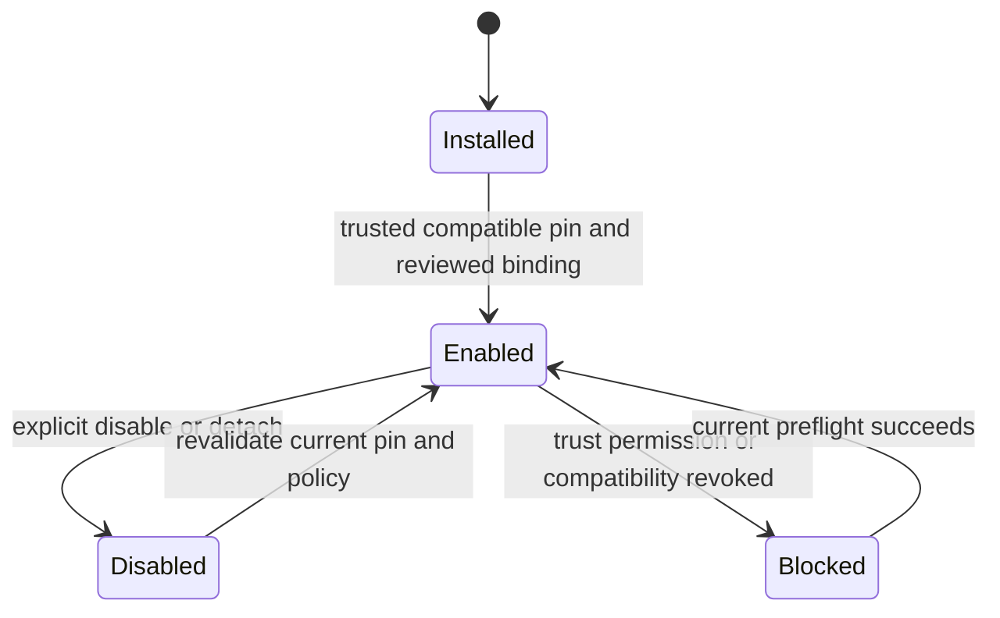
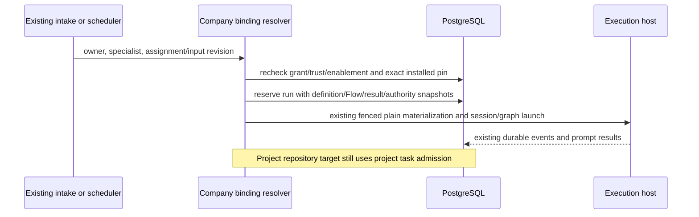

# Specialist role and company execution runtime

## Purpose

**Implemented: specialist metadata, binding configuration, company standalone Run/session path and internal credentials; Designed: complete company lifecycle and graph execution — ADR-203.** Reusable specialist roles extend existing package agents and installed Flow bindings. This domain owns company execution and invocation scope; [assignments](specialist-assignments.md) owns durable work and [cooperation](specialist-cooperation.md) owns delegation/acceptance.

## Domain entities

- Specialist: existing package-qualified agent ID with responsibilities, tools, execution policy and applicable target classes.
- Company agent binding: trusted/enabled exact package/definition pin, config, grants, runner policy and optional coordinator Flow binding.
- Company Flow binding: installed `flow_revisions` pin plus reviewed enablement and execution declaration.
- Execution owner: discriminated company/project identity, never empty project slug.
- Trigger binding/attempt: existing scheduler entities with explicit ownership and immutable scheduled request.
- Run/session/attempt: existing `runs`, `run_sessions`, `node_attempts`, results and prompt owners; see [persistence](../db/specialist-assignments-domain.md).

## State machine

Binding readiness is independent of run/assignment state and current permission.

## Process flows

Company execution resolves an installed revision directly and uses existing graph/session ownership.

### Definition and declaration

Implemented additive agent metadata is `specialist: {responsibilities: string[], targetClasses: string[]}`; each list has 1–32 distinct, nonblank entries of 1–256 characters. Parser/rendering, explicit package validation and the catalog share the declaration. Generated main `0235_specialist_metadata` adds nullable `agents.specialist`; old rows stay NULL. Catalog SET/CLEAR/re-SET follows the selected package source, while effective project definitions continue to resolve their own immutable attachment pin. Absence remains absent in serialized definitions, preserving legacy hashes and frozen snapshots. Existing `kind=operational|code_delivery`, workspace, capabilities and execution-policy fields retain their meanings. Metadata never grants authority.

Company binding configuration uses a stable head and immutable version-1 configuration receipts in main migration `0236_company_specialist_bindings`. An explicitly authorized user selects an installed, trusted package revision and its exact professional-role digest; the newest catalog projection cannot retarget the selection. The frozen configuration retains the full role, raw overrides, resolved defaults, action limits, runner/execution policy, optional coordinator Flow revision and server-recorded authority witness. These are configuration/history records, not a second execution ledger.

Native session routes list company bindings, create a binding, inspect its current configuration, replace it and detach it. Creation and full replacement require current `specialists:manage` and `specialists:read`; inspection requires current `specialists:read`. Full replacement requires the current revision and explicit nullable/empty values to clear configuration, runner, Flow and action limits. Each mutation requires a content-guarded delivery key. Replaying an older accepted key returns its original configuration receipt under current authority; changed content conflicts. Parent locking serializes competing revisions, and concurrent creation cannot duplicate a live role. List cursors bind the authenticated user and exact current read grant.

Accepted revisions are immutable and retain exact configuration and attribution after catalog changes or provider retirement. The history service validates retained structure, digest, role and owner without reading provider files. Snapshot and authority bounds are checked before commit, with no partial binding on refusal. Detach needs current management authority and returns only a content-free receipt; it records its reason, disables admission and releases the current package foreign key while retaining historical pin identity and frozen definition. A retired binding cannot be reactivated; a new reviewed binding has a new identity. A disabled live binding still protects its current installed pin. The existing Flow removal and revision GC services also preserve exact coordinator Flow revisions referenced by live bindings; retirement releases those current references. Binding capture takes the shared Flow lock used by removal/GC, so the reference check and admission cannot race. Neither binding ownership nor action limits create a company grant. The native company launch and human-action paths below enforce current authority; bounded cooperation and complete assignment recovery remain their later slices.

Company Flow binding storage freezes a closed version-1 configuration: company, exact installed Flow/package and manifest digest, exact responsible specialist binding/revision with its frozen configuration, reviewed `workspace:none/completion:result` intent, enablement and explicit human role mappings. It retains immutable configuration/authority/request receipts separately from execution history. A live company/Flow reference is unique; replacing it requires CAS and explicit mappings, and retirement preserves accepted history. Each mapped user must currently hold `assignments:answer`; labels only route existing authority. Main `0237_company_flow_bindings` persists stable heads and immutable configuration/authority/routing receipts. Current Flow/package/specialist foreign keys protect providers; retirement releases those current keys while retained snapshots keep their logical identities. The existing removal/GC services check both direct Flow bindings and specialist pins under the Flow revision lock. A staged disabled binding may review a legacy installed Flow, but enablement requires the actual company execution declaration and capability floor 3.12.0. Internal create, full replacement, current/history inspection and content-free retirement services are implemented; public Flow-binding interfaces and execution remain their owning later slices. Storage alone does not activate execution; T20.1 owns the runtime preflight and declaration grammar. Existing v1 scheduled request snapshots remain unchanged.

Existing `agent_schedules` and `agent_trigger_attempts` now support explicit exclusive company/project owners in migration `0238_company_trigger_scope`. Company cron source configuration uses the existing cron validator and request normalizer, server creation identity/content key and a separate configuration revision. Exact replay returns the original source receipt; another key creates independent configuration. Old project attribution remains unknown. A v2 binding snapshot captures exact accepted professional/coordinator configuration references; the protected scheduled request remains v1. References are server-generated configuration witnesses and carry no grants. The current project dispatcher, reconciler and legacy backfill exclude company rows before bounded selection, and project-only settlement explicitly refuses them. Actual company dispatch/settlement and protected views remain their runtime slices. No parallel scheduler or invocation ledger is introduced.

### Company agent admission preflight

**Implemented native standalone preflight, reservation and controlled-ACP lifecycle qualification (T20); complete phase compatibility remains T21.** The server-internal company agent preflight receives company/assignment/binding IDs, exact positive 32-bit business/input/binding revisions and a declared trigger (`manual`, `cron`, `domain_event` or `webhook`). The authenticated initiating user is a separate server argument. No request-supplied role, attribution, authority snapshot, package, runner, workspace or confirmation is accepted by this grammar.

Before reading assignment content it checks current `assignments:read` and `assignments:update` for the selected company and active user. The preflight locks the assignment before the specialist binding, checks its company owner and queued state, business/input revision, responsible binding/role and retained source access. It requires a current enabled, non-retired specialist configuration and enabled, non-quarantined catalog identity. It resolves the actual immutable trusted installed package, compares the retained definition/package witness and effective configuration to the assignment's frozen standing input, and validates the selected trigger. A first standalone company operational session requires `workspace:none`, no repository qualification, no coordinator Flow and the exact required operational result descriptor captured by the assignment. Coordinator Flow admission is the distinct T20.1 path; this preflight never substitutes a standalone session for a declared Flow.

The result contains typed current binding, effective definition/configuration/execution policy, immutable assignment/input and current initiating authority. Resolving it creates no run, session, token, workspace or assignment transition. The launch transaction must rerun the preflight immediately before reserving its existing run and assignment link; an earlier result is not an authorization ticket. Stale business/input/configuration revisions or non-queued work return actionable `CONFLICT`; missing/foreign assignment uses the existing unavailable-assignment response; disabled/retired/quarantined/untrusted/mismatched provider or unsupported workspace/trigger/result refuses before effects. Source checks retain current resource authority independently of the historical input snapshot. Actual tool actions also require the current role's explicit action limits, current agent/user authority and source/target restrictions.

### Company Run reservation

The internal `reserveCompanyAgentRun` service admits one exact queued assignment through the existing `runs`, default `run_sessions`, execution-host placement and `specialist_run_links`. It rechecks current preflight under the assignment lock, freezes the reviewed configuration, policy, result and scheduled request, and classifies the exact assignment input before commit. Its assignment becomes `active` while the Run waits in the existing `Pending` queue; no process or credential is created by reservation. Competing admissions using the same business revision yield one committed Run and a conflict. Source denial rolls back the Run, session, placement, link, assignment transition and transactional outbox changes together.

Company runner selection uses the shared standalone resolver: exact binding runner, declared agent default, then platform default. There is no project tier. An explicit binding/agent runner does not require a configured platform-default row; when every tier is absent, admission refuses without allocating a Run/session/link. A selected missing, disabled, unready or read-only-incompatible runner refuses admission; it never silently chooses a different configured runner. Required read-only diagnostics come from the selected execution-host boundary. Assignment and reviewed execution policies must have equal normalized axes; changing requested authority requires explicit review. Native input references are re-inspected under current initiating-user and executing-specialist authority, including exact available version witnesses. Declared private project memory or project MCP bindings are refused until their actual project admission is provided. Native standalone dispatch uses the shared owned-session path below. Native permission continuation and parked-host restart are qualified below; extended phase recovery remains T21 and company graph execution remains T20.1.

### Company agent credentials

**Implemented native credential/session lifecycle (T20); complete phase qualification remains T21.** Company standalone sessions use the existing ephemeral `agent` token kind and existing deterministic `agent-run:<runId>` terminal revocation. New `project_tokens.company_id/company_run_id` identify the exact company execution; `project_id` is null. A current assigned run, source role, initiating user and immutable launch capture are resolved by the server. Only an active operational company run may receive a credential. The initiating account must remain active, hold current `assignments:read/update`, and match the retained server actor; the current role/configuration/provider and exact assignment input/link must remain available. Minting locks the run, revokes any previous live token for that run and stores only the normal secret hash. One live company credential per run is enforced by a partial unique index. The credential cannot be retargeted, have its scopes widened in place or be reactivated after revocation.

Initial company agent token scopes are the explicitly configured intersection of `knowledge:read/propose` with the reviewed role action limits. No wildcard, repository mutation, human confirmation or management scope is inferred. The domain still checks current agent/user knowledge and source grants for each operation; possession of a scope is insufficient. Later assignment/delegation/target tools add their exact scopes in the owning slices. Verification additionally rechecks current run/company/assignment/configuration/provider/account and `assignments:read`, so a Pending or terminal run, disabled/retired/retargeted role, revoked content grant or removed account cannot use a retained credential. Action-specific mutation authority remains separate. Legacy project/user/librarian token shapes and the personal-user actor rules remain unchanged.

### Company execution knowledge identity

**Implemented native identity/read/proposal services (T20); native standalone session launch is implemented; full runtime/package qualification remains open.** A company standalone execution resolves the server-only `company_agent` principal from its exact current assignment/input/configuration/provider, retained professional role attestation and initiating active user. Its Brain actor remains the professional agent and originating run; the initiating user is an additional authority boundary, never a replacement author. API token verification still requires an active execution; server-only read inspection may validate a Pending reservation before its first prompt. Neither path can accept a model-supplied role, grant or confirmation.

Initial company-agent knowledge authority is confined to its bound company. Project-owned records, repository/context and private agent-memory sources remain unavailable on this path; actual project work and authorized evidence sharing use the existing project admission/cooperation slices. Existing project-agent knowledge behavior is unchanged. Native company read/propose requires all of: the reviewed role action limit, the agent's current explicit company action grant, the initiating user's current matching company action grant and current source closure. Restricted records additionally require the corresponding record grant for both recipients. Search applies both policies before LIMIT and cursors bind both current grant sets; record/evidence lookup and proposal/correction use the same intersection. No retrieval score or source repetition supplies a grant.

Company-agent authorization uses internal policy snapshot version 2: the existing primary agent authority ID/revision and empty confirmation classes, plus `initiator` (server user actor and current matching knowledge-grant ID/revision) and `execution` (server run ID and exact version-1 `launchSnapshot` company capture). Existing v1 policy bytes remain unchanged. Proposals retain the agent/run attribution and both current authorities; acceptance and confirmation remain independent human/governed actions. Company execution cannot acquire review, confirmation or management through its proposed content or a wider action list. The same native source capture, disclosure, proposal and evidence validators remain authoritative; missing evidence stays explicit.

### Retained retry scope

**Implemented: T19.1 storage/version readers and T20 company execution ownership; Designed: T29 company retry admission and recovery.** The existing `agent_retry_intents` remains the sole retry-intent ledger. Ownership is exclusive: project rows have a non-null project and null company; company rows have the reverse. Existing v1/v2 project recipes retain their exact JSON and do not gain inferred authority, assignment or author fields. Their current project admission, source claim, actor/request-key uniqueness and successor identity remain unchanged.

Company recipes use version 3 with `strategy:pre_work_retry`, explicit company `owner`, null `projectId`, `taskId`, `taskRevision` and `project`, exact `specialistBinding` and nullable `coordinatorFlowBinding` configuration references (`id`, positive 32-bit `revision`, 64-character lowercase SHA-256 `snapshotSha256`), and an `assignment` reference (`id`, positive 32-bit `inputRevision`, 64-character `inputSha256`). They retain the existing agent definition, effective configuration, trigger, runner, execution policy and context digest, plus an optional unchanged v1 scheduled-request snapshot. Configuration references identify accepted immutable bytes; they grant no authority. The assignment reference identifies the input used for this retry, not necessarily the current input. The complete recipe remains bounded to 1 MiB in PostgreSQL. Company recipes cannot request repository qualification or carry project workspace configuration. The insert guard validates exact company-owned specialist/coordinator history digests, the responsible binding and immutable assignment/input digest, the frozen role/package/configuration and unchanged scheduled input. Accepted recipe/owner identity remains immutable; current authority and execution safety are admission concerns, separately rechecked before effects.

The version reader rejects unknown versions, invalid company shapes, mismatched agent/definition identities and malformed configuration references with `CONFIG/retry_recipe_invalid`; it returns validated retained bytes without filling historical defaults. A project-only consumer rejects a company intent before project, source-run, filesystem or launch work with `CONFLICT/company_retry_runtime_unavailable`. Until company retry admission is implemented, the existing admission/cleanup sweep excludes company rows before its bounded selection, leaving their state, leases, attempts and allocations untouched. Company persistence does not activate retry execution. All actual retry actions will recheck current assignment, principal, binding/provider and source authority; a retained snapshot alone cannot authorize an action.

Company-capable Flow declaration is `execution: {workspace: "none", completion: "result"}`. It requires designed engine capability floor `3.12.0`; engine 3.11.0 provides native evidence findings, while company result-only execution remains Designed until its runtime slice and binding preflight are implemented and qualified. The same result-only Flow can be enabled for a project; owner comes from the server binding, never a model field. Its required result export is frozen at launch.

The declaration is now typed in the shared client-safe manifest schema used by filesystem loading, Studio diagnostics and authored validation. It rejects malformed/authority-bearing declarations, a missing or lower floor, and absent/optional result export. Initial capability validation refuses shell setup/probes, pre-finish gates, repository context and writable workspace access. Explicit retry/rework workspace policies must be `keep`; unchanged repository rewind defaults refuse. Human takeover and further-track settings refuse. Absence remains absent for historical manifests. This authoring validation does not activate the 3.12.0 runtime or company binding enablement.

Permitted nodes are `orchestrator`, `ai_coding` for structured result production, `human`, and `form`. All ACP nodes use the run-owned plain workspace, strict declared tools/MCP capabilities and existing supervisor enforcement. Repo mounts, repository CLI/check nodes, worktree writers, promotion/merge and implicit coding delivery refuse on the launch action path. A company Flow cannot acquire repository access by naming a project in its prompt. An explicit repo target must become governed work admitted by that actual project's rules; automated cross-repository delivery is not added here.

The company graph prompt context has an explicit `assignment` namespace: `id`, `inputRevision`, `inputSha256` and the exact frozen objective input (`objective`, `expectedOutcome`, `input`, `targetIds`, `inputRefs`, `constraints`, `expectedResult`, `verification`). Its `run` namespace contains the real Run `id` and server-owned company `owner`. It exposes no `task`, task attempt number or `run.projectSlug`; strict references to those repository-only paths fail rather than synthesizing identities. Shared executor, ledger steps, artifacts, filtered environment and injected rework variables retain their existing semantics. Reserved task/assignment/run/executor/steps/env/artifact namespaces cannot be introduced or replaced by injected variables. Standing role instructions, scheduled request and authority snapshots stay separate from objective input. Historical project prompt namespaces remain unchanged. The same result-only Flow used from a project must receive the real assignment namespace through its admitted assignment; generic repository launches must not fabricate one. Native company prompt dispatch and project-assignment wiring remain T20.1 qualification gates.

Company runs retain `runs.flow_revision_id`, binding snapshot and required result contract; `project_id`, `task_id`, and project `flow_id` are null. Existing project `flows.project_id NOT NULL` remains unchanged. Runner/session/prompt/result/finalization readers use the frozen revision, not newest catalog or mutable `flows.manifest`.

### Scope and launch refusals

| Surface | Required company extension | Refusal/compatibility |
| --- | --- | --- |
| Effective agent/Flow | Explicit company binding and installed/trusted/enabled revision | Missing/disabled/untrusted/incompatible pin refuses before run/session/effect |
| Agent token | Verified company owner, agent/run/principal and current grants | No empty project ID; old project-token CHECK/reads remain explicit union arms |
| Scheduler | Owner-aware existing schedule/attempt claim, same fences/reserved run/request snapshot | New owner-aware binding snapshot version; existing v1 scheduled request retained exactly; old v1/v2 retry recipes read by version |
| Company actors/HITL | Current company principals and company binding's human role mappings | Extend existing human assignment/actor owner shape; no dummy project roles or new human ledger |
| Workspace | Existing opaque run-owned plain materialization and lifecycle cleanup | No repo/worktree inferred from missing project; current non-company scratch/librarian behavior unchanged |
| Resume/terminal | Exact stored definition/Flow/result and current actor grants | Revoked capability blocks new action; historical snapshot remains read subject to current content access |
| UI/history/Inbox | Owner-aware direct reads and scope predicates | Company rows do not disappear through project INNER JOIN or leak to platform viewers |

Company human role labels map in the reviewed Flow binding to explicit current user IDs with `answer_assignment` authority. Labels route work, never grant permission. Project role routing remains unchanged. Company cron/event sources use existing `agent_tick`/domain-event dispatch; source receipt resolves the pinned specialist entry as agent or result-only Flow. A selected row's owner, enabled/trust state and input are rechecked under claim.

### Authority vocabulary

Stored company grants are domain-qualified, never an unqualified company-wide `read` or `write`: `specialists:read/manage`, `assignments:read/submit/update/answer/accept/cancel/recover/delegate`, `targets:read/logs/restart/recover/manage`. Knowledge uses `knowledge:read/propose/review/confirm/manage`. Company binding permissions intersect these grants, the initiating current principal and exact assignment/target/source restrictions; configuration cannot mint a grant. `answer_assignment` in routing means `assignments:answer`. The target helper service principal can check only its configured operation authority and submit/read exact receipts; it is not an agent and cannot nominate another user, create assignments or issue a new restart intent. No ordinary agent receives management or human-confirmation authority by default.

### Recovery matrix

Both company agent and result-only Flow paths derive the following actions from the shared run-status enum; each status is explicit. Slot accounting remains owned by the existing scheduler predicates.

| Run status | Runtime recovery action | Durable owner/wake |
| --- | --- | --- |
| Pending | Admit reserved run only once under pool cap; repeat input does not mint another run | Existing scheduler claim/trigger receipt |
| Running | Live session retains fenced ownership; lost session follows existing crash/prompt-application reconciliation | Host projection/prompt owner, then assignment owner reconciliation |
| NeedsInput | Preserve existing permission/form request and current answer authority; no generic relaunch | HITL response and existing checkpoint policy |
| NeedsInputIdle | Restore exact snapshot/session handle through proper idle resume claim, cap-gated | Existing agent or graph idle resume, not other-kind dispatcher |
| HumanWorking | Preserve explicit human takeover/claim; do not auto-accept or replace its work | Existing human work owner; current authorized recovery |
| WaitingOnChildren | Preserve child IDs/results and durable wake intent; reacquire slot only on continuation | Existing child event consumer/prompt owner |
| Review | Review result according to exact Flow finish contract; no implicit repo promotion for result-only Flow | Existing graph review/HITL decision and assignment acceptance |
| Crashed | Retain work/effects and diagnose; explicit current-authority replacement, not replay from prompt prose | Existing retry/recovery plus assignment epoch |
| Done | Preserve exact published result/receipt; only assignment acceptance may settle business work | Child-settle wake and assignment acceptance |
| Abandoned | Preserve cancellation/effects and close owned waits; no unattended relaunch | Terminal outbox and independent operation reconciliation |
| Failed | Keep classified diagnostics/results; no success inference; explicit bounded retry where contract permits | Existing retry recipe and assignment revision |

## Expectations

- **CBS-01:** Specialist metadata retains agent identity/kind and config symmetry across lifecycle gates, enforced by the common definition/package/binding validator (`IT-CBS-01`).
- **CBS-02:** Company agent runs resolve pinned trusted bindings, owner-bound tokens and plain workspaces with current revocation, enforced by company launch/resume and frozen contracts (`IT-CBS-02`).
- **CBS-03:** Company result-only graph execution works without project/carrier task and refuses repo-only capabilities before effects, enforced by declaration preflight and graph lifecycle (`IT-CBS-03`).
- **CBS-04:** Company scheduled/event invocation uses existing claim/dispatch and immutable source request with one reserved run, enforced by scoped trigger persistence/dispatcher (`IT-CBS-04`).
- **CBS-05:** Repository targets retain actual project qualification/workspace admission, enforced by existing project launch gates at delegation and action paths (`IT-CBS-05`).

## Edge cases

- **EDGE-CBS-01:** Trust/pin/permission changes between reservation and launch refuse or park the reserved intent, never select newest revision (`IT-CBS-02`).
- **EDGE-CBS-02:** Repo-only node declared in company result-only Flow returns `CONFIG` before any session/workspace/effect (`IT-CBS-03`).
- **EDGE-CBS-03:** A permanently ineligible first cron row cannot starve later rows; bounded keyset/retry state is persisted by existing dispatcher (`IT-CBS-04`).
- **EDGE-CBS-04:** Company flow with a project locator cannot bypass project admission (`IT-CBS-05`).

## Linked artifacts

- [ADR-203](../decisions.md#adr-203-durable-specialist-assignments-and-company-coordinator-flows), [persistence](../db/specialist-assignments-domain.md), [agents](agents.md), [scheduled requests](scheduled-agent-requests.md).
- [Flow DSL](../flow-dsl.md), [web API](../api/web.openapi.yaml), [supervisor](../supervisor.md), [execution prompt lifecycle](execution-prompt-lifecycle.md).
- Implementation: `web/lib/agents/`, `web/lib/services/runs.ts`, `web/lib/flows/graph/`, `web/lib/tokens/`, existing scheduler and execution-host services.

Company operational workspace ownership uses an opaque company/run digest below
`worktreesRoot()/.company/`, with a separate adapter runtime directory. The
existing integrity baseline retains the explicit company and run identities and
both managed paths. Inspection refuses a different owner, moved/retargeted
baseline, missing company execution capture or repository workspace before
probing source bytes. Company runs have no repository reference history.
Legacy project baseline owner JSON remains unchanged. The shared disposition
uses the resolved runtime path and refuses repository allocation for a company
owner. Native company terminal result/token/outbox application and clean directory
release and native session/host recovery are qualified separately below; extended phase compatibility remains T21.

Company operational finalization uses the existing Run result ledger, terminal
transaction, token revoker and cleanup disposition. A terminal preparation
validates the retained company execution/workspace owner; historical capture
never supplies action authority. A result, terminal state, credential revocation
and company outbox fact commit together. Rollback leaves all four unchanged;
replay cannot publish a second result. A missing required result produces a
failed Run with the existing typed `CONFIG/result_missing` cause. Task
qualification remains project-only and cannot be attached to company work.

Main `0242_company_run_terminal_events` admits the existing `run.done`,
`run.failed`, `run.crashed`, `run.abandoned` and
`run.operational_cleanup_changed` kinds for an exact company-owned operational
Run with no task. Company event identities cannot be retargeted. Existing
project consumers continue to skip company facts, and outgoing project webhook
subscriptions receive only project-owned terminal events. Company result
delivery and cooperating-agent consumers remain their later owning slices.

A clean terminal directory releases through the same leased disposition and
managed-path remover, including its separate adapter runtime directory. Failed
source bytes require the existing host evidence transport before removal;
missing transport retains the bytes and a durable actionable retry reason.
Finishing a Run never accepts or completes the durable specialist assignment.
These native service/PostgreSQL/filesystem qualifications do not establish
actual company ACP launch, interrupted-host recovery or stand-pilot readiness.

Company standalone runs use the existing global agent pool, advisory admission
lock and Pending queue. A project run can hold the same slot; racing company
candidates cannot exceed the cap, and a slot freed through terminal application
promotes queued work through the existing dispatch callback. Direct starts,
queue promotion and queued resume emit project `run.started` webhooks only
when an actual project owner exists. The native company cap qualification
covers admission/queue/terminal release with a bounded dispatch seam; real
company ACP sessions, permission idle-resume and retained-host restart are
qualified below. Extended lifecycle compatibility remains T21.

Assignment prompt-source contract (T20 source resolution and native launch
capture Implemented): the native restriction
`{kind: "assignment_input", assignmentId, inputRevision, inputSha256}` names
an exact immutable input and content witness. It is a source restriction,
separate from model evidence references and confirmation. An initiating user
needs current assignment read authority and the input's inherited source
permissions. A company execution receives only its server-bound assignment and
exact retained input; appointment to one assignment grants no other assignment
or Company Brain record access. Existing project-agent sharing remains denied
until its explicit assignment/delegation binding is implemented.

Source closure follows the retained input's own restrictions. Direct reads,
search filtering before LIMIT, proposal review and outward results must apply
the same closure and current grants. A wrong revision/digest, missing input,
foreign execution or revoked reader is unavailable. This is a logical source
reference with no Brain-to-project foreign key. Current assignment head
changes do not rewrite a previously captured input. Company prompt capture
must commit this classification with the Run/input link before any prompt or
external effect; a model cannot supply or widen it.

The native source resolver validates and locks an execution's exact appointment
before evaluating `assignment_input`. Human readers use current company
`assignments:read` grants or the existing project assignment read policy; company
ownership has no administrator shortcut. A company execution matches only the
input already validated in its server identity. Inherited record, repository and
memory restrictions remain independently binding. Source-only project
references are logical: deleting a source project succeeds and makes its source
unavailable while retaining the company's immutable assignment input.

Retrieval computes accessible record/revision dependencies once for the source
closure and then tests membership, preserving exact versus current-version
checks before LIMIT. Company grant checks are fixed to the execution's bound
company. The small native integration fixture has a 500 ms database execution
budget; EXPLAIN-based qualification caught and removed repeated grant planning
that previously spent about one second in JIT compilation per query. This is a
fixture regression bound, not a production latency guarantee. Existing stored
source arrays and legacy capture bytes are unchanged; the source kind itself requires no data rewrite or invented
historical attribution. Main `0243_native_source_array_planning` adds only a pure
JSON iterator with a four-row planner estimate, which returns every source entry.
Native source, owner, context, memory and record/revision checks use bounded
authorized sets to avoid repeating grant plans per recursive edge. Its 256-entry
Unicode/ordering check and actual built MCP workflow retain their original
semantics and process deadline.

### Company workspace adoption

**Implemented native host boundary and company standalone dispatch; company Flow admission remains T20.1.**
The server resolves a company Run's retained owner through the shared operational
workspace resolver. Adoption sends its managed `.company/<owner-run-digest>`
directory, explicit `{kind:company,companyId}` owner and reserved `_company`
runtime namespace. The legacy wire field `projectSlug` names that runtime
namespace; the host never resolves it against registered projects. No project,
repository, local package or sibling mount is substituted. Later session creation
uses the opaque workspace handle and inherits its cwd and log namespace.

The supervisor accepts this owner only for an isolated directory, validates the
managed company/run path witness and refuses owner retargeting on replay.
SQLite schema 16 adds nullable `workspaces.company_id` with exclusive namespace,
directory, repository and mount constraints. Migration from populated schema 15
preserves old workspace bytes and leaves company ownership absent; no historical
authority is inferred. Reopening the host retains a new company owner and
`GET /workspaces/{id}` returns it without source paths. Existing project and
librarian wire shapes remain unchanged. Invalid command payloads retain the
supervisor's existing 409 mapping; `workspace_rejected/owner_mismatch` identifies
a managed-path or replay-owner conflict. See the authoritative
[supervisor contract](../api/supervisor.openapi.yaml).

### Company standalone session driver

**Implemented and qualified native standalone dispatch, permission continuation
and parked-host restart; complete phase compatibility remains T21.** `driveAgentSession` distinguishes a company owner before project
resolution. It uses the existing generation turn, default session, host command
ledger, opaque workspace adoption, canonical prompt owner and operational
finalization. It supplies no synthetic project, repository, attachment or private
memory. Declared project memory/MCP dependencies and coordinator execution models
are explicitly refused through one shared standalone-definition guard.

`loadCompanyAgentSessionContext` decodes the exact retained input/digest and
frozen operational role, verifies the current installed definition witness, trust, catalog and binding,
initiating account and assignment read/update authority, exact source references
and current frozen-runner availability. It verifies configuration and normalized
policy against the immutable input. The same guard runs inside company session
create and prompt admission, including retained-create re-entry. Acknowledging
already performed creation remains independent of new-action authority.

The company prompt keeps standing instructions, effective configuration,
objective/input/targets, knowledge references, constraints, expected result and
verification, historical execution policy and the unchanged scheduled request
as separate sections. Current server permissions remain authoritative. Existing
native disclosure records classify the exact assignment input before model work.
The owner-aware operational baseline, adapter runtime directory, facade token,
capability materialization and shared terminal/disposition path are reused.
A valid Run result and completed host execution do not complete or confirm the
assignment. Revocation before initial dispatch produces no workspace, session,
prompt or credential and preserves the assignment/input for governed recovery.

Native initial qualification uses a real pinned package, real PostgreSQL and a
canonical fake host whose physical session state explicitly becomes exited;
agent prose or a clean return alone cannot pass quiescence. Real supervisor
adoption/SQLite restart are separately qualified above; the supervisor/ACP fixture
loop is qualified below. Actual company model/companion-package invocation,
idle/HITL continuations, interrupted/replaced owners, company
activity pages and the stand pilot retain their separate acceptance gates.

### Company execution content access

**Implemented — native peek authorization, canonical Run SSE and runtime-object
metadata/content.** The shared company read guard derives owner and exact immutable
assignment input from the retained Run/link. It requires current explicit
`assignments:read`, a complete source capture containing that input, and current
access to every inherited source. Neither administrator status nor Run creation
alone grants company read authority. Incomplete company captures fail closed with
the same concealed 404 as missing/unauthorized Runs; inherited source loss returns
a safe 409. Historical reader authority does not depend on an enabled specialist,
trusted provider files, or a currently executable assignment. SSE rechecks company
reader/source authority before each canonical batch; protected object bytes retain
the existing per-chunk source recheck. No project or new execution is created by a
read. Company specialist metadata history is available through
`GET /api/specialists/{specialistId}/runs`, reusing the existing Run projection
and signed cursor. Source closure filters before pagination; the cursor also binds
the current receiving user/read-grant identity and revision. History contains no
scheduled input or diagnostic prose. Company activity UI and full Run navigation
remain subsequent slices.

### Native company supervisor/ACP qualification

A company standalone qualification runs the native reservation, shared scheduler,
owned create/prompt driver and operational finalization through a real supervisor
child, actual ACP fixture process and the application's autonomous canonical
projection registry/worker. No manual projection substitutes for background
terminal confirmation. It checks one physical session, typed result,
quiescence, credential revocation, placement release and retained source-authorized
transcript after completion. A repeated driver invocation creates no second session,
prompt or result. Business assignment acceptance remains separate. The fixture
also verifies explicit binding-runner admission without a platform-default row and
atomic refusal when every runner tier is absent. This qualifies native mechanics;
it does not establish real model/companion-package or stand-pilot readiness.

### Native company permission and human delivery

Company operational permission requests retain the exact owned prompt/session
source and create one company human-work assignment in the existing ledger in
the same transaction. Canonical replay retains that work and its actor history.
The shared HITL response service requires current explicit company read/answer
authority and the Run's exact source access, including for administrators and
callers with a project preauthorization. Permission intent admission rechecks
under the existing Run/HITL lock; refusing an answer creates no response or input
command. The authorized current user becomes the scoped human actor; native input
ACK completes the human work under that actor, while the specialist assignment
remains subject to separate result acceptance.

Main `0246_company_hitl_wait_events` admits the existing `run.needs_input` fact
for an exact retained company operational Run, without a project/task owner.
The single native HITL writer emits that fact atomically; private local assistants
retain their separate notification path. Existing company event owner/reference
and immutable routing guards remain active.

An actual idle checkpoint releases the existing execution assignment. The normal
continuation worker reconciles the retained prompt/checkpoint evidence and admits
one resumed turn. A reissued company permission uses the original human decision
actor, with current read/answer/source authority checked by the existing human
claim service before input preparation. Revocation while capacity is unavailable
preserves the decision but prevents delivery; a current re-grant permits recovery
without another input or business assignment. Qualification also restarts the actual
supervisor on its retained SQLite/runtime directory after checkpoint: host identity
stays stable, boot identity changes, and the exact frozen Run/result contract and
canonical ACP session handle survive. ACK completes the original and
linked reissued human work under the same actor. Inbox UI, full interruption
recovery and company coordinator Flow qualification retain their own gates.

### Company Run stop contract

The existing `POST /api/runs/{runId}/stop` owner dispatch must admit a company
standalone operational Run without a project/worktree. Current explicit
`assignments:read` and `assignments:cancel`, plus the exact retained input/source
closure, authorize the human action; an administrator has no implicit grant.
`Pending`, `Running`, `NeedsInput`, `NeedsInputIdle`, `Review` and `Crashed`
are cancellable through the existing operational finalizer. An already
`Abandoned` Run still requires current authority and returns the same terminal outcome without another command/event;
`Done` and `Failed` refuse with 409. Missing/currently inaccessible ownership is
concealed as 404; missing cancellation authority with read access is 403.

The native bound command ledger records each session deletion before transport.
Unconfirmed host teardown or pending canonical exit evidence returns 503 and
cannot assert abandonment. Retry reconciles actual host/canonical state; the
response flag describes deletion performed by that request, not a historical
effect count. Current
cancellation authority is rechecked before deletion and terminal application.
Canonical quiescence, typed cancellation, credential revocation, human-work
closure and cleanup use existing mechanisms. Human-work cancellation and the canonical terminal fact retain the
current company user actor; the stopped specialist remains execution provenance. Stopping an execution does not cancel or complete
its business assignment, nor reconcile unknown external stand effects. The
response retains `{ok,runId,runStatus:"Abandoned",supervisorStopped}`. Project
and private execution routes retain their existing admission and behavior.

### Company operational attention and cleanup authority

Existing operational acknowledgement and cleanup-retry endpoints derive the
company from their retained Run. Acknowledgement requires current explicit
`assignments:read`/`assignments:answer`; cleanup rearm requires
`assignments:read`/`assignments:recover`. Both retain exact input/source access
and repeat authorization inside the existing Run-locked service transaction,
including idempotent replay. Inaccessible ownership remains 404, absent current
action authority is 403, and stale reason/revision or non-exhausted cleanup is
409. No administrator bypass applies. The project route policy is unchanged.

Acknowledgement writes the existing per-user/reason/revision receipt and emits
one content-free, company-owned `run.operational_attention_acknowledged` fact.
Main `0247_company_operational_attention` extends the existing kind CHECK;
current company Run-reference and immutable-routing guards still apply. Cleanup
rearm uses the existing revision/receipt, resets its bounded retry budget and
emits the existing cleanup-change fact; an exact repeat adds no revision or
additional effect. These actions neither confirm Brain facts nor accept the
business assignment. Runtime recovery remains in the existing cleanup worker.
