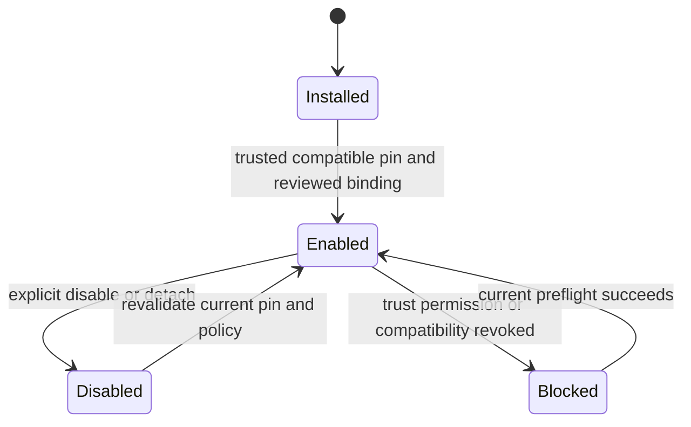
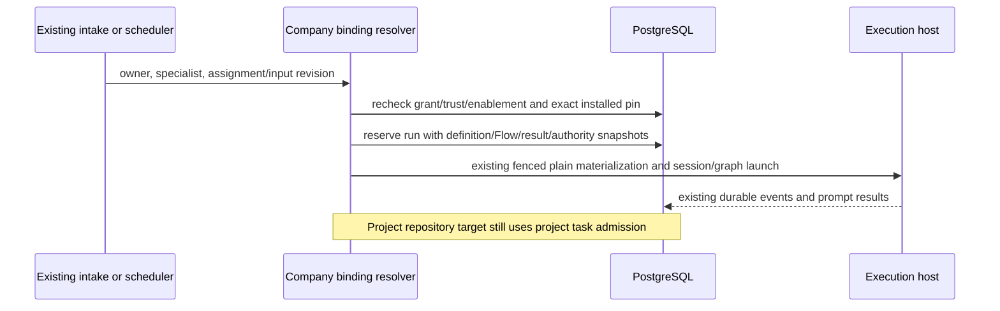

# Specialist role and company execution runtime

## Purpose

**Implemented: descriptive specialist metadata; Designed: company binding and execution — ADR-203.** Reusable specialist roles extend existing package agents and installed Flow bindings. This domain owns company execution and invocation scope; [assignments](specialist-assignments.md) owns durable work and [cooperation](specialist-cooperation.md) owns delegation/acceptance.

## Domain entities

- Specialist: existing package-qualified agent ID with responsibilities, tools, execution policy and applicable target classes.
- Company agent binding: trusted/enabled exact package/definition pin, config, grants, runner policy and optional coordinator Flow binding.
- Company Flow binding: installed `flow_revisions` pin plus reviewed enablement and execution declaration.
- Execution owner: discriminated company/project identity, never empty project slug.
- Trigger binding/attempt: existing scheduler entities with explicit ownership and immutable scheduled request.
- Run/session/attempt: existing `runs`, `run_sessions`, `node_attempts`, results and prompt owners; see [persistence](../db/specialist-assignments-domain.md).

## State machine

Binding readiness is independent of run/assignment state and current permission.

## Process flows

Company execution resolves an installed revision directly and uses existing graph/session ownership.

### Definition and declaration

Implemented additive agent metadata is `specialist: {responsibilities: string[], targetClasses: string[]}`; each list has 1–32 distinct, nonblank entries of 1–256 characters. Parser/rendering, explicit package validation and the catalog share the declaration. Generated main `0235_specialist_metadata` adds nullable `agents.specialist`; old rows stay NULL. Catalog SET/CLEAR/re-SET follows the selected package source, while effective project definitions continue to resolve their own immutable attachment pin. Absence remains absent in serialized definitions, preserving legacy hashes and frozen snapshots. Existing `kind=operational|code_delivery`, workspace, capabilities and execution-policy fields retain their meanings. Metadata never grants authority.

Company binding configuration remains designed. A stable binding head and immutable configuration revisions retain the exact package/definition, configuration, runner/policy, allowed action subset and server author. Creation requires a content-guarded delivery key; full replacement additionally requires the current configuration revision. A repeat of an older accepted key resolves its retained receipt, while changed content conflicts. Optional configuration fields use explicit SET/CLEAR semantics. Current company grants and binding limits are intersected at action time; a retained revision cannot authorize a revoked capability. Detach retires current admission without deleting prior configuration or execution snapshots.

Company-capable Flow declaration is `execution: {workspace: "none", completion: "result"}`. It requires designed engine capability floor `3.12.0`; engine 3.11.0 provides native evidence findings, while company result-only execution remains Designed until its runtime slice and binding preflight are implemented and qualified. The same result-only Flow can be enabled for a project; owner comes from the server binding, never a model field. Its required result export is frozen at launch.

Permitted nodes are `orchestrator`, `ai_coding` for structured result production, `human`, and `form`. All ACP nodes use the run-owned plain workspace, strict declared tools/MCP capabilities and existing supervisor enforcement. Repo mounts, repository CLI/check nodes, worktree writers, promotion/merge and implicit coding delivery refuse on the launch action path. A company Flow cannot acquire repository access by naming a project in its prompt. An explicit repo target must become governed work admitted by that actual project's rules; automated cross-repository delivery is not added here.

Company runs retain `runs.flow_revision_id`, binding snapshot and required result contract; `project_id`, `task_id`, and project `flow_id` are null. Existing project `flows.project_id NOT NULL` remains unchanged. Runner/session/prompt/result/finalization readers use the frozen revision, not newest catalog or mutable `flows.manifest`.

### Scope and launch refusals

| Surface | Required company extension | Refusal/compatibility |
| --- | --- | --- |
| Effective agent/Flow | Explicit company binding and installed/trusted/enabled revision | Missing/disabled/untrusted/incompatible pin refuses before run/session/effect |
| Agent token | Verified company owner, agent/run/principal and current grants | No empty project ID; old project-token CHECK/reads remain explicit union arms |
| Scheduler | Owner-aware existing schedule/attempt claim, same fences/reserved run/request snapshot | New owner-aware binding snapshot version; existing v1 scheduled request retained exactly; old v1/v2 retry recipes read by version |
| Company actors/HITL | Current company principals and company binding's human role mappings | Extend existing human assignment/actor owner shape; no dummy project roles or new human ledger |
| Workspace | Existing opaque run-owned plain materialization and lifecycle cleanup | No repo/worktree inferred from missing project; current non-company scratch/librarian behavior unchanged |
| Resume/terminal | Exact stored definition/Flow/result and current actor grants | Revoked capability blocks new action; historical snapshot remains read subject to current content access |
| UI/history/Inbox | Owner-aware direct reads and scope predicates | Company rows do not disappear through project INNER JOIN or leak to platform viewers |

Company human role labels map in the reviewed Flow binding to explicit current user IDs with `answer_assignment` authority. Labels route work, never grant permission. Project role routing remains unchanged. Company cron/event sources use existing `agent_tick`/domain-event dispatch; source receipt resolves the pinned specialist entry as agent or result-only Flow. A selected row's owner, enabled/trust state and input are rechecked under claim.

### Authority vocabulary

Stored company grants are domain-qualified, never an unqualified company-wide `read` or `write`: `specialists:read/manage`, `assignments:read/submit/update/answer/accept/cancel/recover/delegate`, `targets:read/logs/restart/recover/manage`. Knowledge uses `knowledge:read/propose/review/confirm/manage`. Company binding permissions intersect these grants, the initiating current principal and exact assignment/target/source restrictions; configuration cannot mint a grant. `answer_assignment` in routing means `assignments:answer`. The target helper service principal can check only its configured operation authority and submit/read exact receipts; it is not an agent and cannot nominate another user, create assignments or issue a new restart intent. No ordinary agent receives management or human-confirmation authority by default.

### Recovery matrix

Both company agent and result-only Flow paths derive the following actions from the shared run-status enum; each status is explicit. Slot accounting remains owned by the existing scheduler predicates.

| Run status | Runtime recovery action | Durable owner/wake |
| --- | --- | --- |
| Pending | Admit reserved run only once under pool cap; repeat input does not mint another run | Existing scheduler claim/trigger receipt |
| Running | Live session retains fenced ownership; lost session follows existing crash/prompt-application reconciliation | Host projection/prompt owner, then assignment owner reconciliation |
| NeedsInput | Preserve existing permission/form request and current answer authority; no generic relaunch | HITL response and existing checkpoint policy |
| NeedsInputIdle | Restore exact snapshot/session handle through proper idle resume claim, cap-gated | Existing agent or graph idle resume, not other-kind dispatcher |
| HumanWorking | Preserve explicit human takeover/claim; do not auto-accept or replace its work | Existing human work owner; current authorized recovery |
| WaitingOnChildren | Preserve child IDs/results and durable wake intent; reacquire slot only on continuation | Existing child event consumer/prompt owner |
| Review | Review result according to exact Flow finish contract; no implicit repo promotion for result-only Flow | Existing graph review/HITL decision and assignment acceptance |
| Crashed | Retain work/effects and diagnose; explicit current-authority replacement, not replay from prompt prose | Existing retry/recovery plus assignment epoch |
| Done | Preserve exact published result/receipt; only assignment acceptance may settle business work | Child-settle wake and assignment acceptance |
| Abandoned | Preserve cancellation/effects and close owned waits; no unattended relaunch | Terminal outbox and independent operation reconciliation |
| Failed | Keep classified diagnostics/results; no success inference; explicit bounded retry where contract permits | Existing retry recipe and assignment revision |

## Expectations

- **CBS-01:** Specialist metadata retains agent identity/kind and config symmetry across lifecycle gates, enforced by the common definition/package/binding validator (`IT-CBS-01`).
- **CBS-02:** Company agent runs resolve pinned trusted bindings, owner-bound tokens and plain workspaces with current revocation, enforced by company launch/resume and frozen contracts (`IT-CBS-02`).
- **CBS-03:** Company result-only graph execution works without project/carrier task and refuses repo-only capabilities before effects, enforced by declaration preflight and graph lifecycle (`IT-CBS-03`).
- **CBS-04:** Company scheduled/event invocation uses existing claim/dispatch and immutable source request with one reserved run, enforced by scoped trigger persistence/dispatcher (`IT-CBS-04`).
- **CBS-05:** Repository targets retain actual project qualification/workspace admission, enforced by existing project launch gates at delegation and action paths (`IT-CBS-05`).

## Edge cases

- **EDGE-CBS-01:** Trust/pin/permission changes between reservation and launch refuse or park the reserved intent, never select newest revision (`IT-CBS-02`).
- **EDGE-CBS-02:** Repo-only node declared in company result-only Flow returns `CONFIG` before any session/workspace/effect (`IT-CBS-03`).
- **EDGE-CBS-03:** A permanently ineligible first cron row cannot starve later rows; bounded keyset/retry state is persisted by existing dispatcher (`IT-CBS-04`).
- **EDGE-CBS-04:** Company flow with a project locator cannot bypass project admission (`IT-CBS-05`).

## Linked artifacts

- [ADR-203](../decisions.md#adr-203-durable-specialist-assignments-and-company-coordinator-flows), [persistence](../db/specialist-assignments-domain.md), [agents](agents.md), [scheduled requests](scheduled-agent-requests.md).
- [Flow DSL](../flow-dsl.md), [web API](../api/web.openapi.yaml), [supervisor](../supervisor.md), [execution prompt lifecycle](execution-prompt-lifecycle.md).
- Implementation: `web/lib/agents/`, `web/lib/services/runs.ts`, `web/lib/flows/graph/`, `web/lib/tokens/`, existing scheduler and execution-host services.
