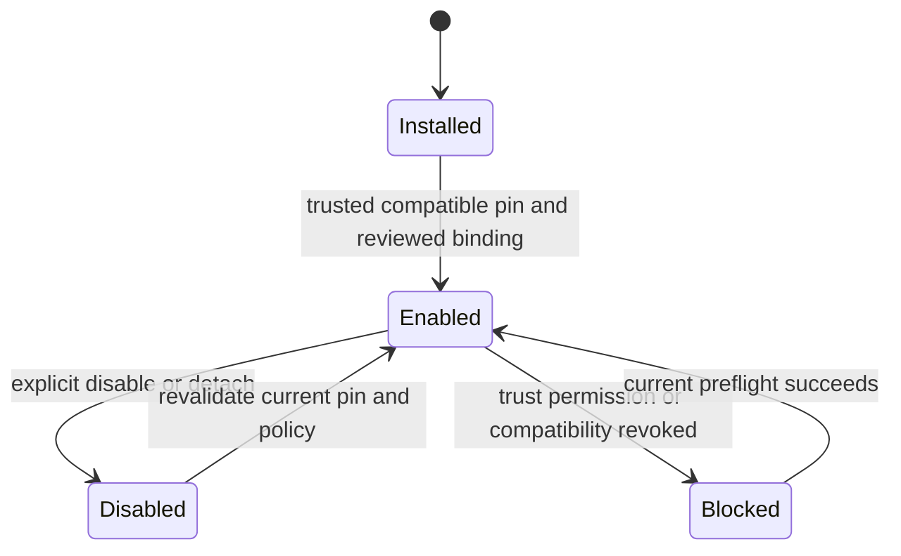
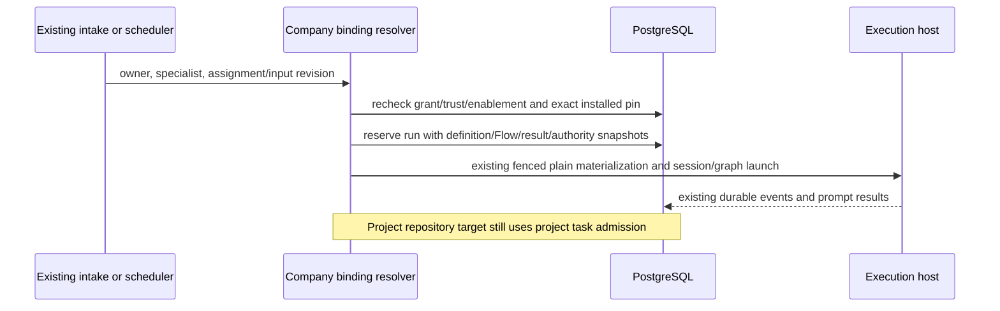

# Specialist role and company execution runtime

## Purpose

**Implemented: specialist metadata, binding configuration, company preflight/run storage and internal credentials; Designed: company session/graph execution — ADR-203.** Reusable specialist roles extend existing package agents and installed Flow bindings. This domain owns company execution and invocation scope; [assignments](specialist-assignments.md) owns durable work and [cooperation](specialist-cooperation.md) owns delegation/acceptance.

## Domain entities

- Specialist: existing package-qualified agent ID with responsibilities, tools, execution policy and applicable target classes.
- Company agent binding: trusted/enabled exact package/definition pin, config, grants, runner policy and optional coordinator Flow binding.
- Company Flow binding: installed `flow_revisions` pin plus reviewed enablement and execution declaration.
- Execution owner: discriminated company/project identity, never empty project slug.
- Trigger binding/attempt: existing scheduler entities with explicit ownership and immutable scheduled request.
- Run/session/attempt: existing `runs`, `run_sessions`, `node_attempts`, results and prompt owners; see [persistence](../db/specialist-assignments-domain.md).

## State machine

Binding readiness is independent of run/assignment state and current permission.

## Process flows

Company execution resolves an installed revision directly and uses existing graph/session ownership.

### Definition and declaration

Implemented additive agent metadata is `specialist: {responsibilities: string[], targetClasses: string[]}`; each list has 1–32 distinct, nonblank entries of 1–256 characters. Parser/rendering, explicit package validation and the catalog share the declaration. Generated main `0235_specialist_metadata` adds nullable `agents.specialist`; old rows stay NULL. Catalog SET/CLEAR/re-SET follows the selected package source, while effective project definitions continue to resolve their own immutable attachment pin. Absence remains absent in serialized definitions, preserving legacy hashes and frozen snapshots. Existing `kind=operational|code_delivery`, workspace, capabilities and execution-policy fields retain their meanings. Metadata never grants authority.

Company binding configuration uses a stable head and immutable version-1 configuration receipts in main migration `0236_company_specialist_bindings`. An explicitly authorized user selects an installed, trusted package revision and its exact professional-role digest; the newest catalog projection cannot retarget the selection. The frozen configuration retains the full role, raw overrides, resolved defaults, action limits, runner/execution policy, optional coordinator Flow revision and server-recorded authority witness. These are configuration/history records, not a second execution ledger.

Native session routes list company bindings, create a binding, inspect its current configuration, replace it and detach it. Creation and full replacement require current `specialists:manage` and `specialists:read`; inspection requires current `specialists:read`. Full replacement requires the current revision and explicit nullable/empty values to clear configuration, runner, Flow and action limits. Each mutation requires a content-guarded delivery key. Replaying an older accepted key returns its original configuration receipt under current authority; changed content conflicts. Parent locking serializes competing revisions, and concurrent creation cannot duplicate a live role. List cursors bind the authenticated user and exact current read grant.

Accepted revisions are immutable and retain exact configuration and attribution after catalog changes or provider retirement. The history service validates retained structure, digest, role and owner without reading provider files. Snapshot and authority bounds are checked before commit, with no partial binding on refusal. Detach needs current management authority and returns only a content-free receipt; it records its reason, disables admission and releases the current package foreign key while retaining historical pin identity and frozen definition. A retired binding cannot be reactivated; a new reviewed binding has a new identity. A disabled live binding still protects its current installed pin. The existing Flow removal and revision GC services also preserve exact coordinator Flow revisions referenced by live bindings; retirement releases those current references. Binding capture takes the shared Flow lock used by removal/GC, so the reference check and admission cannot race. Neither binding ownership nor action limits create a company grant. Actual company launch, current action-limit intersection and execution recovery remain the following runtime slices.

Company Flow binding storage freezes a closed version-1 configuration: company, exact installed Flow/package and manifest digest, exact responsible specialist binding/revision with its frozen configuration, reviewed `workspace:none/completion:result` intent, enablement and explicit human role mappings. It retains immutable configuration/authority/request receipts separately from execution history. A live company/Flow reference is unique; replacing it requires CAS and explicit mappings, and retirement preserves accepted history. Each mapped user must currently hold `assignments:answer`; labels only route existing authority. Main `0237_company_flow_bindings` persists stable heads and immutable configuration/authority/routing receipts. Current Flow/package/specialist foreign keys protect providers; retirement releases those current keys while retained snapshots keep their logical identities. The existing removal/GC services check both direct Flow bindings and specialist pins under the Flow revision lock. A staged disabled binding may review a legacy installed Flow, but enablement requires the actual company execution declaration and capability floor 3.12.0. Internal create, full replacement, current/history inspection and content-free retirement services are implemented; public Flow-binding interfaces and execution remain their owning later slices. Storage alone does not activate execution; T20.1 owns the runtime preflight and declaration grammar. Existing v1 scheduled request snapshots remain unchanged.

Existing `agent_schedules` and `agent_trigger_attempts` now support explicit exclusive company/project owners in migration `0238_company_trigger_scope`. Company cron source configuration uses the existing cron validator and request normalizer, server creation identity/content key and a separate configuration revision. Exact replay returns the original source receipt; another key creates independent configuration. Old project attribution remains unknown. A v2 binding snapshot captures exact accepted professional/coordinator configuration references; the protected scheduled request remains v1. References are server-generated configuration witnesses and carry no grants. The current project dispatcher, reconciler and legacy backfill exclude company rows before bounded selection, and project-only settlement explicitly refuses them. Actual company dispatch/settlement and protected views remain their runtime slices. No parallel scheduler or invocation ledger is introduced.

### Company agent admission preflight

**Implemented internal preflight (T20); session admission remains Designed.** The server-internal company agent preflight receives company/assignment/binding IDs, exact positive 32-bit business/input/binding revisions and a declared trigger (`manual`, `cron`, `domain_event` or `webhook`). The authenticated initiating user is a separate server argument. No request-supplied role, attribution, authority snapshot, package, runner, workspace or confirmation is accepted by this grammar.

Before reading assignment content it checks current `assignments:read` and `assignments:update` for the selected company and active user. The preflight locks the assignment before the specialist binding, checks its company owner and queued state, business/input revision, responsible binding/role and retained source access. It requires a current enabled, non-retired specialist configuration and enabled, non-quarantined catalog identity. It resolves the actual immutable trusted installed package, compares the retained definition/package witness and effective configuration to the assignment's frozen standing input, and validates the selected trigger. A first standalone company operational session requires `workspace:none`, no repository qualification, no coordinator Flow and the exact required operational result descriptor captured by the assignment. Coordinator Flow admission is the distinct T20.1 path; this preflight never substitutes a standalone session for a declared Flow.

The result contains typed current binding, effective definition/configuration/execution policy, immutable assignment/input and current initiating authority. Resolving it creates no run, session, token, workspace or assignment transition. The launch transaction must rerun the preflight immediately before reserving its existing run and assignment link; an earlier result is not an authorization ticket. Stale business/input/configuration revisions or non-queued work return actionable `CONFLICT`; missing/foreign assignment uses the existing unavailable-assignment response; disabled/retired/quarantined/untrusted/mismatched provider or unsupported workspace/trigger/result refuses before effects. Source checks retain current resource authority independently of the historical input snapshot. Actual tool actions also require the current role's explicit action limits, current agent/user authority and source/target restrictions.

### Company agent credentials

**Implemented internal credential storage/issuance/verification (T20); session wiring remains Designed.** Company standalone sessions use the existing ephemeral `agent` token kind and existing deterministic `agent-run:<runId>` terminal revocation. New `project_tokens.company_id/company_run_id` identify the exact company execution; `project_id` is null. A current assigned run, source role, initiating user and immutable launch capture are resolved by the server. Only an active operational company run may receive a credential. The initiating account must remain active, hold current `assignments:read/update`, and match the retained server actor; the current role/configuration/provider and exact assignment input/link must remain available. Minting locks the run, revokes any previous live token for that run and stores only the normal secret hash. One live company credential per run is enforced by a partial unique index. The credential cannot be retargeted, have its scopes widened in place or be reactivated after revocation.

Initial company agent token scopes are the explicitly configured intersection of `knowledge:read/propose` with the reviewed role action limits. No wildcard, repository mutation, human confirmation or management scope is inferred. The domain still checks current agent/user knowledge and source grants for each operation; possession of a scope is insufficient. Later assignment/delegation/target tools add their exact scopes in the owning slices. Verification additionally rechecks current run/company/assignment/configuration/provider/account and `assignments:read`, so a Pending or terminal run, disabled/retired/retargeted role, revoked content grant or removed account cannot use a retained credential. Action-specific mutation authority remains separate. Legacy project/user/librarian token shapes and the personal-user actor rules remain unchanged.

### Retained retry scope

**Implemented: T19.1 storage and version readers; Designed: T20/T29 company retry execution.** The existing `agent_retry_intents` remains the sole retry-intent ledger. Ownership is exclusive: project rows have a non-null project and null company; company rows have the reverse. Existing v1/v2 project recipes retain their exact JSON and do not gain inferred authority, assignment or author fields. Their current project admission, source claim, actor/request-key uniqueness and successor identity remain unchanged.

Company recipes use version 3 with `strategy:pre_work_retry`, explicit company `owner`, null `projectId`, `taskId`, `taskRevision` and `project`, exact `specialistBinding` and nullable `coordinatorFlowBinding` configuration references (`id`, positive 32-bit `revision`, 64-character lowercase SHA-256 `snapshotSha256`), and an `assignment` reference (`id`, positive 32-bit `inputRevision`, 64-character `inputSha256`). They retain the existing agent definition, effective configuration, trigger, runner, execution policy and context digest, plus an optional unchanged v1 scheduled-request snapshot. Configuration references identify accepted immutable bytes; they grant no authority. The assignment reference identifies the input used for this retry, not necessarily the current input. The complete recipe remains bounded to 1 MiB in PostgreSQL. Company recipes cannot request repository qualification or carry project workspace configuration. The insert guard validates exact company-owned specialist/coordinator history digests, the responsible binding and immutable assignment/input digest, the frozen role/package/configuration and unchanged scheduled input. Accepted recipe/owner identity remains immutable; current authority and execution safety are admission concerns, separately rechecked before effects.

The version reader rejects unknown versions, invalid company shapes, mismatched agent/definition identities and malformed configuration references with `CONFIG/retry_recipe_invalid`; it returns validated retained bytes without filling historical defaults. A project-only consumer rejects a company intent before project, source-run, filesystem or launch work with `CONFLICT/company_retry_runtime_unavailable`. Until company retry admission is implemented, the existing admission/cleanup sweep excludes company rows before its bounded selection, leaving their state, leases, attempts and allocations untouched. Company persistence does not activate retry execution. All actual retry actions will recheck current assignment, principal, binding/provider and source authority; a retained snapshot alone cannot authorize an action.

Company-capable Flow declaration is `execution: {workspace: "none", completion: "result"}`. It requires designed engine capability floor `3.12.0`; engine 3.11.0 provides native evidence findings, while company result-only execution remains Designed until its runtime slice and binding preflight are implemented and qualified. The same result-only Flow can be enabled for a project; owner comes from the server binding, never a model field. Its required result export is frozen at launch.

Permitted nodes are `orchestrator`, `ai_coding` for structured result production, `human`, and `form`. All ACP nodes use the run-owned plain workspace, strict declared tools/MCP capabilities and existing supervisor enforcement. Repo mounts, repository CLI/check nodes, worktree writers, promotion/merge and implicit coding delivery refuse on the launch action path. A company Flow cannot acquire repository access by naming a project in its prompt. An explicit repo target must become governed work admitted by that actual project's rules; automated cross-repository delivery is not added here.

Company runs retain `runs.flow_revision_id`, binding snapshot and required result contract; `project_id`, `task_id`, and project `flow_id` are null. Existing project `flows.project_id NOT NULL` remains unchanged. Runner/session/prompt/result/finalization readers use the frozen revision, not newest catalog or mutable `flows.manifest`.

### Scope and launch refusals

| Surface | Required company extension | Refusal/compatibility |
| --- | --- | --- |
| Effective agent/Flow | Explicit company binding and installed/trusted/enabled revision | Missing/disabled/untrusted/incompatible pin refuses before run/session/effect |
| Agent token | Verified company owner, agent/run/principal and current grants | No empty project ID; old project-token CHECK/reads remain explicit union arms |
| Scheduler | Owner-aware existing schedule/attempt claim, same fences/reserved run/request snapshot | New owner-aware binding snapshot version; existing v1 scheduled request retained exactly; old v1/v2 retry recipes read by version |
| Company actors/HITL | Current company principals and company binding's human role mappings | Extend existing human assignment/actor owner shape; no dummy project roles or new human ledger |
| Workspace | Existing opaque run-owned plain materialization and lifecycle cleanup | No repo/worktree inferred from missing project; current non-company scratch/librarian behavior unchanged |
| Resume/terminal | Exact stored definition/Flow/result and current actor grants | Revoked capability blocks new action; historical snapshot remains read subject to current content access |
| UI/history/Inbox | Owner-aware direct reads and scope predicates | Company rows do not disappear through project INNER JOIN or leak to platform viewers |

Company human role labels map in the reviewed Flow binding to explicit current user IDs with `answer_assignment` authority. Labels route work, never grant permission. Project role routing remains unchanged. Company cron/event sources use existing `agent_tick`/domain-event dispatch; source receipt resolves the pinned specialist entry as agent or result-only Flow. A selected row's owner, enabled/trust state and input are rechecked under claim.

### Authority vocabulary

Stored company grants are domain-qualified, never an unqualified company-wide `read` or `write`: `specialists:read/manage`, `assignments:read/submit/update/answer/accept/cancel/recover/delegate`, `targets:read/logs/restart/recover/manage`. Knowledge uses `knowledge:read/propose/review/confirm/manage`. Company binding permissions intersect these grants, the initiating current principal and exact assignment/target/source restrictions; configuration cannot mint a grant. `answer_assignment` in routing means `assignments:answer`. The target helper service principal can check only its configured operation authority and submit/read exact receipts; it is not an agent and cannot nominate another user, create assignments or issue a new restart intent. No ordinary agent receives management or human-confirmation authority by default.

### Recovery matrix

Both company agent and result-only Flow paths derive the following actions from the shared run-status enum; each status is explicit. Slot accounting remains owned by the existing scheduler predicates.

| Run status | Runtime recovery action | Durable owner/wake |
| --- | --- | --- |
| Pending | Admit reserved run only once under pool cap; repeat input does not mint another run | Existing scheduler claim/trigger receipt |
| Running | Live session retains fenced ownership; lost session follows existing crash/prompt-application reconciliation | Host projection/prompt owner, then assignment owner reconciliation |
| NeedsInput | Preserve existing permission/form request and current answer authority; no generic relaunch | HITL response and existing checkpoint policy |
| NeedsInputIdle | Restore exact snapshot/session handle through proper idle resume claim, cap-gated | Existing agent or graph idle resume, not other-kind dispatcher |
| HumanWorking | Preserve explicit human takeover/claim; do not auto-accept or replace its work | Existing human work owner; current authorized recovery |
| WaitingOnChildren | Preserve child IDs/results and durable wake intent; reacquire slot only on continuation | Existing child event consumer/prompt owner |
| Review | Review result according to exact Flow finish contract; no implicit repo promotion for result-only Flow | Existing graph review/HITL decision and assignment acceptance |
| Crashed | Retain work/effects and diagnose; explicit current-authority replacement, not replay from prompt prose | Existing retry/recovery plus assignment epoch |
| Done | Preserve exact published result/receipt; only assignment acceptance may settle business work | Child-settle wake and assignment acceptance |
| Abandoned | Preserve cancellation/effects and close owned waits; no unattended relaunch | Terminal outbox and independent operation reconciliation |
| Failed | Keep classified diagnostics/results; no success inference; explicit bounded retry where contract permits | Existing retry recipe and assignment revision |

## Expectations

- **CBS-01:** Specialist metadata retains agent identity/kind and config symmetry across lifecycle gates, enforced by the common definition/package/binding validator (`IT-CBS-01`).
- **CBS-02:** Company agent runs resolve pinned trusted bindings, owner-bound tokens and plain workspaces with current revocation, enforced by company launch/resume and frozen contracts (`IT-CBS-02`).
- **CBS-03:** Company result-only graph execution works without project/carrier task and refuses repo-only capabilities before effects, enforced by declaration preflight and graph lifecycle (`IT-CBS-03`).
- **CBS-04:** Company scheduled/event invocation uses existing claim/dispatch and immutable source request with one reserved run, enforced by scoped trigger persistence/dispatcher (`IT-CBS-04`).
- **CBS-05:** Repository targets retain actual project qualification/workspace admission, enforced by existing project launch gates at delegation and action paths (`IT-CBS-05`).

## Edge cases

- **EDGE-CBS-01:** Trust/pin/permission changes between reservation and launch refuse or park the reserved intent, never select newest revision (`IT-CBS-02`).
- **EDGE-CBS-02:** Repo-only node declared in company result-only Flow returns `CONFIG` before any session/workspace/effect (`IT-CBS-03`).
- **EDGE-CBS-03:** A permanently ineligible first cron row cannot starve later rows; bounded keyset/retry state is persisted by existing dispatcher (`IT-CBS-04`).
- **EDGE-CBS-04:** Company flow with a project locator cannot bypass project admission (`IT-CBS-05`).

## Linked artifacts

- [ADR-203](../decisions.md#adr-203-durable-specialist-assignments-and-company-coordinator-flows), [persistence](../db/specialist-assignments-domain.md), [agents](agents.md), [scheduled requests](scheduled-agent-requests.md).
- [Flow DSL](../flow-dsl.md), [web API](../api/web.openapi.yaml), [supervisor](../supervisor.md), [execution prompt lifecycle](execution-prompt-lifecycle.md).
- Implementation: `web/lib/agents/`, `web/lib/services/runs.ts`, `web/lib/flows/graph/`, `web/lib/tokens/`, existing scheduler and execution-host services.
