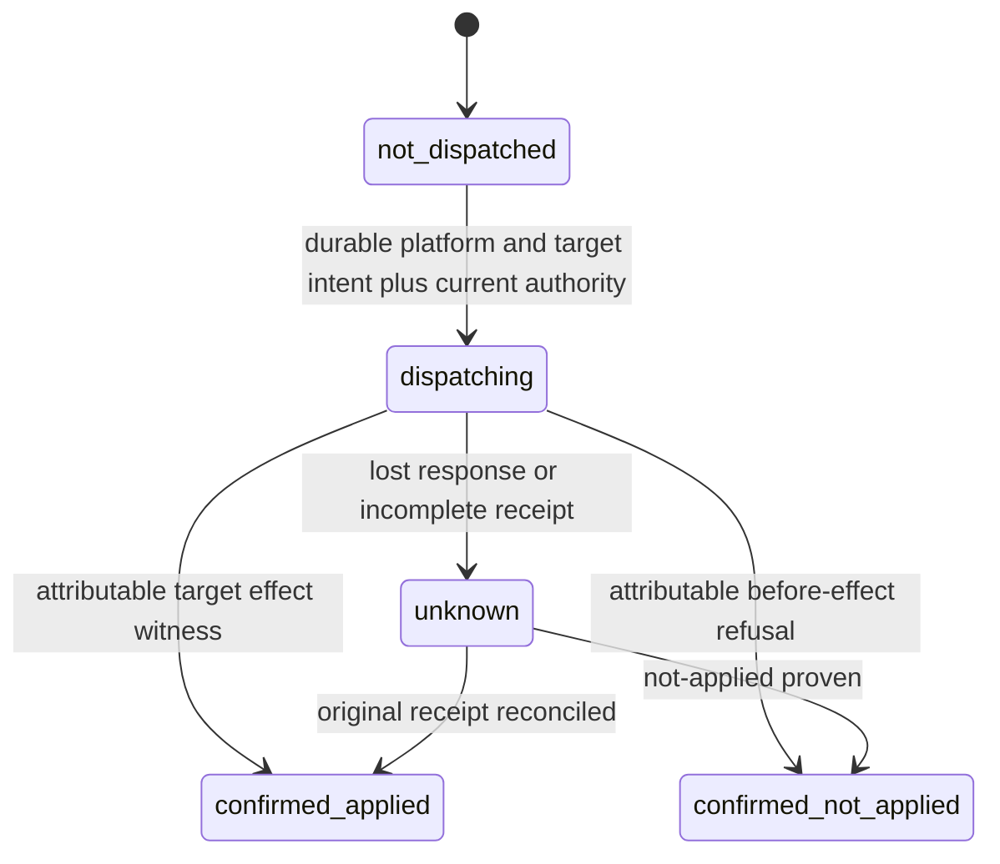
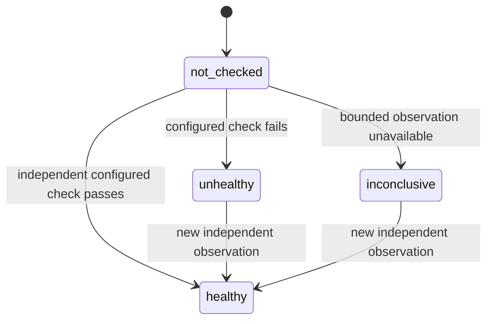
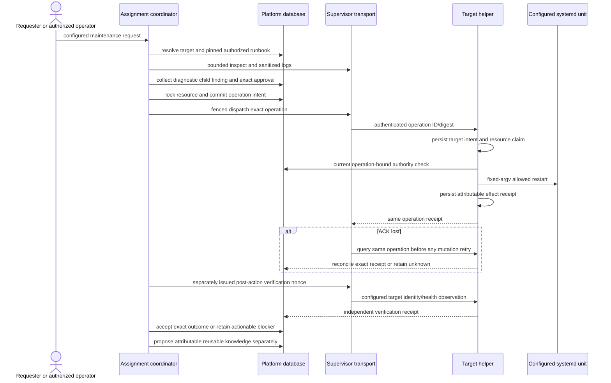

# Governed stand diagnosis, restart and verification

## Purpose

**Designed — ADR-205.** Qualify configured stand maintenance through existing specialist/RAH execution and a narrow first-party helper. The initial action is a permitted systemd component restart, with durable effect identity and separate health evidence. Configuration changes/upgrades and controller self-update are excluded from this acceptance gate.

## Domain entities

- Stand: stable target incarnation, pinned HTTPS endpoint/certificate identity and helper credentials.
- Component: explicit systemd manager/scope/user/unit mapping, allowed actions and configured health probe.
- Runbook: authorized Company Brain record/revision/witness, pinned on operation intent.
- Operation intent: server-generated ID, assignment/work/input, exact target/action/digest, before witness and authority/approval snapshot.
- Target receipt: target-durable intent/effect/service-manager witness, independent of HTTP delivery.
- Resource claim: canonical stand incarnation/manager/scope/user/unit, shared across aliases/assignments/controllers.
- Verification: separately issued nonce/observation, target incarnation, operation ordering and configured healthy/unhealthy/inconclusive result.
- Recovery disposition: proved applied, proved not-applied, unresolved hold or authorized successor preserving prior uncertainty.
- Incident: existing grouped durable target/resource/failure episode. See [persistence](../db/stand-operations-domain.md).

## State machine

Effect state is independent of assignment completion and health.

Verification observations do not change effect state.

## Process flows

Operation identities and durable receipts precede/prove the effect; health is a separate operation.

### Configuration and runtime bounds

The platform registry exposes `GET/POST /api/stands` and
`GET/PATCH /api/stands/{targetId}`. Reads require current `targets:read`.
Writes also require current `targets:manage`, a stable `Idempotency-Key`, and
access to the exact active company procedure revision and supporting witness.
Updates advance the expected configuration revision and retain the target's
incarnation. The receipt identifies that exact revision and its component IDs.
The platform derives one resource key for aliases of the same configured unit.

Each target configuration is a versioned reviewed record: target incarnation ID; HTTPS URL (no userinfo/query/fragment); pinned TLS CA/server identity and mTLS client/helper identity; credential `env:` references; component IDs mapping to manager literal `systemd`, scope `system|user`, explicit user/UID for user scope, exact `.service` unit, allowed actions `inspect|logs|restart|verify`, pinned runbook record/revision and configured probe. No caller supplies endpoints/commands/paths/credentials. Unit IDs are allow-listed literals, not arbitrary systemctl arguments. Unsupported manager/scope/unit/action refuses before effect. Aliases map to one canonical actual unit/resource key.

The helper binds configurable HTTPS address/port, default loopback:7443; remote deployment explicitly configures network reachability/firewall and mTLS. Credentials/cert/key/config/state paths are host service config, never prompts. Target process has only configured systemd privileges; no unrestricted bus/socket, arbitrary shell, package manager, upgrade or controller-self-restart capability. Target identity probes validate helper incarnation/component, not just HTTP liveness.

| Bound | Designed limit/policy |
| --- | --- |
| Platform/target intent body | <=65536 UTF-8 bytes, closed schema |
| Inspect/receipt call | 5-second timeout, up to 3 read attempts with 200/500 ms backoff and structured warnings, then explicit last error |
| Restart | <=45-second target execution, transport deadline 55 seconds; timeout creates uncertainty, never original-command automatic retry |
| Current authority check | 3-second timeout, operation-bound single-use nonce/epoch/digest; fail closed before effect if unavailable |
| Resource/owner lease | 120-second renewable claim, 40-second renewal; unknown operation is durably excluded independently of lease |
| Logs | Last <=10 minutes, <=200 lines, <=262144 bytes, <=5-second read; sanitize while bounded streaming before leaving target |
| Health | Explicit HTTP or service-manager identity probe, <=5 seconds/<=16384 response bytes, fresh nonce; up to 3 independent observations over <=30 seconds |
| Journal | Bounded configured storage, default 256 MiB; durable intent admission fails before mutation when full/corrupt; unknown/in-flight receipts never age-pruned |
| Inspection/recovery | Bounded 3 read attempts per scheduler claim; durable keyset/backoff, current recovery authority and incident after repeated inability; no age-to-failed inference |

Sanitize configured credentials and token/password/authorization patterns, control sequences and private host paths before log/artifact/error publication. Raw logs remain target-private. Sanitized log text retains target-log access restrictions and is not public telemetry. Public diagnostics are allow-listed reason/status/count fields and remediation, never raw systemctl/provider stderr/body or credential values. Native error reasons distinguish unsupported_config, target_identity_mismatch, authority_revoked, resource_conflict, receipt_missing, receipt_corrupt, journal_full, effect_unknown, verification_unhealthy and verification_inconclusive, mapped to existing typed domain codes and EN/RU UI copy.

### Intent, authority and effect contract

The platform intake API retains the current assignment input, target and
component revisions, runbook witness, initiating authority and intent digest.
Restart intake acquires the canonical resource in the same transaction. Exact
replay returns the retained operation. A conflicting payload or held resource
returns a typed conflict. The pending intent and exclusion survive assignment
cancellation and lease expiry. Once the prior effect is proved and its claim
is marked resolved, a new independent intent takes the resource atomically at
the next owner epoch. Dispatch authorization and target receipts are
subsequent stages of the contract below.

1. Resolve target/runbook/policy/current authority and exact before-state under canonical resource claim. Persist operation ID/digest and original expected outcome before dispatch, atomically with assignment work reference and outbox/command ownership.
2. Target durably writes the same operation ID/digest/intended action and resource exclusion before invoking the service manager. Duplicate exact operation returns its receipt/state; changed digest conflicts. Stable target state is shared across helper replicas; exclusive resource creation/locking protects the actual unit.
3. Target calls the platform's authenticated pre-effect authority endpoint with operation ID/digest/target/resource/owner epoch/fresh nonce. Server derives initiating actor, current grants/binding, exact approved intent and active mutation owner from stored state; helper cannot nominate an actor. Authorization linearizes when that current decision/permit commits. Dispatch uses the returned short-lived (5-second) single-use permit immediately and records its ID before the fixed effect. Revocation blocks any later decision/retry; it cannot undo already authorized started work. Lost permit response leaves target before-effect unless its journal proves otherwise; never mint a second effect under an ambiguous receipt.
4. Invoke fixed service-manager argv, then read back configured unit incarnation/invocation and state. Persist attributable receipt with original operation, target identity, before/after witnesses and target journal sequence. HTTP/process success or a changed invocation alone without attributable operation history cannot confirm requested effect.
5. Platform adopts exact receipt under current owner/resource fence. A committed effect followed by local DB failure is settled forward by querying the same target receipt. It is never compensated with a second restart.
6. Issue a separate verification after the effect boundary. Fresh nonce, target identity and platform issue/target journal ordering prevent reuse of stale pre-action health; unsynchronized remote clocks alone never establish ordering. Health does not establish restart causality.

Intent digest is SHA-256 of canonical owner/assignment/input/work identity, canonical target incarnation/resource/config revision, action, approved constraints/runbook revision and required verification policy. Canonical objects sort keys and preserve array order. Generated operation/command/permit IDs, dispatch timestamps and renewable owner epoch are excluded from that intent digest; their separately bound identities cannot make an exact request replay appear different. Same delivery key resolves the original generated operation before any new effect. Authority/permit digest binds that immutable operation intent plus current owner epoch/nonce, so a new recovery authorization cannot silently substitute a target/action.

Default restart requires human approval linked to exact intent digest/target/action/input and current permission. An administrator may configure a bounded unattended grant explicitly; routine diagnosis needs only read/log grants. A model cannot set allowed actions, approval, confirming principal or expected verification policy.

The approval API retains a human decision for the exact undispatched operation
digest and revision under current `targets:restart` and source access. Its
receipt is durable and independent of the transport permit. A waiting-state
transition can change the assignment's business revision while the exact input
stays current. An input change supersedes the original intent for approval.
The operation still
requires current dispatch authority and an authenticated helper decision.

The callback ingress uses a dedicated HTTPS listener with a required
CA-verified client certificate. The request handler derives the certificate
fingerprint from the TLS socket and passes it with the helper credential to
the authority service. Proxy headers cannot set that identity. The listener
accepts only the authorization callback and applies the operation body limit.
Target-specific certificate binding, permit persistence and service startup
remain part of the authorization and deployment wiring.

Authority requests/permits also bind a closed purpose `dispatch|reconcile|logs|verify`. Dispatch validates the frozen intent action and active run/assignment owner. Read-only reconciliation/verification validates the current operation-recovery owner/grant even after original run termination; logs separately requires current log access. A read-purpose permit cannot authorize restart, and the helper compares returned purpose/nonce/digest/target to the exact call before using it. The callback resolves the principal from stored ownership/service configuration, never from its request body. A verification request preserves original operation/digest and issues a separate fresh verification nonce/receipt; changing its read-purpose action does not rewrite the original restart intent.

### Recovery and current responsibility

| Window | Persisted state | Recovery and exclusion |
| --- | --- | --- |
| Before platform intent commit | No effect admitted | Retry intake normally; no success/operation receipt invented |
| Platform intent committed, no known target receipt | Pending/not_dispatched or unknown dispatch evidence | Query same ID and existing durable command status, never assume absent means not-applied after possible dispatch |
| Target intent/permit committed, effect not proved | dispatching/unknown | Inspect exact target journal; keep resource blocked until receipt or authorized inspected disposition |
| Effect happened, target receipt persisted, response lost | Platform unknown, target confirmed receipt | Query/adopt same receipt, no repeat mutation |
| Effect happened, helper died before receipt | unknown with before/dispatch witness | Current health may be known while historical causality remains unknown; no fabricated applied/not-applied |
| Target receipt exists, platform result commit failed | Unknown local application | Adopt under current operation owner fence; existing prompt/result application remains distinct |
| Applied, independent health unhealthy/inconclusive/missing | Confirmed effect, unmet verification | Verify again within observation budget, never restart as a verification retry; surface actionable incident |
| Original coordinator/run cancelled/terminal/host assignment released | Operation evidence retained independently | Read-only reconciliation uses operation-owner epoch/current recovery grant; no session fence required and no new mutation allowed |
| Authority revoked/target unavailable | Existing effect uncertainty unchanged | Fail closed for new effects; authorized recovery service may inspect, return safe blocker/incident if unable |
| Authorized new action after bounded inspection | Original remains unknown, explicit risk/recovery decision | Create new operation ID linked to predecessor and transfer resource exclusion atomically under new fence/approval; never clear unknown by lease expiry |
| Journal pruning or repeated old request | Retained identity/digest tombstone or expired-request refusal | No previously admitted operation ID can execute again after payload pruning |

Reconciliation dispositions are proved_applied, proved_not_applied, unresolved_hold or authorized_successor. Successor authority requires current `targets:recover` and `targets:restart`, exact inspection/preconditions, explicit human decision and new coordinator/action intent; policy may refuse if safe state cannot be established. Original unknown history stays visible. Assignment acceptance may cite the verified successor only with its linked recovery limitation. Cancellation closes human waits and stops agents but does not delete effects or release unresolved exclusion.

### Incidents and deployment

Use existing incident/outbox ownership with scope key target incarnation/canonical resource/failure condition. Repeated unchanged failure updates one episode without independent alerts; meaningful change, needed human action and evidenced recovery drive notifications. Unchanged routine healthy/no-action checks remain quiet. Delivery rechecks current recipient access.

Deployment is host-run web/supervisor plus target helper; Compose remains Postgres-only. New helper package/runtime wiring, configured port, TLS/env/config/state paths, systemd unit scope/user and allow-list are validated before mutation capability is enabled. Docker execution is not supported merely because the image builds; the target qualification explicitly proves the selected real service manager and helper journal survive restart. No production controller is used as a default test target.

## Expectations

- **CBO-01:** Target/resource/runbook/actions/health are explicit configured identities and unsupported input refuses, enforced by target config validation and action resolution (`IT-CBO-01`).
- **CBO-02:** Both durable intents and current exact authority precede effects, enforced by platform/target journals and pre-effect authenticated permit (`IT-CBO-02`).
- **CBO-03:** Canonical resource exclusion spans aliases/assignments/controllers and survives unknown effects/expired owners, enforced by platform and target durable resource claims (`IT-CBO-03`).
- **CBO-04:** Lost responses/crash windows reconcile same operation before any original retry, enforced by receipt queries and explicit unknown disposition (`IT-CBO-04`).
- **CBO-05:** Required effect and independent post-action health are separate attributable evidence, enforced by operation/probe resolvers and exact acceptance policy (`IT-CBO-05`).
- **CBO-06:** Logs/errors are bounded and sanitized before publication while retaining source restrictions, enforced by target streaming/projection and current access (`IT-CBO-06`).
- **CBO-07:** Human recovery preserves historical unknown and permits only explicitly inspected authorized successor work, enforced by recovery decisions and atomic claim transfer (`IT-CBO-07`).
- **CBO-08:** New operational evidence validates server receipts without changing old v1 snapshots, enforced by versioned contract selection/semantic resolvers (`IT-CBO-08`).
- **CBO-09:** Routine unchanged success is quiet and repeated failures share one actionable incident, enforced by existing grouped incident/outbox projections (`IT-CBO-09`).

## Edge cases

- **EDGE-CBO-01:** Same operation/same digest returns receipt; changed digest rejects before a second service-manager call (`IT-CBO-02`).
- **EDGE-CBO-02:** Different component aliases/controllers race on the actual unit; one mutation occurs while unknown predecessor holds exclusion (`IT-CBO-03`).
- **EDGE-CBO-03:** ACK loss after persisted receipt and target death before receipt are distinct, both forbid blind retry (`IT-CBO-04`).
- **EDGE-CBO-04:** Healthy-now, stale/skewed probe, process exit or model confirmed flag cannot prove requested restart (`IT-CBO-05`).
- **EDGE-CBO-05:** Revoked/expired/replayed permit, full/corrupt journal or mismatched target identity refuses before effect (`IT-CBO-02`).
- **EDGE-CBO-06:** Run deletion/cancellation cannot erase unresolved effects; inspected successor does not rewrite old uncertainty (`IT-CBO-07`).
- **EDGE-CBO-07:** Secret/control/host-path markers are absent from published log/error/result projections (`IT-CBO-06`).

## Linked artifacts

- [ADR-205](../decisions.md#adr-205-stand-operation-intents-and-independent-verification), [persistence](../db/stand-operations-domain.md), [target-helper API](../api/external/stand-connector.openapi.yaml).
- [Assignments](specialist-assignments.md), [operational results](operational-agent-results.md), [configuration](../configuration.md), [deployment](../deployment.md), [error taxonomy](../error-taxonomy.md).
- Existing host transport/result/incident/outbox services; designed `web/lib/stand-operations/`, `supervisor/src/stand-operations/` and `stand-connector/`.
