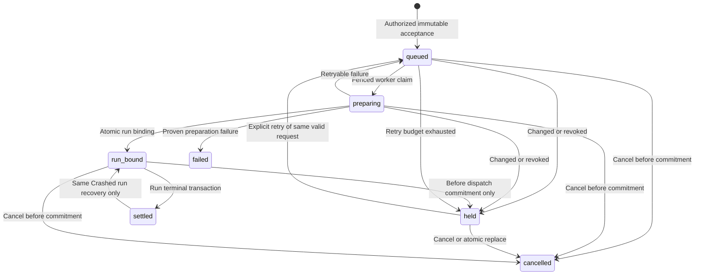
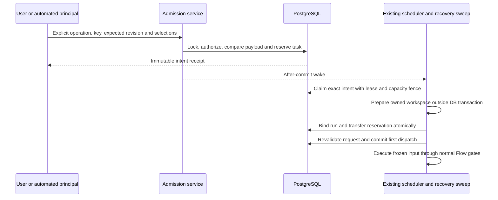

# Task launch admission

## Purpose

**Implemented — ADR-200.** Own explicit execution authority for a task revision, separately from its qualification assessment. Qualification remains the automatic root decision; a session-authenticated human Launch is a one-shot manual decision. [Persistence](../db/task-launch-domain.md) defines storage; qualification value/publication remains owned by [task qualification](task-qualification.md). Validation is local; the active implementation plan records outstanding combined qualification. This status does not imply a production upgrade.

## Domain entities

- Task semantic input, settings resolution and optimistic task revision.
- Immutable launch intent, principal, admission basis and request digest.
- Ordinary task reservation, fenced preparation lease and write-once run binding.
- First-dispatch commitment, execution input snapshot and successor lineage.
- Existing assessment, execution parent, scheduler slot and Flow gates.

Delivery targets are explicitly discriminated: `flow` freezes Flow/package revision and runner slots; task-bound `code_delivery` agents freeze the agent ID, validated definition digest/package identity and runner slots. Operational agents use their existing preparation contract and never borrow task-delivery admission. Agent targets use null Flow IDs in the shared receipt, plus their real agent ID; they never fabricate a Flow identity. Existing agent-launch endpoints construct the same server admission request from their authenticated principal and path target. The task-launch endpoint accepts the explicit Flow or agent target; a Flow-driving agent retains its agent identity while the server derives its declared Flow.

A Flow uses a worktree and immutable base commit. An agent freezes its declared/effective workspace axis. A manual `workspace=none` agent may have a null base commit; admitting it must not introduce a Git prerequisite or invent a SHA. Repository-backed targets retain their existing commit and isolation checks, and automatic roots retain accepted qualification evidence even when their agent needs no repository workspace.

## State machine

Intent lifecycle is independent of existing run status. A bound held intent retains its run identity.

## Process flows

Acceptance persists authority before a worker performs Git/host effects.

### Authority matrix

| Operation                    | Admission                                                                                                       | Lifetime                                                         |
| ---------------------------- | --------------------------------------------------------------------------------------------------------------- | ---------------------------------------------------------------- |
| Configuration save           | Current edit permission                                                                                         | No run, manual grant or new auto arm.                            |
| Human Launch                 | Active session, live project `launchRun`, required policy grants                                                | One immutable request and bound run; no assessment writes.       |
| Bearer/API/MCP root    | Current accepted `ready`, exact semantic input/evidence SHA and live principal scope | One request; legacy task mode is not an exception.               |
| Agent-created child          | Current parent admission, plan revision, relation and child digest                                              | Parent execution only; never C2 or transferable human authority. |
| Same-run resume/rework       | Original run admission/input, current continuation permissions and technical fences                             | Existing run only.                                               |
| Successor retry              | Fresh explicit human intent or current automatic admission and retry policy                                     | New linked intent/run.                                           |

Only the interactive session boundary constructs a manual principal. Body `manual`, actor, trigger source, arbitrary intent ID, PAT owner or Librarian owner does not prove a human decision. External callers use automatic/parent admission; no transferable approval capability is introduced.

The authenticated service boundary owns the admission decision. Database writer
capability settings fence incompatible binaries; they do not authenticate a human
or grant launch permission. SQL protects immutable receipts, compatible historical
V1 occupancy/continuation, current V2 binding and derived-child scope. Historical
V1-shaped rows remain supported by the upgrade contract; new product/API
allocations use the closed, branded service entrypoints. No client field or direct
actor ID can select the historical compatibility path.

### Server-owned launch sources and capacity

Admission basis and mechanical trigger are independent. A session Launch can
retain a cron-created agent's exact configuration without turning the cron actor
into a human decision. Each server producer constructs an opaque capability from
its stored operation; request JSON cannot select a source or provide authority.
Restart validation reconstructs that source through a closed registry.

| Source                                                           | Durable operation identity and additional authority                                                                            | Capacity policy                                                                                                                           |
| ---------------------------------------------------------------- | ------------------------------------------------------------------------------------------------------------------------------ | ----------------------------------------------------------------------------------------------------------------------------------------- |
| Qualified task drain                                             | Task's current accepted assessment and independent automatic arm                                                               | Global Flow cap, manual reserve and per-project automatic share                                                                           |
| Scheduler job, recurring run schedule, one-time scheduled launch | Stored job attempt or schedule fire; source revision/policy; original fixed allocation where present                           | Existing global delivery cap and source limits; these explicit scheduled operations do not consume the task-drain reserve/share allowance |
| Evaluation participant                                           | Stored study/batch/item and pinned recipe, runner and form inputs                                                              | Global delivery cap and evaluation limits; current qualification is still required for a task-bound new root                              |
| Agent trigger                                                    | Current registered definition, attachment, declared mechanical trigger and durable trigger reservation where required          | Global pool cap and the agent's technical/workspace protections                                                                           |
| Ralph retry                                                      | Exact failed source run, snapshotted retry policy, bounded attempt and fresh current assessment                                | Global delivery cap; fresh retry intent, never the source run's manual grant                                                              |
| Human budget restart or agent retry                              | Current interactive principal plus the stored HITL/retry operation and displayed request witness                               | Fresh ordinary manual intent; original grant is not reused                                                                                |
| Delegated task or as-plan child                                  | Admitted parent, exact child proof/input/relation and current plan target; bound token authority where applicable              | Global pool cap and parent fanout/depth/tree budget                                                                                       |
| Consensus draft                                                  | V3 derived receipt for one pinned parent node attempt, round and participant                                                   | Agent pool cap; parent/attempt/child authority is checked again for each new create or prompt command                                     |
| Taskless Flow-driving agent carrier                              | Only the private creator of one fresh generated carrier Task; immutable input witness, exact agent metadata and one allocation | Existing Flow execution limits; this finite procedure does not waive qualification for an incoming Task or future carrier revision        |

A queued child does not consume a live parent fanout slot. Active child Runs and
preparing, unbound child intents consume that slot exactly once under the shared
parent lock. Binding excludes the current intent's own reservation. Exhaustion
leaves the accepted request queued with `launch_parent_capacity_wait`, without
allocating an attempt, touching Git or consuming the preparation failure budget.
The total tree budget also counts authorized proof-owned carrier Tasks that have
no Run yet; binding their Run replaces that logical count rather than adding it
again. Child completion releases live capacity, while spent tree budget remains.

A writable shared agent child freezes the root ID, existing workspace ID (or
its absence), seed commit, branch and target. Its preparation identity uses the
actual shared root path/resource while runtime overlays remain per Run. A
later-created workspace may be adopted only if its root, seed, branch and target
match that witness. The seed remains immutable; the operational baseline records
the current shared HEAD and contents at the admitted turn. Reuse does not require
an untouched seed checkout, and child cleanup never deletes a borrowed root tree.

A taskless carrier stores its input in the V1 receipt's bounded `carrier` witness;
its Task's qualification policy remains unchanged. First dispatch rejects an
edited carrier or changed agent configuration, and later graph reads use the
frozen witness. Existing V1 history is not rewritten. A V3 consensus draft uses
the original parent's frozen input, including while the parent is parked waiting
for children; it does not create a new ordinary task reservation or authorize a
future task revision. SQL guards prevent receipt reclassification after creation.

### Request and mutation rules

- Acceptance snapshots task title/prompt, statement/source identity and relevant clarifications; semantic/settings digest versions; resolved Flow/package revision or agent definition identity, runner slots/model/profile/capabilities, base commit/target, delivery/execution/promotion policy. Runner provenance excludes environment and provider credential values; a private configuration digest binds the server-resolved executable profile, which must still match at dispatch. No credential values enter the intent receipt. `tasks.revision` guards acceptance, while semantic/settings digests govern dispatch freshness.
- Same principal/project/operation/key and identical canonical payload returns the original receipt after current access checks. A changed payload under the key conflicts without mutation. Different keys compete under one ordinary task reservation; losing manual settings are not silently replaced by automatic work. Existing nonterminal v1 delivery runs participate in that fence too.
  A scoped `409 launch_already_reserved` includes `details.existing` with nullable
  `intentId`/`runId` and the existing `manual|automatic|execution_child|historical`
  basis. It reports the earlier work; it does not acknowledge the losing request.
  Historical admission is never relabeled as a human decision. These selectors
  expose no input or principal credentials and grant no additional access.
- Description, blocking clarification or selected execution-setting changes before commitment hold the old request. Atomic replace cancels it and accepts a newly authorized successor. Priority/comments or assessment-pointer-only changes do not invalidate a manual request. A concurrently published assessment retains routing as a proposal if applying it would overwrite pending manual selections.
- Mutable defaults cannot change the accepted resolution. Manual base movement retains the selected immutable commit; automatic launch additionally rechecks current evidence SHA. Disabled/untrusted/incompatible/unavailable resources refuse or hold under typed reasons; no silent runner/Flow substitution.
- `triageStatus=flagged` with `triageFlagOrigin=qualification`, and absent/stale/negative/source-failed assessments, are advisory to manual Launch. Explicit, dispatch-failure and unknown-origin flags remain holds until an authorized fresh resolution; historical missing origin is unknown. `queuePaused`, actual relation/clarification blockers and technical gates retain their effect. Explicit unpause remains required. Launch never clears findings or sets auto intent.
- An explicit manual Run again retains the existing ability to relaunch a completed or abandoned task when its previous execution is retryable. Automatic admission still refuses terminal tasks, and archived projects remain unavailable. This decision never removes pause, independent hold, relation, clarification or active-execution protections.
- Before-commit cancel/replacement races use run/assignment/intent/task fences; an execution commitment winner causes 409. Bound never-dispatched cancellation uses existing terminal owner and owned cleanup. Post-commit stopping uses existing Stop.
- Terminal settlement frees the reservation. Same-run `Crashed` recovery may reacquire it only if no newer ordinary owner exists and original input is recoverable. Done/Failed/Abandoned do not gain a resume path. A new successor needs new authority.

### Queue, effects and recovery

Accepted capability imports are materialized from a private per-preparation
capture. Its whole-bundle digest must match the accepted content digest before
artifact copying; copying consumes the validated capture rather than mutable
installed paths. Internal relative links retain their text. Absolute or escaping
links refuse without reading their targets. The private capture is removed before
sealing the checkout receipt; a removal failure is actionable and does not roll
back a checkout or Run. An interrupted materializing phase remains fail-closed
and follows the existing owned disposition process.

A Flow's own installation is frozen separately: the preview token includes its
whole-directory content identity as well as immutable revision metadata. A change
between preview and acceptance requires a fresh decision; a change after
acceptance refuses preparation. The preparation owner validates a private
`accepted-flow` capture before binding. CLI actions, forms and result schemas read
that same capture on execution and recovery. They never switch back to a mutable
installation after the Run starts. The witness binds intent, run, preparation
incarnation and settings digest. Closed preparations that never bound a Run remove
only a verified owned capture; a bound Run retains its assets for its existing
lifecycle owner. Partial or changed captures remain fail-closed for diagnosis.

Package updates that create or advance a shared cut are explicit setup operations
before Launch. The setup action applies the existing reviewed package operation,
then reloads the displayed immutable Flow revision and settings token. Acceptance
supports keeping the displayed cut or a read-only `try_once` selection of an
existing immutable installation; it never freezes a fictitious not-yet-created
cut. A compatibility launch requesting adopt/cut-and-adopt returns an actionable
`launch_setup_required` refusal. Ambient Brain inclusion is frozen as the selected
boolean/null; consumption-time memory contents retain their existing contract.

Intentional concurrent relaunch uses a separate interactive operation and
reservation lane. It requires the same active-session and project/policy grants,
plus the existing explicit relaunch eligibility. An ordinary Launch, token flag,
or repeated click cannot select that lane. It changes duplicate policy only;
capacity, technical gates and immutable execution input remain mandatory.

Intent reservation is not execution capacity. A held intent retains task reservation but consumes no slot. Automatic intents retain reserve/per-project/retry/qualification policy even when ordered in C1; ordering never changes authority. Counters include token-owned preparation reservations exactly once until run handoff. Existing root/child/pool limits remain enforced.

Accepted requests join C1 using live task priority and immutable acceptance time.
Capacity and origin quota eligibility are applied before the bounded candidate
page; an ineligible automatic prefix cannot hide manual headroom. An expired
preparation reservation remains eligible for reconciliation even when the pool
is full, so it can be recovered or released. Temporary host/runner/repository
contention advances the request's due time without spending a genuine failure
attempt. Already bound, undispatched work may release capacity back to `queued`
with `launch_capacity_wait`; it keeps its exact Run/workspace and reuses their
verified materialization when admitted again.

Explicit Send to triage opts a legacy task into `required` qualification for its
next assessment; it does not rewrite earlier runs or assessments. After successful
qualifier publication commits, finalization persists the selected automatic intent
before waking the shared delivery scheduler. The existing automatic tick recovers
missed publication wakes through that same constructor. A pending manual intent
in either reservation lane keeps its selection: publication retains the full routing
proposal and records `routingApplication` in `task_activity.triage_set` as `applied`,
`not_applied_active_launch` or `not_applied_independent_hold` with safe proposal IDs.

`launch-dispatch` is a bounded reconciler invoked after acceptance, by slot-free dispatch and existing `system_sweep`; no new timer or filesystem watcher. Index `(state,due_at,id)`, keyset progress and classified retry attempts prevent poison/held rows starving later work. Capacity and host-pressure waits do not consume genuine failure budget or prove task failure.

Commit intent/snapshot/audit/outbox together. Git/host effects occur outside SQL transactions. Bind run, intent link, task status and slot handoff atomically. Persist the first-dispatch commitment under current ownership before executable effects; an earlier edit holds, a later edit affects future requests. Unknown create/prompt effects join existing command receipts instead of redispatching. Every execution reader, including restart and terminal delivery, reads frozen input/settings.

### Successor and continuation lineage

`relaunchOfRunId` is a scoped lineage selector for a fresh launch, never a grant
or a request to resume a different revision. Acceptance captures the current task
input and new selected settings under fresh manual authority or current automatic
qualification. The source must be a Flow or non-operational standalone agent run
of the same project/task and satisfy
the existing ordinary or explicitly concurrent relaunch policy. Its immutable
`relaunchSource` settings retain the observed Flow revision, known package install,
driving agent, scheduled request and live evaluation lineage. Unknown historical
package identity stays null; this does not reconstruct archived packages.
Evaluation replicate ordinal remains a binding-time allocation through the
existing participant deriver. Live study identity, source removal and policy drift
after acceptance hold the request instead of silently dropping its forced hold.
A study already decided/archived when a fresh request is accepted retains the
existing plain-run policy.

Budget restart is a new successor, not same-run recovery. A read-only,
project-scoped preview shows the current task input and selected settings before
its exceptional destructive decision (the previous run will be terminalized).
The response carries that exact canonical launch request and an opaque principal
constructed by the active-session boundary. Actor attribution alone never grants
manual admission. The existing staged HITL response durably retains the request;
re-drive uses the same request and operation key. Drift detected in preflight
refuses before checkpoint. Drift during checkpoint refuses the new execution and
rolls back SQL terminalization; the already-checkpointed source remains paused.
The failed staged claim exposes a fresh preview and explicit new decision, plus
the existing budget Raise/Stop paths; it never silently refreshes the old request.
Terminalizing the source, settling
its old reservation and accepting its successor share one transaction under the
existing scheduler/reservation/run ownership locks. Acceptance may return an
intent with no run yet; it must never fabricate a run receipt. A historical
claimed restart without the required input witness needs a fresh explicit
Launch. Ordinary Raise/Park/Abandon and same-run HITL continuation keep their
existing contracts.

Same-run `Crashed` recovery is a continuation of the original frozen execution.
The recovery owner locks scheduler capacity, the task reservation, run/assignment,
then intent/task in the existing order and rechecks current recovery permission.
It prepares reservation reacquisition without publishing it until recovery can
commit `Crashed` to `Pending` or `Running`; workspace-busy/discard-only refusal
leaves the settled intent untouched. A newer ordinary owner refuses recovery.
The original first-dispatch receipt and epoch remain immutable evidence while
every actual new driver/session effect is fenced by its current assignment epoch.
Changed task text is future work and cannot replace the resumed prompt. A missing
original dispatch/input witness cannot be repaired by writing a timestamp or
fabricating a successful assessment. Done/Failed/Abandoned gain no same-run resume
path; their successor requires fresh authority.

### Compatibility and external surface

New intent APIs return a versioned receipt with nullable runId and Location. Existing run APIs retain run-bound success schemas. Idempotency-Key is mandatory for new launch mutations; absent keys refuse before writes. Bounded compatibility waits may return typed `launch_pending` with `accepted:true`, intentId and Location, distinct from no-acceptance failure. UI preserves key and resumes the accepted receipt after disconnect. Existing attention ticks invalidate authorized intent state before a run exists; GET has no recovery side effects.

External acceptance commits its required token audit and any Librarian operation
receipt in the admission transaction. The new resource supports keys up to 256
characters, including Librarian requests; older external operation limits remain
unchanged. A reused admitted Librarian operation re-enters the same idempotent
admission service, so an interrupted preflight can recover and concurrent requests
converge on one intent. A completed operation reads its original intent under
current scoped launch and frozen-policy authority, without granting another
execution. Every successful replay returns the intent DTO, `Location` and
`Cache-Control: no-store`; a generic `202 admitted` is insufficient. Business
refusals retain their original operation result. Transient storage failures return
503 and retain the key for recovery; a lost commit acknowledgement can leave an
accepted intent, so clients replay the original key instead of assuming failure
means no work was accepted. Unknown non-database effects require reconciliation.

No historic assessment/run receipt is rewritten. Writer floor fences v2 and intent-owned legacy tasks. `taskAdmissionCheckedAt` alone is not evidence that execution started or inputs were frozen. Queued/checked-but-undispatched v1 requests lacking immutable evidence are held; a live session is not killed to repair metadata, but an unreconstructible later prompt/resume is refused. Explicit legacy qualification opt-in preserves old receipts and enables future automatic qualification.

## Expectations

- LA01/LA02: the trusted admission service and v2 insert guard admit one-shot manual work independently of assessment, without changing assessments or arming automation; qualification-admission and intent integration own the checks.
- LA03: automatic selector and dispatch guards require current accepted readiness and exact evidence, including legacy roots; scheduler integration covers opt-in, publication and competing manual routing.
- LA04/LA05: immutable snapshot guards and frozen reader paths preserve selected/executed input and settings across queue/edit/resume; queued-dispatch integration proves both edit orderings.
- LA06: request-key content comparison, task/run locks and partial unique reservation constraints prevent duplicates and silent substitution; real two-connection contenders prove winner/loser behavior.
- LA07: auth adapters derive principal/project/scope and recheck current permission on dispatch/replay; route integration includes permitted callers and forged/cross-project/revoked callers.
- LA08: retry/recover/parent proof services keep successor and continuation authority distinct; their integration suites assert exact original lineage/input.
- LA09: scheduler lock, origin-aware counters and indexed bounded recovery preserve capacity and progress; system-sweep integration includes held first-page work and slot release.
- LA10/LA11: shared readiness projection and optional evidence selectors expose accessible EN/RU manual action and complete structured findings without requiring user IDs/codes/SHAs; browser journeys verify the actual controls.
- LA12/LA14: unchanged technical and Flow gates remain on the action path; launch/gate and provider-boundary journeys prove PR settings without a qualification form.
- LA13: strict OpenAPI/MCP DTOs, explicit async resource and existing attention invalidation preserve truthful acceptance/status/cancel/replace/replay; real response and built stdio parity tests enforce the contract.
- DB01: versioned schema/writer guards and populated-upgrade integration preserve immutable v1 history and refuse malformed, foreign, duplicated or incompatible v2 writes.

## Edge cases

- Request/key/stateVersion changed: `CONFLICT`, no hidden update; held request includes actionable changed field categories.
- Revoked permission/project archived/independent blockers: existing `UNAUTHORIZED`/`PRECONDITION`; no launch grant from stored actor alone.
- Accepted work outlives response: retain receipt and recover through original key; no second run from browser retry.
- Before-model infrastructure failure: retain safe primary cause, not a negative assessment; operational completion/publication integrity remains independent.
- Unknown old input or physical ownership: explicit compatibility hold; never infer success from missing metadata.

## Linked artifacts

- [ADR-200](../decisions/adr-200.md), [persistence](../db/task-launch-domain.md), [preparation](agent-preparation.md).
- [Web API](../api/web.openapi.yaml), [external API](../api/external/operations.openapi.yaml), [attention](../api/async/attention-stream.asyncapi.yaml).
- Execution plan: `.ai-factory/plans/codex-manual-launch-triager-reliability.md`; primary tests and RED/GREEN evidence are recorded there.

## Acceptance and queued-edit implementation boundary

The session adapter constructs an opaque interactive principal; accepting a
client actor/source/manual flag cannot construct it. The domain operation checks
current DB grants, freezes a canonical semantic input and credential-free resolved
settings, and inserts the intent plus content-free invalidation in one transaction.
Configuration selections for Flow, runner and branches advance the saved task
revision in that transaction; run-only delivery/execution/promotion selections
remain in the frozen intent. Replay precedes current-revision checks after access
checks, so a lost response returns its original request even after later edits.
The scoped key lock and ordinary task reservation serialize acceptance; conflicting
payloads or a different live reservation produce a typed conflict.

Queued task editing shares the reservation lock, then locks bound runs, intents
and the task. Its hold and edit commit together. Semantic input and saved settings
are compared independently of priority/status and qualification counters. An edit
holds an undispatched request with `launch_input_changed`, `launch_settings_changed`
or `queue_paused`, preserves its original snapshot, and emits no source content.
A held reservation continues to occupy the ordinary task slot until the user
cancels or explicitly replaces it. Dispatched runs retain their frozen request.

The session HTTP cancellation and replacement adapters enforce the same origin,
opaque principal and live grants as acceptance. Metadata, cancellation and
replacement use one existence-hiding scoped lookup. Cancellation records a scoped,
immutable receipt; exact replay rechecks current access before returning the
original version. Replacement cancels the old request and accepts a uniquely
linked successor in one transaction; validation failure rolls both back. Its key
belongs to the successor's replacement operation, independently of cancellation
keys. A bound Pending cancellation uses the existing database terminal owner,
releases its assignment and arms workspace cleanup in that transaction. Physical
cleanup occurs after commitment through existing cleanup owners. Dispatch
commitment or any execution command/session witness refuses cancellation.

Bearer cancellation uses current scoped launch authority and records the token
principal separately from the immutable original admission. It requires no fresh
assessment or automatic arm. Bearer replacement must acquire a new automatic
basis; it cannot inherit the predecessor's human authorization. Both mutations
commit their required audit and Librarian receipt with the state change and use
the same resumable journal contract as acceptance. Cancellation returns 200 and
replacement returns 202; their operation keys and retained receipts are distinct.
An audit outage rolls back cancellation and successor creation, preserving the
original reservation for same-key recovery.

Read scope remains independent of launch availability: archiving a project
preserves authorized receipt inspection. A caller without task/intent visibility
receives the same not-found response as an unknown selector. Cancellation remains
available during upgrade maintenance; replacement admits new work and stays
fenced. Git preflight completes before replacement's SQL transaction. Application
then acquires the scoped key and task reservation before run, assignment, intent
and task rows; no key is acquired after the reservation. A cancellation that wins
during preflight prevents the prepared replacement from committing.

## Automated adapter contract

The internal constructor, admission, SQL origin guard, external HTTP/MCP adapters,
scheduled and child sources, and shared dispatch consume the same durable intent.
Focused local integration and built-stdio checks cover these boundaries. The
active implementation plan tracks the remaining combined browser and full-suite
qualification; these checks do not establish a production deployment.

The bearer constructor verifies the presented secret through the existing token
verifier and returns an opaque server principal. Only its durable token identity
and credential-free origin enter the intent: token kind, original project scope,
owner, agent, bound run and Librarian turn. Acceptance and dispatch re-read those
bindings, current scopes, expiry/revocation, active owner/project grants and live
turn/parent state. Identity drift refuses; attribution to a user never becomes a
session decision. A project token without a privileged user grant cannot authorize
an elevated unattended policy; no silent policy downgrade or new implicit token
scope is introduced.

Bearer root requests require `runs:launch`, a current accepted ready assessment
and the task's explicit automatic-launch intent. A parent-bound execution child
uses the existing delegation scope/proof instead. Cancelling accepted work does
not require a new positive assessment or auto arm; it requires current scoped
write authority. Replacement creates new work and must independently satisfy its
current automatic/child admission. A copied manual intent ID never supplies that
basis. Metadata uses `runs:read`; source-bearing operations retain their existing
separate permissions.

| Existing producer | Required authority at the common admission boundary |
| --- | --- |
| `app/api/runs/route.ts` and staged response | Opaque interactive session for an explicit request; preserve run-bound compatibility responses and request keys. |
| `app/api/v1/ext/runs/route.ts`, MCP HTTP client | Verified token; automatic root admission, existing external idempotency/audit and Librarian operation receipts. |
| `app/api/v1/ext/runs/delegate/route.ts`, `runs/plan/route.ts` | Server-derived live bound parent, plan/relation/child digest; no body parent authority. |
| `scheduler.ts`, `scheduler/handlers/flow-run.ts`, auto-triage handler | System automatic principal; accepted qualification and independent auto arm. |
| `scheduled-launches/service.ts`, `run-schedules/dispatch.ts` | Existing durable scheduled occurrence/settings plus automatic root admission; no inherited human decision. |
| `evaluations/launch-seam.ts`, evaluator agent launch | Existing controlled recipe/judge ownership and technical gates; independent task roots qualify, derived children use parent proof. |
| `services/hitl.ts` successor launch | Carry authenticated decision authority from its route and create fresh retry lineage; same-run continuation retains its original admission. |
| `agents/launch.ts`, project agent launch/event routes | Task-bound code delivery derives session, automation or parent authority from its entry point; operational agents retain their own preparation contract. |
| `agents/retry.ts` | Operational retry policy remains separate; a code-delivery successor earns fresh task admission rather than borrowing a source run's manual grant. |

### Unbound preparation cleanup

A launch preparation owns its immutable run ID, checkout path, branch, resource
and incarnation before a Run exists. Held, failed, cancelled and settled intents
may arm `cleanupState=pending`; this state never changes the primary refusal or
preparation attempt budget. Any intent run/original-run navigation or Run matching
the preparation ID or launch-intent link transfers cleanup exclusively to existing
Run/workspace GC. A physically busy repository returns a deferred outcome and
spends no failure budget.

The cleanup owner commits pending state before acquiring the existing common-Git
repository fence. It rechecks closed intent state and all Run links after physical
acquisition and immediately before removal. Pending/retained cleanup must not be
cleared by a retry/reactivation writer. Canonical manager-root placement, repository,
resource hash, branch/base SHA and versioned provenance must match. A pristine
checkout may contain only unchanged tracked bytes and verified platform provenance;
unknown ignored bytes, symlinked owner paths or changed provenance are retained.
Platform materialization requires its exact intent/incarnation/settings/full-content
receipt; an absent or partial receipt retains the resource for diagnosis.

The repository fence covers identity checks, Git effects and final durable removed
receipt, including registered Git children across process death. Remove only an
owned checkout and an unreferenced branch still at its accepted base SHA. A reserved
absent path with an existing unproven branch is retained. A previously checkout-ready
journal can reconcile an absent checkout and owned unchanged branch after interrupted
removal; absent checkout and branch completes the removed receipt without recreating
anything. `cleanupState=removed` is immutable; stale preparation drivers cannot
reactivate it. A lost final database stamp is retried using these same physical and
immutable identity checks, never by assuming removal succeeded.

The bounded sweep orders candidates by last cleanup visit and ID so a busy repository
does not starve later projects. Retained resources require operator diagnosis rather
than unbounded automatic retries. Structured cleanup logs contain intent/resource
identity and safe cause categories, independently of the launch's primary diagnosis.
Real PostgreSQL/Git tests own busy preparation, cancelled/stale owners, bound links,
dirty/symlink/partial materialization, removal receipt recovery and orphan-GC protection.

### Scheduled automatic source ownership

Scheduler jobs, recurring schedules and one-time launches mint server-only source
capabilities from their durable database decision. They require the exact current
accepted assessment, including legacy tasks; recorded actor attribution never grants
manual admission. Restart validation uses the owning static source validator and
frozen target/policy digest. Lease timestamps and recovery epochs are ownership
coordinates, not changes to the accepted logical request.

A scheduler job uses its job/attempt identity. A recurring schedule uses schedule ID
and the original `lastFiredAt` fire identity, with `updatedAt` fencing its refreshed
owner lease. An accepted fire may return `dispatching` plus its intent ID before any
Run exists. Re-entry preserves that fire and its already advanced cron cursor;
source configuration changes refuse the old decision before dispatch. Pause affects
future automatic fires; the existing authorized Trigger now operation may fire a
paused schedule and still uses automatic qualification admission.

One-time schedules retain their existing reserved Run UUID, task attempt, branch,
path and request hash. Accepted intent recovery rotates the source lease without
cleaning an owned preparation, allocating another identity or consuming the failure
budget for a capacity wait. The source reaches `Launched` only after its actual Run
is linked. Historical dispatches without canonical intents keep their prior recovery
policy. Transient storage unknown-ack leaves the source decision recoverable.

Explicit scheduled package adoption uses the existing package setup operations
before acceptance. Successful cuts/shared installation changes are retained if
later admission refuses. The admitted snapshot resolves the resulting immutable
installation; replay of an accepted fire never repeats setup.

### Fresh task-bound agent retry

A failed code-delivery agent can request a new attempt only through a fresh active
session decision for a displayed canonical task request. The retry preview exposes
the current task revision, material input, selected agent/workspace and runner.
Changing the runner refreshes this preview. The POST submits the exact request,
preview fingerprint and stable request key; it never infers manual authority from
historical actor attribution. The common task-launch intent owns capacity, workspace
preparation and eventual dispatch. No second agent-retry allocation is created.

This shortcut is limited to positive pre-work failure evidence and the same frozen
task material, agent definition, configuration and execution policy. Missing legacy
witnesses or material changes require the normal task Launch workflow. The original
source trigger and scheduled-request provenance remain inspectable, while the new
intent records its own manual admission and retry lineage. A restart revalidates the
stored source through its static validator and current user authorization. Replaying
an accepted request returns its original receipt before checking newer task defaults.

The existing retry receipt endpoint resolves either a historical agent-retry intent
or a canonical retry intent scoped to the source Run. `retryIntentId` is the durable
identity of that owning ledger; `runId` remains absent until an actual Run is bound.
Historical successful receipts retain their original meaning. Undispatched legacy
task-bound delivery retries lack the new decision witness and refuse with an
actionable new-Launch requirement. Operational qualifier retries and taskless agent
retries retain their existing separate lifecycle.

### External delegated child requests

A run-bound `runs:delegate` token supplies parent authority, never a manual-user
claim. New task-backed `/runs/delegate` and `/runs/plan` effects require a stable
`Idempotency-Key`. The server derives an operation identity from token, bound
parent, operation family and key; a second semantic body under that identity
returns `delegation_launch_key_conflict`. Carrier/DAG lookup and creation share
the existing parent delegation lock. The child proof's opaque `planRevision` has
a strict versioned representation: family, `v2`, identity SHA-256, body SHA-256,
and a hashed item key for a plan. SHA-only historical revisions retain v1 meaning.
This representation records operation ownership without adding client authority.

An authorized agent target whose effective definition drives a Flow follows the
Flow option allow-list. Workspace overrides, shared workspace, persistence,
addressable keys and result profiles are refused before carrier or intent
creation. A taskless `mode: run` facade returns `CONFIG` with
`delegation_facade_requires_task`; the caller must choose `mode: task`. Ordinary
facade children retain their package pin, agent activity, branch base and policy
through actual Flow Run binding. Taskless standalone agents and operational
agents keep their separate existing contracts.

Source Flow tasks and task-backed agents enter canonical `execution_child`
intents. The immutable parent proof, relation, task input, target, result contract
and original token scope remain diagnostic and are revalidated at acceptance and
dispatch. Each intent and its required success audit commit atomically. Queued
receipts report `accepted: true`, `intentId`, and null Run selectors until an
actual Run is bound. Re-entry returns the owning receipt and never allocates a
second carrier, DAG or Run. Plan dependents use the same source identity and
request key as the existing dependency-release consumer. Taskless agent
continuations retain their distinct existing lifecycle.
