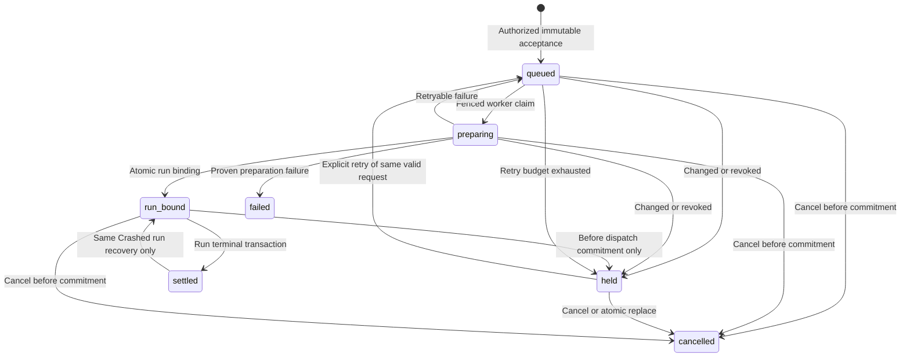
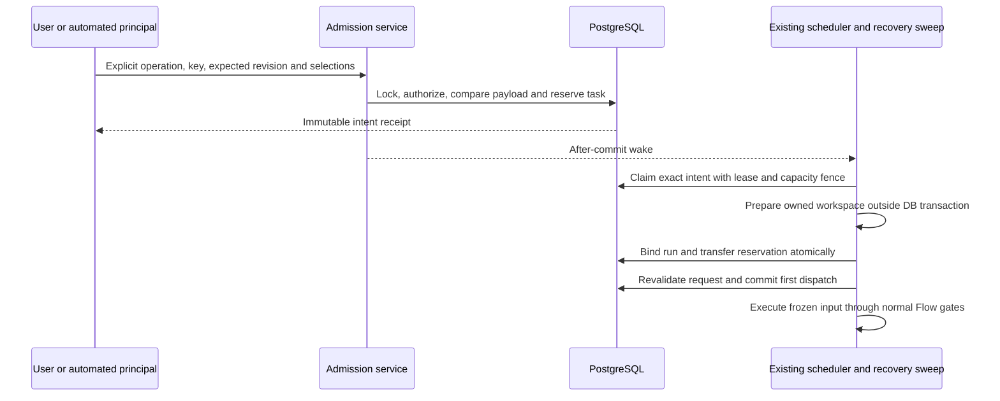

# Task launch admission

## Purpose

**Designed — ADR-200.** Own explicit execution authority for a task revision, separately from its qualification assessment. Qualification remains the automatic root decision; a session-authenticated human Launch is a one-shot manual decision. [Persistence](../db/task-launch-domain.md) defines storage; qualification value/publication remains owned by [task qualification](task-qualification.md).

## Domain entities

- Task semantic input, settings resolution and optimistic task revision.
- Immutable launch intent, principal, admission basis and request digest.
- Ordinary task reservation, fenced preparation lease and write-once run binding.
- First-dispatch commitment, execution input snapshot and successor lineage.
- Existing assessment, execution parent, scheduler slot and Flow gates.

Delivery targets are explicitly discriminated: `flow` freezes Flow/package revision and runner slots; task-bound `code_delivery` agents freeze the agent ID, validated definition digest/package identity and runner slots. Operational agents use their existing preparation contract and never borrow task-delivery admission. Agent targets use null Flow IDs in the shared receipt, plus their real agent ID; they never fabricate a Flow identity. Existing agent-launch endpoints construct the same server admission request from their authenticated principal and path target. The task-launch endpoint remains the configured Flow selection surface.

A Flow uses a worktree and immutable base commit. An agent freezes its declared/effective workspace axis. A manual `workspace=none` agent may have a null base commit; admitting it must not introduce a Git prerequisite or invent a SHA. Repository-backed targets retain their existing commit and isolation checks, and automatic roots retain accepted qualification evidence even when their agent needs no repository workspace.

## State machine

Intent lifecycle is independent of existing run status. A bound held intent retains its run identity.

## Process flows

Acceptance persists authority before a worker performs Git/host effects.

### Authority matrix

| Operation                    | Admission                                                                                                       | Lifetime                                                         |
| ---------------------------- | --------------------------------------------------------------------------------------------------------------- | ---------------------------------------------------------------- |
| Configuration save           | Current edit permission                                                                                         | No run, manual grant or new auto arm.                            |
| Human Launch                 | Active session, live project `launchRun`, required policy grants                                                | One immutable request and bound run; no assessment writes.       |
| Bearer/API/MCP/schedule root | Current accepted `ready`, exact semantic input/evidence SHA, allowed automation intent and live principal scope | One request; legacy task mode is not an exception.               |
| Agent-created child          | Current parent admission, plan revision, relation and child digest                                              | Parent execution only; never C2 or transferable human authority. |
| Same-run resume/rework       | Original run admission/input, current continuation permissions and technical fences                             | Existing run only.                                               |
| Successor retry              | Fresh explicit human intent or current automatic admission and retry policy                                     | New linked intent/run.                                           |

Only the interactive session boundary constructs a manual principal. Body `manual`, actor, trigger source, arbitrary intent ID, PAT owner or Librarian owner does not prove a human decision. External callers use automatic/parent admission; no transferable approval capability is introduced.

### Request and mutation rules

- Acceptance snapshots task title/prompt, statement/source identity and relevant clarifications; semantic/settings digest versions; resolved Flow/package revision or agent definition identity, runner slots/model/profile/capabilities, base commit/target, delivery/execution/promotion policy. Runner provenance excludes environment and provider credential values; a private configuration digest binds the server-resolved executable profile, which must still match at dispatch. No credential values enter the intent receipt. `tasks.revision` guards acceptance, while semantic/settings digests govern dispatch freshness.
- Same principal/project/operation/key and identical canonical payload returns the original receipt after current access checks. A changed payload under the key conflicts without mutation. Different keys compete under one ordinary task reservation; losing manual settings are not silently replaced by automatic work. Existing nonterminal v1 delivery runs participate in that fence too.
- Description, blocking clarification or selected execution-setting changes before commitment hold the old request. Atomic replace cancels it and accepts a newly authorized successor. Priority/comments or assessment-pointer-only changes do not invalidate a manual request. A concurrently published assessment retains routing as a proposal if applying it would overwrite pending manual selections.
- Mutable defaults cannot change the accepted resolution. Manual base movement retains the selected immutable commit; automatic launch additionally rechecks current evidence SHA. Disabled/untrusted/incompatible/unavailable resources refuse or hold under typed reasons; no silent runner/Flow substitution.
- `triageStatus=flagged` and absent/stale/negative/source-failed assessment are advisory to manual Launch. `queuePaused`, actual relation/clarification blockers and technical gates retain their effect. Explicit unpause remains required. Launch never clears findings or sets auto intent.
- Before-commit cancel/replacement races use run/assignment/intent/task fences; an execution commitment winner causes 409. Bound never-dispatched cancellation uses existing terminal owner and owned cleanup. Post-commit stopping uses existing Stop.
- Terminal settlement frees the reservation. Same-run `Crashed` recovery may reacquire it only if no newer ordinary owner exists and original input is recoverable. Done/Failed/Abandoned do not gain a resume path. A new successor needs new authority.

### Queue, effects and recovery

Intent reservation is not execution capacity. A held intent retains task reservation but consumes no slot. Automatic intents retain reserve/per-project/retry/qualification policy even when ordered in C1; ordering never changes authority. Counters include token-owned preparation reservations exactly once until run handoff. Existing root/child/pool limits remain enforced.

`launch-dispatch` is a bounded reconciler invoked after acceptance, by slot-free dispatch and existing `system_sweep`; no new timer or filesystem watcher. Index `(state,due_at,id)`, keyset progress and classified retry attempts prevent poison/held rows starving later work. Capacity and host-pressure waits do not consume genuine failure budget or prove task failure.

Commit intent/snapshot/audit/outbox together. Git/host effects occur outside SQL transactions. Bind run, intent link, task status and slot handoff atomically. Persist the first-dispatch commitment under current ownership before executable effects; an earlier edit holds, a later edit affects future requests. Unknown create/prompt effects join existing command receipts instead of redispatching. Every execution reader, including restart and terminal delivery, reads frozen input/settings.

### Compatibility and external surface

New intent APIs return a versioned receipt with nullable runId and Location. Existing run APIs retain run-bound success schemas. Idempotency-Key is mandatory for new launch mutations; absent keys refuse before writes. Bounded compatibility waits may return typed `launch_pending` with `accepted:true`, intentId and Location, distinct from no-acceptance failure. UI preserves key and resumes the accepted receipt after disconnect. Existing attention ticks invalidate authorized intent state before a run exists; GET has no recovery side effects.

No historic assessment/run receipt is rewritten. Writer floor fences v2 and intent-owned legacy tasks. `taskAdmissionCheckedAt` alone is not evidence that execution started or inputs were frozen. Queued/checked-but-undispatched v1 requests lacking immutable evidence are held; a live session is not killed to repair metadata, but an unreconstructible later prompt/resume is refused. Explicit legacy qualification opt-in preserves old receipts and enables future automatic qualification.

## Expectations

- LA01/LA02: the trusted admission service and v2 insert guard admit one-shot manual work independently of assessment, without changing assessments or arming automation; qualification-admission and intent integration own the checks.
- LA03: automatic selector and dispatch guards require current accepted readiness and exact evidence, including legacy roots; scheduler integration covers opt-in, publication and competing manual routing.
- LA04/LA05: immutable snapshot guards and frozen reader paths preserve selected/executed input and settings across queue/edit/resume; queued-dispatch integration proves both edit orderings.
- LA06: request-key content comparison, task/run locks and partial unique reservation constraints prevent duplicates and silent substitution; real two-connection contenders prove winner/loser behavior.
- LA07: auth adapters derive principal/project/scope and recheck current permission on dispatch/replay; route integration includes permitted callers and forged/cross-project/revoked callers.
- LA08: retry/recover/parent proof services keep successor and continuation authority distinct; their integration suites assert exact original lineage/input.
- LA09: scheduler lock, origin-aware counters and indexed bounded recovery preserve capacity and progress; system-sweep integration includes held first-page work and slot release.
- LA10/LA11: shared readiness projection and optional evidence selectors expose accessible EN/RU manual action and complete structured findings without requiring user IDs/codes/SHAs; browser journeys verify the actual controls.
- LA12/LA14: unchanged technical and Flow gates remain on the action path; launch/gate and provider-boundary journeys prove PR settings without a qualification form.
- LA13: strict OpenAPI/MCP DTOs, explicit async resource and existing attention invalidation preserve truthful acceptance/status/cancel/replace/replay; real response and built stdio parity tests enforce the contract.
- DB01: versioned schema/writer guards and populated-upgrade integration preserve immutable v1 history and refuse malformed, foreign, duplicated or incompatible v2 writes.

## Edge cases

- Request/key/stateVersion changed: `CONFLICT`, no hidden update; held request includes actionable changed field categories.
- Revoked permission/project archived/independent blockers: existing `UNAUTHORIZED`/`PRECONDITION`; no launch grant from stored actor alone.
- Accepted work outlives response: retain receipt and recover through original key; no second run from browser retry.
- Before-model infrastructure failure: retain safe primary cause, not a negative assessment; operational completion/publication integrity remains independent.
- Unknown old input or physical ownership: explicit compatibility hold; never infer success from missing metadata.

## Linked artifacts

- [ADR-200](../decisions/adr-200.md), [persistence](../db/task-launch-domain.md), [preparation](agent-preparation.md).
- [Web API](../api/web.openapi.yaml), [external API](../api/external/operations.openapi.yaml), [attention](../api/async/attention-stream.asyncapi.yaml).
- Execution plan: `.ai-factory/plans/codex-manual-launch-triager-reliability.md`; primary tests and RED/GREEN evidence are recorded there.

## Acceptance and queued-edit implementation boundary

The session adapter constructs an opaque interactive principal; accepting a
client actor/source/manual flag cannot construct it. The domain operation checks
current DB grants, freezes a canonical semantic input and credential-free resolved
settings, and inserts the intent plus content-free invalidation in one transaction.
Configuration selections for Flow, runner and branches advance the saved task
revision in that transaction; run-only delivery/execution/promotion selections
remain in the frozen intent. Replay precedes current-revision checks after access
checks, so a lost response returns its original request even after later edits.
The scoped key lock and ordinary task reservation serialize acceptance; conflicting
payloads or a different live reservation produce a typed conflict.

Queued task editing shares the reservation lock, then locks bound runs, intents
and the task. Its hold and edit commit together. Semantic input and saved settings
are compared independently of priority/status and qualification counters. An edit
holds an undispatched request with `launch_input_changed`, `launch_settings_changed`
or `queue_paused`, preserves its original snapshot, and emits no source content.
A held reservation continues to occupy the ordinary task slot until the user
cancels or explicitly replaces it. Dispatched runs retain their frozen request.

The session HTTP cancellation and replacement adapters enforce the same origin,
opaque principal and live grants as acceptance. Metadata, cancellation and
replacement use one existence-hiding scoped lookup. Cancellation records a scoped,
immutable receipt; exact replay rechecks current access before returning the
original version. Replacement cancels the old request and accepts a uniquely
linked successor in one transaction; validation failure rolls both back. Its key
belongs to the successor's replacement operation, independently of cancellation
keys. A bound Pending cancellation uses the existing database terminal owner,
releases its assignment and arms workspace cleanup in that transaction. Physical
cleanup occurs after commitment through existing cleanup owners. Dispatch
commitment or any execution command/session witness refuses cancellation.

Read scope remains independent of launch availability: archiving a project
preserves authorized receipt inspection. A caller without task/intent visibility
receives the same not-found response as an unknown selector. Cancellation remains
available during upgrade maintenance; replacement admits new work and stays
fenced. Git preflight completes before replacement's SQL transaction. Application
then acquires the scoped key and task reservation before run, assignment, intent
and task rows; no key is acquired after the reservation. A cancellation that wins
during preflight prevents the prepared replacement from committing.

## Automated adapter contract (Designed)

The internal constructor/admission and SQL origin guard are implemented. External
HTTP/MCP, schedule/child adapters and dispatch consumption remain designed; their
existing launch paths have not yet been cut over by this checkpoint.

The bearer constructor verifies the presented secret through the existing token
verifier and returns an opaque server principal. Only its durable token identity
and credential-free origin enter the intent: token kind, original project scope,
owner, agent, bound run and Librarian turn. Acceptance and dispatch re-read those
bindings, current scopes, expiry/revocation, active owner/project grants and live
turn/parent state. Identity drift refuses; attribution to a user never becomes a
session decision. A project token without a privileged user grant cannot authorize
an elevated unattended policy; no silent policy downgrade or new implicit token
scope is introduced.

Bearer root requests require `runs:launch`, a current accepted ready assessment
and the task's explicit automatic-launch intent. A parent-bound execution child
uses the existing delegation scope/proof instead. Cancelling accepted work does
not require a new positive assessment or auto arm; it requires current scoped
write authority. Replacement creates new work and must independently satisfy its
current automatic/child admission. A copied manual intent ID never supplies that
basis. Metadata uses `runs:read`; source-bearing operations retain their existing
separate permissions.

| Existing producer | Required authority at the common admission boundary |
| --- | --- |
| `app/api/runs/route.ts` and staged response | Opaque interactive session for an explicit request; preserve run-bound compatibility responses and request keys. |
| `app/api/v1/ext/runs/route.ts`, MCP HTTP client | Verified token; automatic root admission, existing external idempotency/audit and Librarian operation receipts. |
| `app/api/v1/ext/runs/delegate/route.ts`, `runs/plan/route.ts` | Server-derived live bound parent, plan/relation/child digest; no body parent authority. |
| `scheduler.ts`, `scheduler/handlers/flow-run.ts`, auto-triage handler | System automatic principal; accepted qualification and independent auto arm. |
| `scheduled-launches/service.ts`, `run-schedules/dispatch.ts` | Existing durable scheduled occurrence/settings plus automatic root admission; no inherited human decision. |
| `evaluations/launch-seam.ts`, evaluator agent launch | Existing controlled recipe/judge ownership and technical gates; independent task roots qualify, derived children use parent proof. |
| `services/hitl.ts` successor launch | Carry authenticated decision authority from its route and create fresh retry lineage; same-run continuation retains its original admission. |
| `agents/launch.ts`, project agent launch/event routes | Task-bound code delivery derives session, automation or parent authority from its entry point; operational agents retain their own preparation contract. |
| `agents/retry.ts` | Operational retry policy remains separate; a code-delivery successor earns fresh task admission rather than borrowing a source run's manual grant. |
