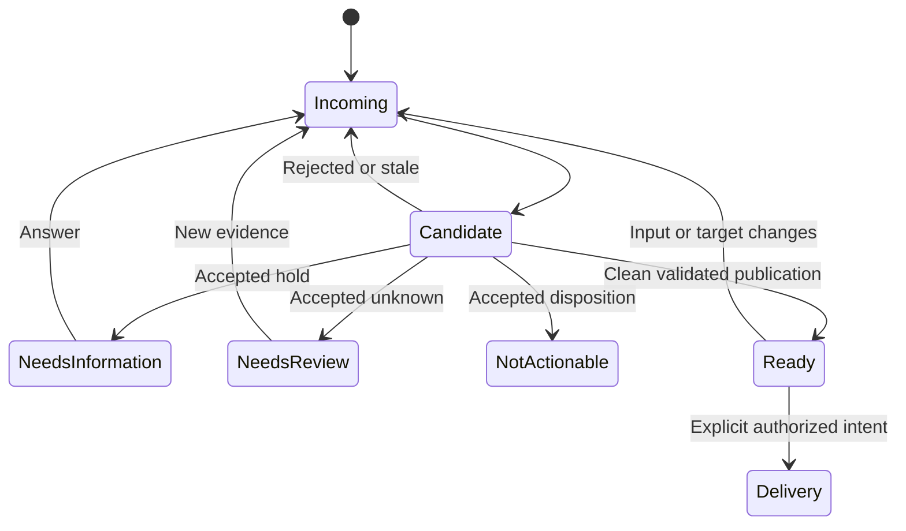
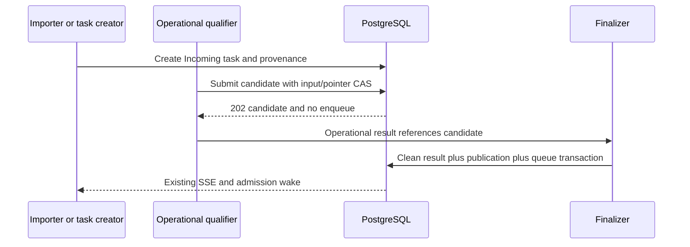

# Incoming request qualification

**Designed — ADR-196–198.**

## Purpose

Qualify independent incoming requests before accepted backlog or delivery execution, with versioned evidence, human clarification and authoritative admission.

## Domain entities

- Incoming task, policy and server-owned input revision.
- Immutable assessment candidate and publication receipt.
- Frozen repository evidence and delivery admission; [schema](../db/task-qualification-domain.md).
- Existing task Human ask, parent execution plan and operational result.

## State machine

The state boundary distinguishes current execution from retained evidence.

## Process flows

The owning transaction commits durable state before its wake-up signal.

### Contract 10

Verified package owner: `/Users/kaa/Work/dev/github/maister-plugins`, main
`0bab5fa5bd41ff825e160ed5a998412c2537c29e` during investigation. Original intake
changes also exist on local branch `codex/operational-agent-kind` at
`fc24713c00558bf2aa72195c22c8433c42d6e21c`; continue that authorized package work
rather than overwriting main or dropping the intake changes. Reverify both before
editing. Platform fixture is
`web/lib/agents/__tests__/fixtures/core-package/maister-agents/triager.md`.

`packages/core/maister-agents/triager.md` currently declares none/session/read_only
and manual/domain-event triggers, without kind/completion/Flow. It performs MAIster
operations: relation/comment/flag creation, clarification, triage verdict and
enqueue intent; it forbids direct Flow launch. No separate triage skill is referenced.
Use `kind: operational` + `completion.contract: operational_v1`, preserving permission governance, trigger bindings and downstream Flow dispatch.
UX-D11 deliberately extends its workspace/configuration semantics for qualification;
that extension requires its own engine capability floor, not an agent-ID exception.

This is a prompt/protocol migration, not just frontmatter. Current prompt lines
135–158 request `reTriggerMode: triage` and assume terminalization followed by a
fresh run. Operational clarification must use the existing `agent` continuation
mode: ask → park → human answer → **same run** resume → reread confirmed task
clarifications → continue. Do not emit final success while parked. Keep explicit
`task.triage_requeued` binding for deliberate requeue only. Verify no duplicate spawn
from answer events (`agent-question.ts:471-486`, `hitl.ts` requeue branch and
`triggers.ts:580-587`). Max-round behavior and human-triage flag remain intact.

Define one work item as the triggering task, not each MCP call. Confirmed verdict,
confirmed duplicate/human-triage flag and an already-flagged no-op are valid success
with zero created tasks. Failure to persist a required mutation is failed/blocked;
confirmed earlier relations/comments plus an incomplete remaining operation can be
partial. Respect strict count equations, confirmed/unresolved references and fixed
operational-v1 top-level fields; do not add verdict/flowId/enqueue/needs_human fields.
Absent/malformed result fails, never inferred from prose. Package update affects
new launches only; historical legacy triagers retain old completion semantics and
are covered by UX-D08's generic failure projection.

Update the canonical package, README/compatibility/release notes, platform fixture
and synthesized fixture manifest floors in triager package/wire suites together.
UX-D11 adds shared qualification guidance to triager and both GitHub intake
variants. Linked-PR filtering, credentials and automatic failover remain outside scope. Qualify exact
package revision through normal install/trust/attach/launch, not only fixture parse.
Platform (including same-run continuation and new surfaces) first, then the updated
core release and explicit attachment pin upgrades. No tag/push/publication in the
implementation session without separate authorization.

### Contract 11

**Verified gap:** `plugins:packages/core/maister-agents/triager.md:65-79,126-168`
permits no repository access and asks mainly when routing is unclear;
`triage_only` deliberately postpones detail. Neither contradictions nor current
implementation/bug validity are mandatory checks. Both GitHub variants use
`packages/core/capability/skills/github-issue-intake/SKILL.md:85-102,134-148`, which
carries unanswered questions into `task_create`. `services/tasks.ts:170-192,270-275`
creates Backlog before `task.created`; `work/stage.ts:90-123,200` calls untriaged
work Triage but includes it in backlog. `services/triage.ts:187-225` stores routing,
not a validated qualification; confidence is advisory. This is an explicitly
requested expansion of intake scope, not a claim current prompts enforce it.

**Carrier and product boundary.** Reuse the task row, source identity, comments,
clarifications and task activity as the durable intake carrier. Add **Incoming
requests / Входящие задачи** as a distinct project view/read-model partition,
separate from accepted Backlog and the user's personal Inbox. No second issue store
or new TaskStatus/RunStatus. On projects with the new qualification policy enabled,
all newly created independent requests (UI, GitHub, MCP/API, librarian and
ordinary agent `task_create` requests)
start unqualified in Incoming; supplying a Flow does not bypass this. A persisted
KEY-N intake record is not accepted backlog work. The importer records source and
imports into Incoming; the triager qualifies once before accepting it. This meets
the product boundary without duplicating semantic judgments in each transport.

Use a project-owned versioned `taskQualificationPolicy` (`legacy | required`),
configured through existing project settings/config contracts with `editSettings`.
Existing projects/tasks migrate as explicit legacy, not fabricated qualified.
New projects default required; upgrading the core intake/triager attachment requires
required policy through the normal explicit project configuration change. Package
activation refuses incompatible policy with a remedy; the agent cannot enable it.
Existing in-flight/review work continues. An explicit existing-task requalification
opts that task in; once required, disabling project policy does not silently waive
its hold. No agent-ID special case: package capability requirements declare this
boundary. Existing generic code-delivery fixtures remain legacy unless testing the
new policy. This versioned cutover must be visible in settings and release docs.

**One quality contract, separate from execution outcome.** Add immutable,
versioned `task_qualifications` revisions and a task's current qualification pointer
plus server-owned qualification-input revision. The record contains task/project,
policy version, input revision/digest, author/run, evaluated repository target/SHA,
structured check results, evidence references, decision, reason codes and specific
next actions. Strict schema with bounded collections/text; no arbitrary dynamic
keys or credentials. Reuse statement concepts (`tasks/statement.ts:21-32`) rather
than a parallel freeform specification: context/goal/acceptance/constraints/scope/
links/open questions. Do not require librarian conversation ownership for ordinary
tasks; `statementRevision` alone is not a universal freshness token.

Required checks: clear goal and scope; sufficient acceptance criteria; internal
consistency; relevant constraints/dependencies; strong duplicates; current relevance.
Bug checks include expected vs actual behavior, environment/version, credible
reproduction or observed evidence and why behavior violates the intended contract.
Feature checks compare requested behavior with current implementation/docs/tests.
No mandatory ceremonial template for a small clear task. The strict value includes `requestType: bug | feature | maintenance | question`.
All seven dimensions occur exactly once. Only `bug_evidence` may be N/A, and
only for a non-bug request with an explicit rationale. Each check is
`pass | fail | unknown | not_applicable` with rationale and evidence; N/A requires
a justified request-type rule, not an escape from relevance. Decisions:

| Decision            | Meaning / product result                                                                                                                                                                                               |
| ------------------- | ---------------------------------------------------------------------------------------------------------------------------------------------------------------------------------------------------------------------- |
| `ready`             | All applicable blocking checks pass, no blocking contradiction/question; accepted backlog. Routing and launch intent still govern execution.                                                                           |
| `needs_information` | Missing requester facts or contradictory requirements; stay Incoming and use existing task Human ask.                                                                                                                  |
| `needs_review`      | Evidence inaccessible, insufficient, stale or uncertain; stay Incoming with explicit evidence gap and human/technical verification action.                                                                             |
| `not_actionable`    | Evidence supports duplicate, already satisfied, obsolete or invalid request; stay in Incoming's resolved/held filter with reason and evidence. No automatic deletion, GitHub closure or irreversible task abandonment. |

Task rejection/needs-information can be a **successful operational run**: the agent
completed qualification correctly. Provider/auth/tool/persistence failure is an
operational failure, leaves the task unaccepted and uses grouped agent attention.
Do not add these decisions as fields/statuses to fixed `operational_v1`; its
references point to the task/qualification record. Import success means captured
in Incoming, never “accepted for implementation”; UI counters distinguish these.

**Evidence capability.** Change the upgraded triager to operational `repo_read`
with a disposable detached checkout of a **server-resolved task target/project
default commit**, using the existing read-only checkout/integrity/cleanup owners.
Add explicit `workspace_ref: task_target` resolution, authorized only for a bound
project task, with target derived from server configuration, never issue text.
Current `workspace_ref: trigger` only accepts webhook/run.* sources
(`agents/launch.ts:747-823`), so it cannot be reused unchanged for task.created.
Freeze resolved SHA and target at launch, including recovery; do not inspect a
mutable dirty developer checkout. Keep read-only tools, permissions and isolation;
no implicit shell or automatic approvals. Qualify actual runner file-read support.
Brain recall, when authorized, is supporting context with provenance, not proof of
current code. Read-only inspection may support relevance but must never be labeled
“bug reproduced.” Runtime reproduction needed beyond read-only inspection requires human-supplied
evidence in this release (which may reference a separately authorized existing
run). Do not launch a diagnostic task Flow from held intake: it would require a
separate evidence-only execution contract. Never execute issue-supplied commands
automatically. Insufficient runtime evidence remains unknown/needs_review,
not “invalid bug.” A good specification can therefore remain held for verification.

The task's current qualification pointer means **accepted** publication only.
A separate nullable latest candidate in read DTOs shows pending work without
confusing expectedQualificationRevision with a candidate revision. Allocate each
assessment revision from a task-locked high-water counter; input revision, current
accepted revision and candidate revision are distinct. A candidate records its
expected accepted pointer and uses it at terminal publication. Published content
is immutable; only its publication receipt changes candidate→accepted/rejected.
Human submission uses the same counter and pointer CAS. All constraints and states
are included in [qualification persistence](../db/task-qualification-domain.md).

**Freshness and launch enforcement.** Bind assessment to title/prompt/accepted
statement, source version, target and answered blocking clarifications through one
server-owned input revision/digest. Inventory every writer: UI/ext/MCP/librarian
updates, source refresh, clarification answer, target changes and explicit requeue.
Advance this revision and invalidate the active qualification transactionally;
ordinary comments/priority/queue pauses do not invalidate unless explicitly adopted
as requirements. A comment is discussion, not a silent amendment. Qualification
and verdict writes never invalidate their own input. Historical records remain
immutable. Explicit task requeue invalidates readiness and clears old enqueue;
answering a question resumes the same agent with freshly loaded input.

Extend existing `triage_set` transaction with a typed qualification, expected input
revision and expected current qualification revision/pointer (null for first write).
Lock the task and CAS both: a late agent assessment must not overwrite a newer
human needs_review/not_actionable decision on unchanged input. Request-key replay
returns the original receipt; it never reapplies an obsolete assessment. For required tasks, only a current `ready` receipt can stamp launchable
routing/arm enqueue. Human/project-token assessments authorized as a human may publish qualification,
verdict/hold, enqueue intent, audit and event atomically. Agent-authored assessment
submission instead persists a **candidate** and proposed routing/enqueue, returning
202; it cannot make the task ready or arm its queue while its evidence run is still
executing. Current `services/triage.ts:187-225` arms immediately, before
`agents/finalization.ts:609-705` validates result/integrity; preserve that legacy
behavior only for legacy tasks, not required qualification.

Keep immutable assessment content separate from its publication receipt
`candidate | accepted | rejected`; rejected here means unsafe/stale publication,
not the task decision `not_actionable`. A qualifier launch freezes the bound task and its qualification obligation from
the declared role, independently of operational_v1. A valid operational result with
no candidate is not sufficient: allow a no-op only when canonical current task
state proves a previously accepted assessment or an explicit human-owned hold;
otherwise finalize blocked/failed with `qualification_missing`. An intake-role run
has no per-task assessment obligation. No agent-ID inference. One candidate per
task/run/input revision,
request-key/payload replay and expected current-pointer CAS are mandatory. The
existing agent finalizer publishes a candidate only in the same transaction as its
canonical valid, clean successful operational result. Bind run/task/author and
repository SHA from token/snapshot, never client-supplied IDs; the final result must
reference the submitted qualification receipt. Failure, cancellation, missing or
malformed result, unexpected source changes, stale input/pointer or revoked scope
reject publication and leave the task held, with exact evidence/reason. A source
run that cannot publish its proposed qualification must not claim that operation
succeeded; terminalization maps it to the existing blocked/failed contract. Preserve the
reported result separately from the effective publication failure; do not rewrite
agent counts or turn a stored candidate into proof of accepted work. No
second asynchronous finalizer and no publication from an unowned sweep. Recovery
replays the existing finalizer transaction; duplicates never arm twice. Human
assessments supersede candidates via pointer CAS, so late completion cannot undo
them. A held assessment or normal clarification can be a clean successful outcome;
question creation itself continues through existing same-run HITL.

Inventory locks before implementation: candidate submit/finalizer acquire source
run then task, then incident advisory/episode locks where required; human task-only
writers never acquire a run lock afterward. No external calls while holding them.
Update conflicting existing owners together and test actual barriers. Stale writes
return CONFLICT without partial mutation. Legacy
callers can flag/ask but cannot ready a required task without the contract. Existing
`auto_enqueue=always` and `triage_only` may not bypass quality; always means enqueue
only after qualification, and triage_only holds unclear requests without asking.
A ready task without a Flow remains unconfigured; ready with enqueue off stays
accepted Backlog; dependencies and permissions still gate work. Human correction or
assessment uses the same revisioned contract with existing task-edit/triage authority,
explicit rationale/evidence and audit; no generic force/checkbox bypass.

Enforce the same predicate in manual, force, scheduler, schedule, external/MCP and
agent-driven task Flow and task-bound code-delivery agent launch paths before
allocation and again in the task-lock
admission transaction. Task-bound operational qualification/inspection agents must
remain able to inspect held intake; distinguish operation purpose from delivering
the task, without an agent-ID exception or an operational agent bypass into Flow
launch. Existing task-scope permissions still apply. Pending work must recheck before dispatch; stale pending
admission settles through its existing owner without dispatch. Running/review work
is not silently canceled by an edit; expose new-input drift for ordinary rework.
Repo evidence is scoped to the checked target/SHA. Before accepting readiness and
before starting work, resolve the intended base outside the DB transaction and pin
allocation to that exact checked SHA; if it differs from assessment, hold/requalify.
No mutable branch-name checkout after the check. This is local registered-repository
revision evidence, not a claim of remote freshness. No per-commit event storm: stale
is detected at decision/admission or explicit requalification, using existing event
ownership; user-facing status must indicate when evidence needs rechecking.

Each newly admitted delivery run freezes `taskAdmissionSnapshot` (version, admission
mode, policy/input/qualification revisions, evidence SHA/target and parent receipt
when inherited). Pending dispatch checks current task authority/freshness against
this snapshot; an already-running run keeps its original receipt. Task content
changes do not rewrite a historical admission. Store this on runs under immutable
schema guards; it is not inferred later from current task state.

**Existing orchestrator decomposition.** Internal execution-plan carriers are not
independent intake requests. Preserve `run_plan`/task-mode `run_delegate` under an
already admitted governed parent using an explicit server-owned qualification
provenance `execution_child`: parent run/task, its frozen admission receipt (or
explicit legacy admission), plan revision, child input digest and relation. Derive
this only inside the existing bound-parent-token transaction after parent activity,
project, delegation scope and child target checks; never accept a client field or
infer it from any `parent_of` relation. This authorizes work under the already
admitted parent contract, not a claim the child has passed independent triage. Keep
these carriers in the existing execution-plan view rather than Incoming/accepted
backlog. Ordinary `task_create` cannot obtain this exemption. A stopped/revoked
parent cannot launch new children. Independent reuse, detachment or edits outside
the owning plan invalidate inherited admission and require normal qualification;
no permanent reusable pass. Existing parent/child constraints, requires edges and
cascade/cancel ownership remain authoritative. If a required parent lacks a valid
admission receipt, reject the plan/delegation before carrier creation, with a typed
prequalification remedy; do not create and immediately abandon an entire DAG via
existing launch-refusal compensation (`ext/runs/plan/route.ts:627-650`,
`delegate/route.ts:66-90`). No new durable parent waiting protocol is introduced.
Prove this narrow exception at real plan/delegate boundaries; legacy and previously
admitted code-delivery orchestrators retain their governed decomposition behavior.

**Importer and UX.** Both transports use one shared qualification guidance skill
with the triager. Importer handles source scope, provenance, identity and basic
structure; it neither invents missing facts nor repeats repository assessment.
Keep the original body and explicit gaps. Repeated scans link the same existing
source/task and do not issue repeated questions. Where existing source refresh is
available, a changed source version invalidates qualification atomically; otherwise
show that the recorded source is a snapshot and require explicit refresh. Do not
claim silent external synchronization. Additional GitHub qualification/clarification comments, labels or closure remain
excluded, as do credential changes and linked-PR filtering. Preserve the original
importer pending/completion receipt comments and their existing authorization;
this scope adds no new external message type. Clarification occurs
in MAIster using the durable task carrier, not an unauthorized GitHub mutation.
Board/work-table/project/portfolio use the same Incoming-vs-accepted predicates,
including aggregate counts (current portfolio counts every Backlog row at
`queries/portfolio.ts:404`). Incoming has URL filters/counts for unassessed/needs info/needs review/not actionable,
links to source/assessment/run, specific fix actions and a separate accepted backlog
count. Task detail shows evidence SHA, freshness and route/launch intent separately.
EN/RU copy must distinguish “request already satisfied” from “runner failed.”

**Contracts, migration and compatibility.** Add additive task fields/policy and
qualification ledger, unique `(taskId, inputRevision, requestKey)` idempotency with
payload-conflict rejection, same-project FK/pointer validation, writer CAS and
bounded latest/history indexes, including immutable server-owned execution-child
provenance and current-assessment pointer CAS. Proposed migration 0207 after activity/retry/trigger attempts;
recheck names at T01. No history rewritten to pass. Protect qualification evidence
under existing task/run retention and grants, with tombstones for unavailable
references. Extend task/triage REST DTOs, ext OpenAPI, MCP `task_get/list/create` and
`triage_set`, board/work-stage projections, project config import/export and SSE
invalidation atomically with the policy. Use existing 403/404/409/422 semantics;
preserve the existing triage route
422 CONFIG validation contract (including invalid JSON/body), rather than changing
it to 400. New routes use their explicitly specified validation statuses;
version/capability incompatibility is an explicit precondition.
A reader cannot infer permission from an evidence URL. Specs must enumerate the
request/response fields, identifier trust, size bounds and all admission writers.
Add a named engine capability/floor for task qualification and `task_target`; reserve
3.10.0 only after checking the integration version registry. The core upgrade must
require the new capability; 3.9.0 remains sufficient only for original operational
completion. Platform/schema/MCP/UI first, then qualified core, policy configuration
and attachment upgrade; rollback keeps required tasks held rather than allowing an
older writer to launch them. Stop incompatible old writers at the maintenance gate.

## Expectations

- **UX-10:** triager verdict, flagged no-op and human escalation complete as valid operational outcomes; authorization/partial/malformed-result failures are visible as failures; human answer resumes one run, explicit requeue remains distinct, downstream Flow runner choice remains distinct, qualification additionally gates launch under UX-D11, and pre-update runs keep their snapshots. Both original GitHub intake adopters remain qualified. Enforced by the owning services/constraints below and primary acceptance in [traceability](agent-activity-traceability.md).
- **UX-11:** unclear/contradictory/unverified or evidence-backed non-actionable requests from both GitHub variants and ordinary creation stay Incoming, out of accepted backlog and every delivery execution path; the read-only operational qualifier remains allowed to examine held intake. A current, evidenced ready decision admits exactly the existing task; launch still follows explicit intent/routing. Unknown is never converted into a false rejection. Missing/malformed assessments cannot admit work. Changes invalidate stale qualification; source/decision history and legacy active code work remain intact. Enforced by the owning services/constraints below and primary acceptance in [traceability](agent-activity-traceability.md).

## Edge cases

- **EDGE-UX-16:** AC10: real core parser/install/attach snapshots, verdict + enqueue, duplicate/human flag and flagged no-op, blocked/partial/missing/malformed result The owner returns typed `MaisterError` CONFIG/PRECONDITION/CONFLICT/UNAUTHORIZED or records a canonical operational failure; no silent fallback. Primary `IT-UX-16` (plan alias `UX-IT16`).
- **EDGE-UX-17:** AC10: ask→park→answer→same-run continuation, no task.triage_requeued duplicate; explicit requeue still launches once; old code-delivery source and task Flow runner unchanged The owner returns typed `MaisterError` CONFIG/PRECONDITION/CONFLICT/UNAUTHORIZED or records a canonical operational failure; no silent fallback. Primary `IT-UX-17` (plan alias `UX-IT17`).
- **EDGE-UX-18:** AC11: legacy/required project and task migration, input revision writers, idempotency/CAS, qualification pointer/policy constraints, no fabricated legacy pass, no source mutation The owner returns typed `MaisterError` CONFIG/PRECONDITION/CONFLICT/UNAUTHORIZED or records a canonical operational failure; no silent fallback. Primary `IT-UX-18` (plan alias `UX-IT18`).
- **EDGE-UX-19:** AC11: valid/unclear/contradictory/duplicate/already-satisfied/unknown bug, malformed bodies and exact HTTP/Zod/OpenAPI/MCP parity; actor and evidence grants; stale task/answer/SHA, same-input human-vs-agent assessment CAS, real run_plan/delegate inherited admission vs forged/invalid parent and no abandoned DAG, concurrent triage, exact checkout, every manual/force/schedule/MCP/admission path and stale Pending dispatch The owner returns typed `MaisterError` CONFIG/PRECONDITION/CONFLICT/UNAUTHORIZED or records a canonical operational failure; no silent fallback. Primary `IT-UX-19` (plan alias `UX-IT19`).
- **EDGE-UX-20:** AC11: both import transports capture Incoming with provenance, no-repeat import/questions, one shared qualification skill; capability/policy refusal; normal flag/clarification vs runner failure; exact core snapshots and no automatic GitHub mutation The owner returns typed `MaisterError` CONFIG/PRECONDITION/CONFLICT/UNAUTHORIZED or records a canonical operational failure; no silent fallback. Primary `IT-UX-20` (plan alias `UX-IT20`).
- **EDGE-UX-22:** AC11/10: candidate cannot launch before clean terminal result; valid operational result without required qualification fails; dirty/malformed/cancelled/partial/failed run never publishes; finalizer rollback and recovery replay, same-input human decision wins, accepted queue wakes once, authority loss; no source-body leakage The owner returns typed `MaisterError` CONFIG/PRECONDITION/CONFLICT/UNAUTHORIZED or records a canonical operational failure; no silent fallback. Primary `IT-UX-22` (plan alias `UX-IT22`).
- **EDGE-UX-26:** AC11: GitHub request→Incoming→specific local clarification→candidate still held→clean finalization→accepted Backlog→explicit enqueue; held/obsolete evidence view, stale edit, EN/RU/grants and counts; runner failure separate from request rejection The owner returns typed `MaisterError` CONFIG/PRECONDITION/CONFLICT/UNAUTHORIZED or records a canonical operational failure; no silent fallback. Primary `E2E-UX-04` (plan alias `UX-E2E04`).

## Linked artifacts

- [Traceability](agent-activity-traceability.md)
- [Web API](../api/web.openapi.yaml) and [external API](../api/external/operations.openapi.yaml)
- [Persistence](../db/agent-activity-domain.md) and [qualification persistence](../db/task-qualification-domain.md)
- [Implementation plan](../../.ai-factory/plans/feature-operational-agent-kind.md)

The server registration owner explicitly freezes new projects with a `required`
creation baseline. The additive SQL default remains `legacy` for existing data and
trusted internal legacy fixtures; public task creation cannot override its
project's effective policy. Database input guards cover every semantic task-row
writer, blocking clarification changes and project default-target changes. They
advance the server input revision and clear stale acceptance/enqueue atomically;
ordinary priority/pause edits do not. API and database assessment validation share
the closed seven-dimension vocabulary; publication and active-pointer scope have
deferred transaction constraints.

Held human assessments may explicitly have no repository SHA when evidence is
unavailable; they cannot admit delivery. Ready always requires a verified SHA and
repository evidence linked from the relevance check. An agent assessment binds its
source run's immutable qualifier snapshot and cannot invent a target/SHA from its
request body. New qualifier/intake snapshots are immutable beside task delivery
admission snapshots. Human publication remains separate from agent candidates.

Qualification input reads at most 1,000 blocking clarification records, ordered by
sequence. Exceeding that bound refuses assessment with `qualification_input_limit`;
no truncated evidence digest can be accepted.

Qualification execution boundaries: an explicit requeue under a required project
policy opts an existing legacy request into qualification. Delivery launch stores
the accepted evidence and exact local SHA. The first graph/session dispatch
revalidates that receipt and records `task_admission_checked_at` once; later
semantic edits hold future delivery without changing an already dispatched run.
Governed children inherit their parent's accepted evidence basis. A taskless
legacy parent has no fabricated board relation; a task-bound parent requires its
actual `parent_of` relation, whose deletion invalidates the child's proof.

The database writer floor requires `maister.task_qualification_writer=v1` for
qualification-governed task/run writes. Maintenance remains closed until every
writer supports this capability. Application owners resolve Git before opening
transactions and enforce run → task → credential lock order. Human assessment
writers own only the task and credential locks.
