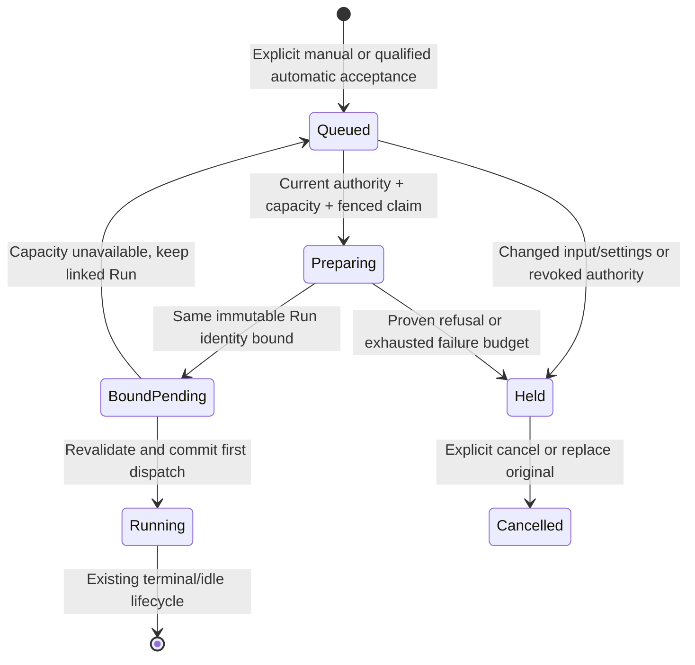
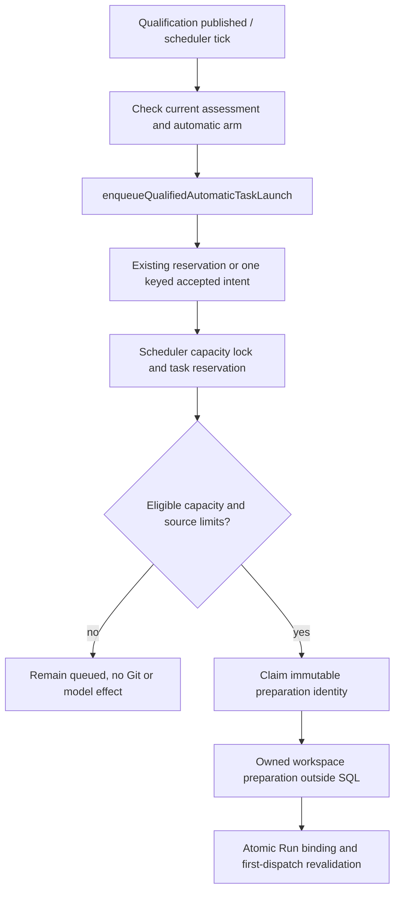

# Task queue (priority-ordered dependency-draining admission)

**Implemented locally — ADR-121/200.** The [launch admission contract](task-launch-admission.md)
owns immutable decisions, manual/automatic authority and compatibility. Final
combined acceptance and deployed qualification remain separate.

## Purpose

Order and bound eligible task execution under existing Flow/agent capacity pools,
parent limits and operator pause. Queue admission consumes an accepted request;
choosing task configuration alone never authorizes execution.

## Domain entities

- **Task priority** — live `low | normal | high | urgent`, ordered by
  `web/lib/tasks/criticality.ts` (`100/200/300/400`); it is not frozen into
  execution authority.
- **Accepted launch intent** — one immutable request, ordinary task reservation,
  due time and preparation ownership. Held requests retain their reservation.
- **Preparation slot** — reserved under the scheduler lock before Git effects;
  transferred to a bound Pending Run and then its Running slot without double count.
- **Automatic task arm** — current accepted Ready assessment plus independent
  `launchMode=auto`, triaged state and compatible launch intent.
- **Queue settings** — project `edgeDrain` / `maxInFlightAuto` overrides and
  configured manual reserve; `triageConfidence` remains advisory.
- **Pause** — `queuePaused` holds new manual/automatic dispatch and automatic
  continuation until explicitly cleared.
- **Resume request** — existing `resumeRequestedAt` FIFO intent for idle work;
  failed-child wake retains its separate owner and cannot answer open HITL.

Persistence is owned by [launch/preparation](../db/task-launch-domain.md) and
[runs](../db/runs-domain.md).

## State machine

Accepted intent state and Run state are distinct; the owning contract carries the
complete state machine. This projection shows queue-to-capacity transfer.

Replacement cancels the original and atomically creates a separately queued
successor; it never changes the original frozen authority.

## Process flows

Qualification publication requests automatic acceptance after commit. The
scheduler and its existing backstop converge on the same durable request.

`promoteNextPending`, `claimTaskLaunchIntent` and `tryStartRun` share the scheduler
capacity lock. `countLiveRuns` includes preparing intents and bound Pending
reservations; the candidate's own reservation is subtracted once. Qualified task
drain also applies manual reserve and per-project automatic share. Explicit
scheduled/evaluation/agent-source operations keep their source limits and global
pool cap; they do not become the C2 task-drain policy merely because their basis
is automatic. Parent-created work additionally uses the existing fanout/depth/tree
budget. [Admission](task-launch-admission.md) owns this source matrix.

The existing `auto-launch-triaged` backstop and `runSystemSweep` reconcile accepted
requests. No client polling or second execution engine is introduced. Priority,
FIFO and relation readiness still select work; acceptance, preparation and model
execution remain different outcomes.

### Autonomous accepted-request service (Implemented)

The [durable launch worker](task-launch-admission.md#durable-launch-worker-implemented)
serves one Flow and one Agent slot under the existing web worker runtime.
Advisory pool wakes and startup/database-deadline reconciliation call the same
shared scheduler; they cannot promote a selected intent ahead of eligible work
or bypass its authority. Expired preparation and bound-but-undispatched requests
remain recoverable without an HTTP callback or cron tick. The existing scheduler
and host backstops retain their responsibilities.

Native restart, browser and full integration qualification remain pending.
Required combined acceptance uses real PostgreSQL/Git fixtures: a busy owned
repository released after acceptance and several rapid acceptances progress without HTTP `after` or
cron; restart discovers expired preparation and bound-undispatched work; blocked
work in either pool does not starve its other eligible candidates or the other
pool. Repeated wakes and competing worker instances preserve one binding and
first dispatch. A no-progress pass waits, and stop admits no new claim while
joining active shared dispatch without an independent lease release. Existing
authorization, cap, retry and fencing assertions remain required.

## Expectations

- **TQ-01:** Ordinary repeated/competing manual and automatic requests cannot
  duplicate delivery, enforced by the task reservation lock, active partial
  unique index and principal/project/operation/key payload comparison.
- **TQ-02:** Capacity includes pre-run preparation and actual execution exactly
  once, enforced by scheduler-lock accounting and first-dispatch transfer.
- **TQ-03:** Automatic task drain requires current accepted qualification and its
  independent arm, enforced by `armedAutomaticTaskLaunchBasis` and frozen
  dispatch checks. A manual decision never arms future revisions.
- **TQ-04:** Input/settings changes before dispatch hold the original request,
  enforced by queued-edit locks and current semantic/settings/runner checks.
- **TQ-05:** Queue pause, blockers, target availability, workspace isolation,
  Flow gates and current authority remain effective, enforced by common admission
  and dispatch paths rather than a button state.
- **TQ-06:** Capacity/ownership contention consumes no genuine failure attempt;
  bounded preparation failures retain their cause, enforced by intent attempts,
  due times and typed hold reasons. Qualification findings are not rewritten.
- **TQ-07:** Historical v1 occupancy, already-running work and continuation remain
  protected. Old incomplete pre-dispatch input is held rather than reconstructed;
  migration guards and the common dispatch reader enforce that compatibility.

- Eligible work uses the shared criticality dictionary and deterministic class/FIFO
  ordering, enforced by `admission-selector.ts` and the scheduler candidate sorter.
  Priority cannot override a blocker, pause, capacity limit or missing authority;
  confidence is read by the Observatory, not routing.
- `edgeDrain=false` disables fresh C2 task-drain selection, while existing Pending
  work and requested idle continuation retain their cap-safe paths. The scheduler,
  `resumeRun` and agent idle-resume checks enforce the same pool cap.
- Gating relation writes cannot create a new cycle, enforced by the relation
  service's transaction/advisory lock and cycle check. Existing mutually blocked
  work remains visible and requires explicit relation repair.

## Edge cases

- Invalid priority/confidence values refuse through the shared field mapper and
  database CHECKs; the configured queue settings are validated independently.
- No free slot: retain the accepted request; a Run may not exist yet. A bound
  Pending Run can return to queued ownership without a new attempt or workspace.
- Parent fanout full: keep the child queued with `launch_parent_capacity_wait`,
  before allocation, without consuming the preparation failure budget.
- Current assessment/evidence stale: automatic launch refuses or holds;
  authorized manual admission remains independent of qualification.
- Lost acceptance response: replay the exact key/body; changing payload with the
  same key conflicts. A receipt is not a successful execution.
- Stale worker, expired lease or restart: re-entry retains the exact allocation;
  current durable claims and physical exclusion prevent unsafe recreation/cleanup.
- Existing `queue_claimed_at` values remain compatibility/reconciliation facts
  for historical C2 owners; they are not a manual grant or an alternative current
  task-launch reservation.

## Linked artifacts

- [Launch admission](task-launch-admission.md), [preparation](agent-preparation.md),
  [qualification](task-qualification.md), [scheduler](scheduler.md).
- Sources: `web/lib/tasks/launch-automatic-enqueue.ts`, `launch-dispatch-claim.ts`,
  `launch-capacity.ts`, `web/lib/scheduler.ts`, `web/lib/scheduler/c2-eligibility.ts`,
  `web/lib/scheduler/handlers/auto-launch-triaged.ts`.
- Real behavior coverage: `web/lib/tasks/__tests__/launch-intent.integration.test.ts`,
  `web/lib/scheduler/__tests__/tick.integration.test.ts`,
  `web/e2e/task-launch-gating.spec.ts`.
- [Queue configuration](../configuration.md), [Web API](../api/web.openapi.yaml),
  [external API](../api/external/operations.openapi.yaml),
  [relations](social-board.md) and [HITL](hitl.md).
