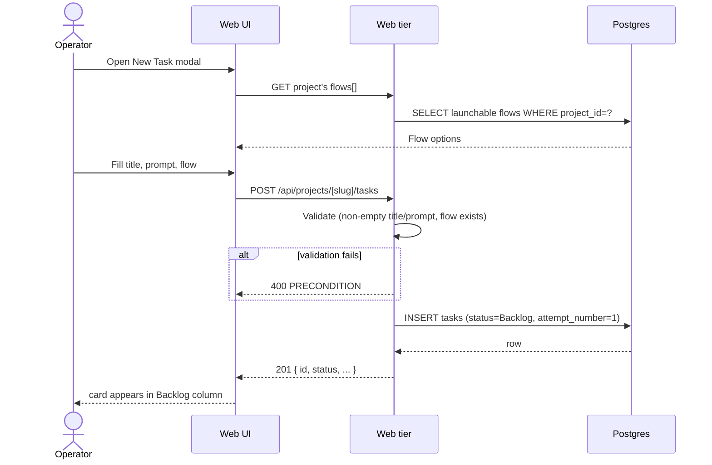
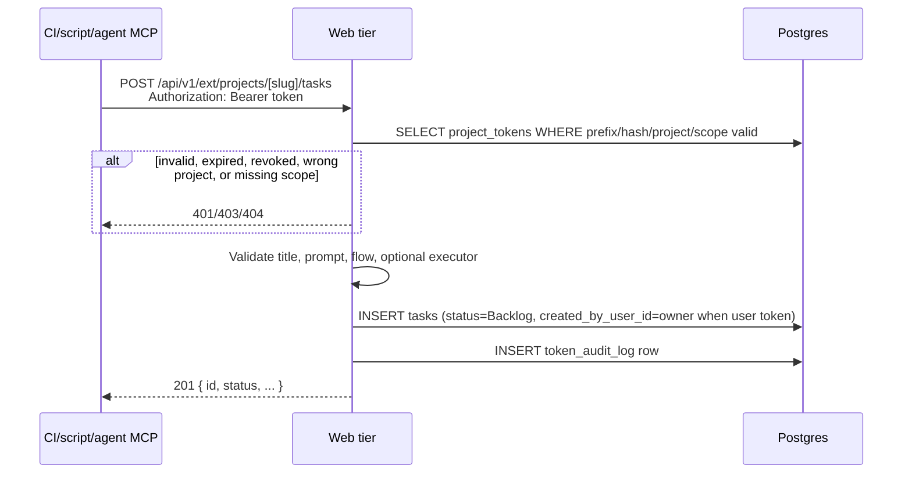
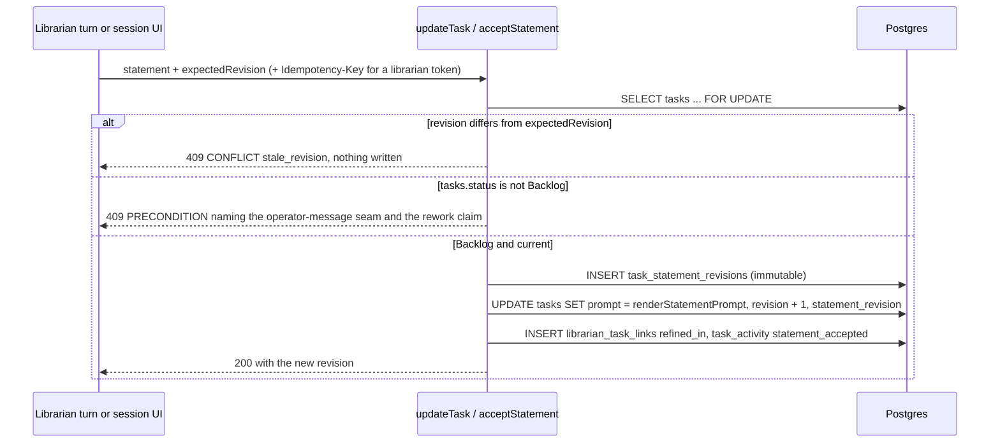
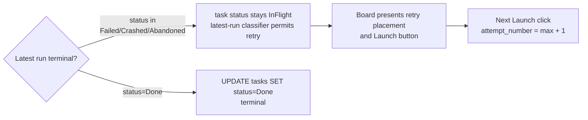
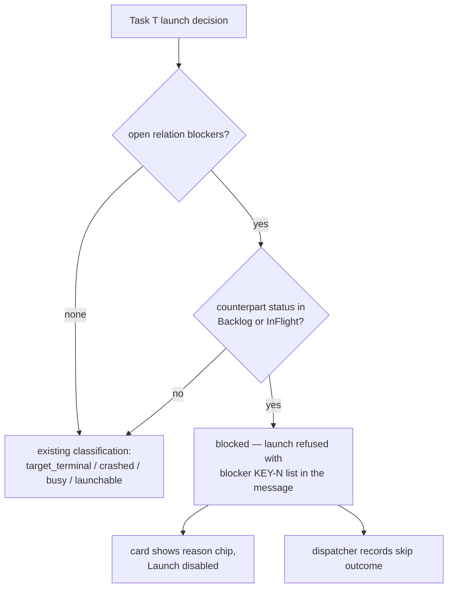
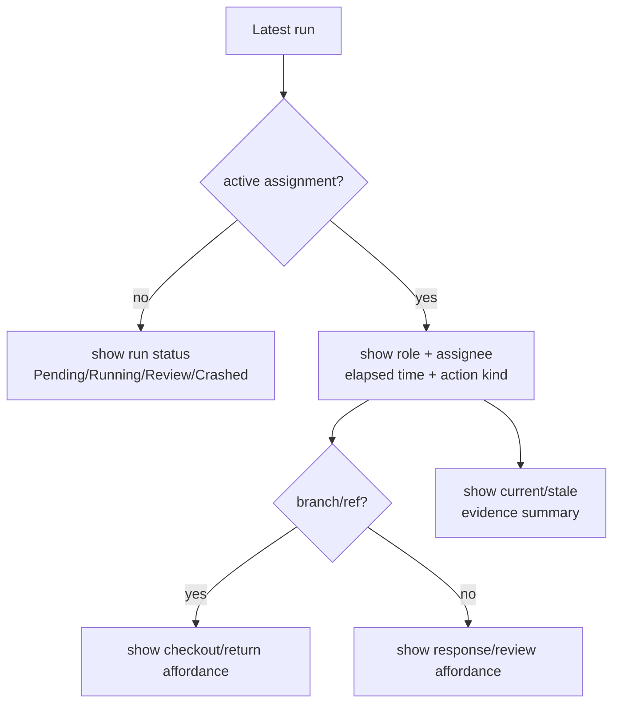
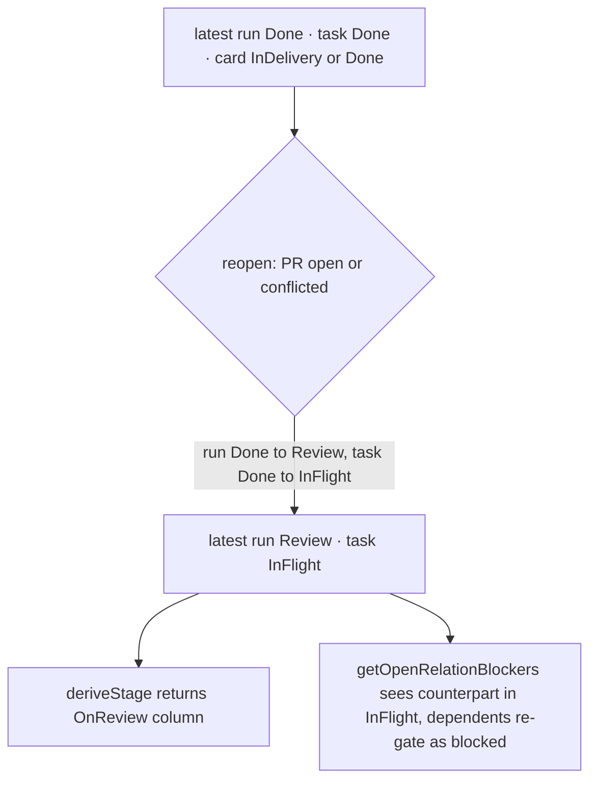

# Tasks domain

**Current launch boundary:** [explicit task launch](task-launch-admission.md) owns the implemented manual/automatic admission, immutable request and dispatch contract. New task-delivery allocations use that boundary; historical v1 receipts remain readable without invented authorization. Qualification content and publication remain separate. Final combined acceptance is tracked by the active implementation plan; this is not production qualification.

## Purpose

A **task** is the operator's unit of intent — one card on a project's
board with a title, prompt, and Flow assignment. Tasks have a simple
board state (`Backlog | InFlight | Done | Abandoned`) and a **1:N**
relationship to runs ([ADR-018](../decisions.md#adr-018-task--run-cardinality-is-1n)).
With ADR-078 (Designed) every task additionally carries a stable
human-readable identity `KEY-N` (`projects.task_key` + `tasks.number`) and
may participate in typed inter-task relations that gate launching; the
comment/activity/subscription/inbox substrate around tasks is owned by
[`social-board.md`](social-board.md).

## Domain entities

- **Task** — board card. Persisted as `tasks` row.
- **Carrier task** (Implemented, ADR-163) — the `tasks` row a flow-target
  delegation mints server-side because a flow run cannot exist without one:
  `launch_mode='manual'` (`run_delegate`) or `auto` (`run_plan`), `flowId` = the
  selected child flow, always linked `parent_of` under the orchestrator's task.
  Its board card carries `parentTask` (the orchestrator's `KEY-N`) and warns
  before a relaunch. A failed launch leaves it `Abandoned`, never deleted.
- **Run** — execution attempt. See [`runs.md`](runs.md).
- **Assignment** — claimable human work item attached to the latest run,
  planned for role-owned waits such as permission, form, review, manual
  takeover, and conflict resolution.
- **External operation** — implemented token-authenticated API or MCP action that
  can create/read/update tasks, launch runs, or report evidence without using
  the web UI.
- **Attempt number** — monotonic counter per task, starting at 1. Current code
  stores it as a **mutable high-water mark** on `tasks.attempt_number`
  allocated under the preparation claim; there is no per-Run attempt-column guarantee
  that a given attempt was actually persisted on a run. The
  `tasks_id_attempt_uq` UNIQUE on `(tasks.id, attempt_number)` is
  vacuous (PK already enforces unique `id`) and provides no
  per-attempt guard. Current canonical intents freeze the exact run/attempt in
  `preparationIdentity`; historical counter-only rows remain unchanged. The
  designed run-attempt schema moves the stamp onto
  `runs.attempt_number` with a real UNIQUE `(task_id, attempt_number)`
  so every run row is immutably tagged and duplicates are rejected at
  the DB.
- **Task key** (Implemented, ADR-078) — `projects.task_key`: platform-wide
  unique, matches `^[A-Z][A-Z0-9]{1,9}$`, set at registration (optional
  explicit `taskKey` or derived from the project name; collision →
  `CONFLICT`), immutable in Stage 1 (comment bodies store expanded `KEY-N`
  links). Migration backfill auto-uniquifies deterministically.
- **Task number** (Implemented, ADR-078) — `tasks.number`: per-project
  monotonic integer allocated from `projects.next_task_number` inside the
  `createTask` transaction (`UPDATE … RETURNING`; the projects-row lock
  serializes concurrent creates), backstopped by
  `UNIQUE(project_id, number)`. Numbers are never reused — deletion leaves
  a hole. `KEY-N` = `task_key` + `-` + `number`.
- **Relation** (Implemented, ADR-083 clause 4) — `task_relations` row: canonical
  one-direction `(from_task_id, kind, to_task_id)` with
  `kind ∈ {blocks, depends_on, parent_of, requires, duplicate_of}`
  (`requires` added by ADR-098, `duplicate_of` by ADR-112),
  `UNIQUE(from_task_id, kind, to_task_id)`, no self-relations,
  same-project only in Stage 1 (`CONFIG` on violation; the project axis is
  lifted by ADR-155 — Implemented, see [`social-board.md`](social-board.md)).
  Inverse labels ("blocked by", "required by", "child of") are render-time
  only.
- **Launch verdict** (Implemented, ADR-089) — `tasks.flow_id` becomes
  NULLABLE (simple-intent creation: title + prompt suffice on both the web
  form and ext/MCP `task_create`) plus four verdict columns the triager or a
  human fills: `runner_id` (FK SET NULL — board Launch passes it as the
  `launchOverride` tier), `target_branch`, `promotion_mode`
  (`local_merge|pull_request`), and `triage_status` (`'triaged'` | `'flagged'` | NULL =
  untriaged; stamped by the ext triage op, cleared by "Send to triage").
  Qualification-origin flags describe the assessment; explicit, dispatch-failure
  and unknown-origin flags remain manual holds. A flowless task can select its
  target in the launch preview and persist that selection atomically with explicit
  acceptance, rather than first PATCHing a Flow to obtain authorization.
- **Task revision** (Designed —
  [ADR-188](../decisions.md#adr-188-task-statements-task-revision-and-conversation-provenance))
  — `tasks.revision integer NOT NULL DEFAULT 0` (migration `0186`), incremented
  by every content write (UI PATCH, ext PATCH, statement accept) inside
  `updateTask` under `SELECT … FOR UPDATE`. `TaskDTO` carries `revision`; the UI
  PATCH (`patchBodySchema`) and the ext PATCH both accept an optional
  `expectedRevision`, and a mismatch is refused
  `MaisterError("CONFLICT")` with `details.reason:"stale_revision"`. The UI
  PATCH's `{ok:true}` response gains `revision`. Contract owner:
  [task-statements.md](task-statements.md) (`TST-02`).
- **Task statement** (Designed — ADR-188) — `tasks.statement_revision integer
NULL` names the accepted row of the immutable `task_statement_revisions`
  ledger. Accepting a statement is a task content write: it renders
  `tasks.prompt` deterministically (`renderStatementPrompt`), bumps
  `tasks.revision`, and passes the same `BACKLOG_GATED_FIELDS` gate as a prompt
  edit. See [task-statements.md](task-statements.md).
- **Librarian provenance columns** (Designed —
  [ADR-187](../decisions.md#adr-187-librarian-operation-ledger-confirmation-cards-and-launch-intent))
  — `tasks.created_via_operation_id` (UNIQUE, nullable) records the librarian
  operation that created the task: a racing retry of the same operation hits the
  unique and returns the existing task, and an operation whose outcome is
  unknown settles by lookup on this column. `tasks.launch_intent`
  (`none | triage_only | triage_then_launch`, `NULL` = today's behaviour) bounds
  triage-driven auto-launch; see [`triage.md`](triage.md).
- **Clarification hold** (Designed —
  [ADR-189](../decisions.md#adr-189-addressed-task-clarification-before-execution))
  — an open blocking user-origin `task_clarifications` row. It adds the
  launchability value `clarification_pending`; it is NOT a task status. See
  [task-clarifications.md](task-clarifications.md).

## State machine — board axis

```mermaid
stateDiagram-v2
    [*] --> Backlog: create task<br/>(title + prompt; flow optional)
    Backlog --> InFlight: Accepted request binds a Run<br/>(preparation and technical gates pass)
    InFlight --> InFlight: latest run terminates<br/>Failed | Crashed | Abandoned<br/>(retry eligibility is derived)
    InFlight --> Done: latest run merged<br/>(terminal)
    Backlog --> Abandoned: explicit Discard click
    InFlight --> Abandoned: explicit Discard click
    Done --> [*]
    Abandoned --> [*]
```

Notes:

- The InFlight bucket contains runs in any of `Pending | Running |
NeedsInput | NeedsInputIdle | HumanWorking | Review | Crashed`.
- Planned assignment-aware board cards show the latest active assignment:
  role, assignee or unclaimed state, elapsed time, action kind, branch/ref when
  relevant, and stale-evidence summary.
- **(Implemented)** The in-flight flight card is **identity-first and compact**:
  row 1 is `KEY-N` (linking to the task page) + task title + time + flow chip +
  agent; row 2 (non-done) is a slim progress spine + current node label. The
  worktree branch and the inline HITL form are **not** on the card — a `needs`
  card shows a needs-attention badge and the response is given on the run page
  (diff visible) or in the HITL Inbox. Click-anywhere opens the run via a
  stretched-link overlay; the `KEY-N` link and lifecycle/launch buttons stay
  independently clickable above it.
- "Latest run" on the card today is `runs ORDER BY started_at DESC
LIMIT 1 WHERE task_id = ?`. Once `runs.attempt_number`
  lands this becomes `MAX(attempt_number) WHERE task_id = ?`.
- A failed, crashed, or abandoned latest run does not mutate the persisted task
  status back to `Backlog`. Retry placement and the launch affordance are derived
  from the latest-run classifier while the task remains `InFlight`.

## Process flows

### Create a task (Designed)

### Create a task from external operations (Implemented)

(Designed — ADR-187 / ADR-188) With a librarian turn token the same route
requires an `Idempotency-Key`, may carry a `statement` instead of a raw prompt,
and writes, in one transaction: the task with `revision = 1`, the rendered
`tasks.prompt`, the accepted statement revision, `launch_intent='none'`,
`created_via_operation_id`, the `created_from` conversation link, and the
operation finalize riding `recordRequiredTokenAudit`. `created_by_user_id` is
the librarian's owner. The Flow is set when the owner named one or the project
has exactly one launchable Flow; otherwise the receipt reports the task as
`unconfigured` with the next step (triage or pick a Flow), never as launchable. Behaviour in [librarian-operations.md](librarian-operations.md).

### Accept a statement through the Backlog gate (Designed — ADR-188)

A statement accept is refused off-Backlog for the same reason a prompt edit is:
a flow run re-reads `tasks.prompt` at every re-entry (resume, recover, rework,
interrupt) and an agent run reads it at every session start, so there is no
launch snapshot to protect — the gate is the protection. The refusal names the
two supported ways to change running work: the operator-message seam and the
rework claim.

### Clarification hold on launch (Designed — ADR-189)

An open **blocking** user-origin clarification classifies the task
`clarification_pending`, placed after `flagged` and before `blocked`:
`target_terminal > crashed > busy > flagged > clarification_pending > blocked >
unconfigured > launchable`. Every launch entry point refuses it explicitly —
`launchRun` with `PRECONDITION` carrying the classification, C2 admission by
skipping, and `decideFire` through its own arm rather than the fall-through to
`launch`. The two hand-mirrored board classifiers carry the value under a
parity test. No task status is added; the answer, cancellation, or supersession
of the last blocking row releases the hold. `/work` shows it as the
`clarificationPending` attribute ([`work-stages.md`](work-stages.md)). A
non-blocking clarification never holds launch.

### Launch a task (implemented locally)

Configuration save and explicit execution authorization are separate. The Web
launch preview displays the current task revision and settings token; an explicit
`POST /api/task-launch-intents` with a stable key records the selected request.
The server authorizes the session, compares the optimistic witnesses and reserves
the task before any workspace effect. A missing or failed assessment does not
block an authorized manual decision; automatic roots retain current accepted
qualification and their source-specific automatic policy.

The accepted receipt remains visible while queued or preparing. A fenced worker
then creates/binds at most one Run through the existing engine. First dispatch
revalidates authority, material input, target/settings and technical gates. The
[launch contract](task-launch-admission.md) owns the full state/authority matrix;
[the launch screen](../screens/chrome/launch-dialog.md) owns UI layout.

### One-time scheduled launch (Implemented, ADR-139)

A future task launch is not a task state transition and does not create a Run
or consume a Flow slot when a member creates it. The intent stores a validated
normal launch selection and, at the due claim, creates a source-owned canonical
launch intent through the common admission service. Its unattended classifier is intentionally stricter than
manual retry: `Review`, `HumanWorking`, `NeedsInput`, `Crashed`, `flagged`,
blocked, unconfigured, Done, and Abandoned targets terminalize with an
actionable safe refusal instead of forcing a concurrent attempt. A full global
cap is not a refusal: normal launch creates the linked `Pending` Run.

Host outbox pressure is not a refusal either (Implemented — ADR-183): the
launch creates the run `Pending` with `queueReason: "host_pressured"`, the task
stays `InFlight`, and the run starts when the host recovers.

The intent preserves a task key/number/title audit snapshot when task deletion
sets its FK to null. It never changes existing recurring schedule overlap
semantics. Full state, recovery, and retry details live in
[project-automations.md](project-automations.md).

### Failure retry eligibility

### Launch progress and uncertain responses

Task launch uses the durable intent receipt plus existing attention SSE.
Acceptance, queued capacity, preparation, Run binding and execution are distinct
states. Closing or remounting the dialog preserves an uncertain request's exact
key/body. Status refresh does not recreate work; cancel and replace compare the
observed state version. Scratch launch retains its own staged-stream contract.
The legacy `/api/runs` adapters require the same optimistic witnesses and common
admission, and report pending acceptance truthfully when no Run is bound yet.

### Relations gate launching (Implemented, ADR-078)

Open relation blockers and blocking clarifications remain server launch gates.
Flow selection can be supplied by the explicit request, so the manual preview does
not require a previously saved `flow_id`. Qualification-origin flags are advisory
to manual Launch, while independent hold origins remain blocking. Automatic
eligibility retains its stricter assessment/arm contract. The shared reservation
and first-dispatch checks protect these gates across queueing and task edits.

Blocking predicate: task T is blocked iff there exists a relation
`(X blocks T)` or `(T depends_on Y)` whose counterpart task status is in
{`Backlog`, `InFlight`} — `Done` AND `Abandoned` both release, so a
discarded blocker cannot deadlock its dependents. `parent_of` never gates.
Cycle-safe relation authoring is owned by [task queue](task-queue.md) and the
relation service. Existing blockers remain visible and must be resolved; manual
admission does not waive them.

### Automatic launch and manual Run again

A current accepted Ready assessment and independent automatic arm allow
`enqueueQualifiedAutomaticTaskLaunch` to accept one request for the selected
Flow. Both the slot-free scheduler and existing backstop use that canonical
reservation; relation-blocked work waits rather than bypassing its blockers.
Parent-created tasks use their exact parent proof and source contract.

Manual **Launch / Run again** records a new one-shot decision. Its assessment can
be absent, stale, negative or source-failed without manufacturing Ready. An
explicit/dispatch/unknown-origin hold still needs its separate authorized
resolution. A running or reserved ordinary request identifies existing work;
intentional concurrent launch uses `/api/task-launch-intents/concurrent` with
session authority, never an arbitrary bypass flag. Both paths retain capacity,
resource availability, isolation and Flow gates.

The task page keeps prior Run history, outcomes, delivery evidence, costs and
runner snapshots. A same-Run recovery continues its original admission/input;
a successor retry requires fresh admission and links to its source. See
[continuation](task-launch-admission.md),
[retry](agent-retry.md) and the [board screen](../screens/projects/project-board.md).

### Assignment-aware board card (Planned)

### Reopen effect on board state and relations (Implemented, ADR-141)

**Reopen** (ADR-141) pulls a top-level `flow`/`agent` run from `Done` back to
`Review` when its PR is still open or conflicted — the PR was in fact never
merged (the run-level machine is owned by [`branch-sync.md`](branch-sync.md)).
Its board-axis consequences:

- **Derived column.** `deriveStage` (`web/lib/board.ts`) keys the card's column
  on the latest run status, so the card moves from **InDelivery**/**Done** back
  to **OnReview**. `InDelivery` is only a worktree-presence approximation —
  `deriveStage` returns `InDelivery` for a `Done` run whose worktree still
  exists and `Done` once it is GC'd; reopen supersedes both by returning the run
  to `Review`.
- **Board status.** The task re-enters the `InFlight` bucket (its latest run is
  `Review` again). Reopen is the one path by which a `Done` task leaves
  the `Done` board status; it returns to `InFlight`, never to `Backlog` (the
  "Done never returns to Backlog" rule still holds).
- **Relations re-gate.** `getOpenRelationBlockers`
  (`web/lib/social/relations.ts`) counts a counterpart as an open blocker only
  while its `tasks.status ∈ {Backlog, InFlight}` (`Done` and `Abandoned` both
  release — see **Relations gate launching** above). Because reopen returns the
  task to `InFlight`, every dependent whose blocker released when this task
  reached `Done` re-gates: the dependent classifies `blocked` again at every
  launch entry point. This is honest — the PR is not merged, so the dependency
  is not truly satisfied.

### New task modal (Designed)

The board opens a named modal with initial Title focus, background isolation
and contained Tab navigation. Idle dismissal restores the opener and keeps
the in-session draft. During submission the dialog prevents repeated submit
and dismissal. Validation or request failure leaves inputs available with an
accessible error. Success clears the draft and refreshes the board. A bounded
scrollable body keeps both actions reachable (UX-02A–B).

## Expectations

- Task ↔ Run cardinality is 1:N; a task can spawn many runs over its
  lifetime via the retry loop.
- Current code: per-task attempt counter lives on `tasks.attempt_number` as a
  mutable high-water mark, monotonic starting at 1, allocated by the
  preparation claim. An accepted intent freezes its exact attempt allocation.
  The DB has **no** per-Run attempt-column uniqueness guard
  (`tasks_id_attempt_uq` is vacuous because `tasks.id` is the PK);
  `runs` rows carry no attempt stamp at all, so duplicate or missing
  attempts are not detectable from a single table.
- **(Designed)** `runs.attempt_number` becomes the immutable
  per-attempt stamp, monotonic per `task_id` starting at 1, with the
  real DB-enforced UNIQUE `(task_id, attempt_number)` on `runs`.
- "Latest run" displayed on a card is the row with `MAX(started_at)`
  for the `task_id`. Designed run-attempt schema switches to
  `MAX(attempt_number) WHERE task_id = ?` on `runs`.
- Board state is exactly `Backlog | InFlight | Done | Abandoned`.
- `InFlight` is a derived bucket; it contains tasks whose latest run is
  in `Pending | Running | NeedsInput | NeedsInputIdle | HumanWorking |
Review | Crashed`.
- **(Planned)** Human-owned waits create assignments. The latest active
  assignment is rendered directly on the task card and in the portfolio inbox;
  the card must make clear that the task is waiting on a role/person, not just
  "running".
- **(Planned)** Roles are routing labels and audit context, not permission
  boundaries. Any project teammate can claim, respond, return, or merge in the
  current target; MAIster records who acted without blocking on role mismatch.
- **(Planned)** Assignment statuses are
  `Open | Claimed | Working | Returned | Responded | Cancelled | Superseded`.
  Only `Open | Claimed | Working` appear as actionable inbox items.
- **(Planned)** Manual takeover assignments include branch/ref, checkout
  affordance, return action, elapsed time, and stale-evidence summary.
- Latest run terminates in `Failed | Crashed | Abandoned` → the persisted task
  remains `InFlight`; the latest-run classifier exposes retry placement and the
  Launch affordance without recreating the task.
- `Done` tasks NEVER return to `Backlog`. `Done` is otherwise terminal EXCEPT
  via ADR-141 reopen, which returns the task to `InFlight` (never `Backlog`)
  together with its run's `Done → Review` flip.
- Title and prompt are non-empty at creation.
- A flowless task can select a real enabled Flow at explicit Launch, or select a
  task-bound code-delivery agent. Acceptance refuses an unresolved target;
  selecting configuration alone creates no execution authority.
- Qualification-origin flags are advisory to manual Launch; explicit,
  dispatch-failure and unknown-origin flags remain independent holds. The shared
  manual gate and server admission enforce the distinction; automatic roots
  still require their current accepted assessment and arm.
- **(Implemented)** A Backlog card is **compact in the description axis**,
  the sibling of the flight card's identity-first contract above: it shows at
  most a ~120-character plain-text excerpt of `tasks.prompt`, and the full
  Markdown is reachable in place behind a disclosure control on the card.
  Truncation is display-only — the authored source is never altered. The excerpt
  MUST read as the expanded body reads: it strips only the markup the renderer
  itself consumes, and keeps what the renderer shows literally (raw HTML is shown
  literally here — there is no `rehype-raw`, ADR-078 D10). Enforced by
  `web/lib/markdown-excerpt.ts`, its per-rule table in
  `web/lib/__tests__/markdown-excerpt.test.ts`, and
  `web/lib/__tests__/markdown-excerpt-renderer-parity.test.ts`, which asserts the
  excerpt against the renderer's own output rather than a hand-written string.
- **(Implemented)** Board-card text is **read-only**. Neither the title nor the
  description carries an inline editor on the card; the title is a link and the
  description is presentation only. Both are edited through the full card editor
  (`PUT`) or on the task detail page (`PATCH`), which keeps ONE editing surface
  per field instead of two that can disagree.
- **(Implemented)** `PATCH /api/projects/{slug}/tasks/{number}` MUST
  update verdict fields in ONE transaction with explicit-`null` CLEAR
  semantics, validating `flowId`/`runnerId` against server-state allow-lists.
- **(External operations + token actor-scope support — Implemented)** External task creation
  uses the same validation as the UI and records the API token in
  `token_audit_log`. User-owned tokens also set `tasks.created_by_user_id` to
  the token owner; project tokens leave it null.
- **(Implemented)** The thin MCP facade can create/list/get/update tasks only
  through the same domain path as the API; it cannot bypass token scopes,
  assignment rules, or run launch preconditions.
- **(Implemented, ADR-078)** `tasks.number` MUST be unique per project
  (`UNIQUE(project_id, number)`), allocated only inside the `createTask`
  transaction, and never reused; `projects.task_key` MUST be platform-wide
  unique and immutable in Stage 1.
- **(Implemented, ADR-078)** A task with an open relation blocker
  (`X blocks T` or `T depends_on Y`, counterpart ∈ {`Backlog`, `InFlight`})
  MUST be refused launch as `"blocked"` at EVERY entry point — internal
  `POST /api/runs`, ext `POST /api/v1/ext/runs`, and the schedules
  dispatcher — via the shared classifier, never via UI-only logic.
- **(Implemented, ADR-083 clause 4)** Duplicate relation writes MUST be
  idempotent no-ops; the relation's project axis (same-project in Stage 1,
  from-end ownership with a possibly foreign to-end under ADR-155 — Implemented,
  which supersedes only that sentence of the clause) is contracted in
  [`social-board.md`](social-board.md).
- Launch runs precondition checks (clean repo, branch free, worktree
  path free, executor registered) BEFORE inserting the `runs` row.
- Capacity exhaustion retains an accepted queued intent; a Run may not exist yet.
  A bound Pending Run and its intent retain one exact preparation identity. The
  scheduler-lock capacity accounting owns transfer to execution.
- Discarding a task with a live run MUST terminate the supervisor
  session (`DELETE /sessions/<id>`) before the task transition; failure
  to terminate does NOT block the transition (reconciliation cleans up).
- (ADR-121, Implemented) `tasks.priority` (`low|normal|high|urgent`, NOT NULL
  default `normal`, CHECK) backs the criticality dictionary and is the LIVE
  admission input; `tasks.triage_confidence` (`numeric(4,3)`, CHECK 0..1) is
  advisory only; `tasks.queue_paused` (default false) excludes a task from
  auto-admission/auto-resume/poll and is settable while Backlog OR InFlight (other
  config edits retain their task/dispatch guards); historical `tasks.queue_claimed_at`
  remains a compatibility/reconciliation fact rather than current manual authority.
  Priority/confidence are dual-writable (human PATCH + agent ext triage,
  via one shared mapper) and CLEAR-symmetric (priority→`normal`, confidence→NULL).
  See [`task-queue.md`](task-queue.md).

## Edge cases

- **Empty title or prompt** → `PRECONDITION` (400).
- **`flow_id` not registered for this project** → `PRECONDITION`.
- **No resolved Flow or agent target at acceptance** → typed configuration/
  precondition refusal; a task need not save a Flow before opening manual Launch.
- **Selected Flow has no enabled package revision** → launch options return
  `no_revision`; `POST /api/runs` fails fast before any worktree/run/workspace
  side effect.
- **Selected Flow package is installed/trusted but not enabled for launch** →
  launch options return `not_enabled`; `POST /api/runs` fails fast before any
  worktree/run/workspace side effect.
- **selected `runnerId` missing, disabled, or not ready** →
  `EXECUTOR_UNAVAILABLE`
  (503).
- **Dirty parent repo on Launch** → `PRECONDITION` ("commit or stash
  changes in `{repo_path}`").
- **Branch name `<branch_prefix><task_slug>` already exists** →
  `PRECONDITION` ("branch exists; abandon prior run or pick a different
  name").
- **Worktree path collision** → `PRECONDITION`.
- **Global concurrency cap hit** → accepted work remains queued; Pending Run
  status applies only after a Run exists. The receipt never invents a Run ID.
- **Discard a task that has a live run** — supervisor `DELETE
/sessions/<id>`, then mark worktree stale, then `tasks.status =
Abandoned`. Failure to terminate the session does NOT block the task
  transition (the run reconciles to `Crashed` on next heartbeat tick).
- **(Implemented, ADR-078) Mutual block (`A blocks B` + `B blocks A`)** —
  both tasks classify `blocked` until one relation is removed; the UI
  renders blockers as removable chips, so the state is always recoverable.
  Cycle-safe authoring prevents new cycles; pre-existing blockers still require
  explicit resolution.
- **(Implemented, ADR-083 clause 4) Self relation** → `MaisterError("CONFIG")`
  (400 internal, 422 ext). A cross-project relation is refused the same way in
  Stage 1 and allowed by ADR-155 (Implemented) — see
  [`social-board.md`](social-board.md).
- **(Implemented, ADR-078) Hole-y numbering** — deleting a task leaves a
  permanent gap in `KEY-N`; `next_task_number` never decrements. Not an
  error.
- **(Designed, ADR-188) Two writers race on one `expectedRevision`** → the
  second waits on the task row lock and is refused `MaisterError("CONFLICT")`
  with `details.reason:"stale_revision"` (409); nothing it sent is written.
- **(Designed, ADR-188) Statement accept on an `InFlight` task** →
  `MaisterError("PRECONDITION")`; `tasks.prompt` and `tasks.revision` are
  unchanged and the refusal names the operator-message seam and the rework
  claim (`EDGE-TST-01`).
- **(Designed, ADR-189) Launch while a blocking clarification is open** →
  `MaisterError("PRECONDITION")` with classification `clarification_pending` at
  every entry point; the schedules dispatcher and C2 skip rather than fail.

## First-run and zero-flow presentation contract (Implemented)

The portfolio first-run checklist is a server-derived, actor-scoped projection
only. Its stages are (1) at least one visible project, (2) at least one
enabled and launchable Flow under the same enablement, trust, compatibility,
and runner checks used by launch UI, and (3) at least one Flow run with a
non-null `task_id`. A package attachment alone does not satisfy stage 2; a
scratch or agent run does not satisfy stage 3. The projection never reveals
projects outside the current actor's visibility.

When a project has no enabled launchable Flow, the board gives an explicit
packages-tab remediation link rather than an empty Flow picker. This does not
block simple-intent task creation: a task may remain flowless/unconfigured
until an operator configures and launches it through the existing path.

## Clarification context on a task (Implemented — ADR-136)

`tasks.prompt` is immutable for this feature. The task projection exposes
ordered answered `task_clarifications` and `awaitingClarification`; unanswered
or superseded questions are never injected. Context assembly preserves
`FlowContext.task.prompt` byte-for-byte, adds
`FlowContext.task.effectivePrompt` and `FlowContext.task.clarifications`, and
passes only `effectivePrompt` to a fresh standalone agent. Ordered history is
deterministic by `(seq, id)` and presentation-bounded; legacy templates do not
observe a silent rewrite.

(Designed — ADR-189) A clarification may also be addressed by one user to
another before any run exists (`origin_kind='user'`, no source run, agent or
HITL row). `composeEffectivePrompt` folds its answer exactly like an
agent-origin answer; answering never edits the statement or launches work.
Task detail lists open, answered and cancelled requests — see
[task-clarifications.md](task-clarifications.md).

## Linked artifacts

- ADRs: [ADR-018 Task ↔ Run 1:N](../decisions.md#adr-018-task--run-cardinality-is-1n),
  [ADR-083 Social board substrate](../decisions.md#adr-083-social-board-substrate--per-project-task-numbering-typed-relations-polymorphic-actor),
  [ADR-141 Branch sync with AI conflict resolver and reopen](../decisions.md#adr-141-branch-sync-with-ai-conflict-resolver-and-reopen)
  (Implemented — reopen board/relation effect);
  (Designed) [ADR-187 Librarian operation ledger and launch intent](../decisions.md#adr-187-librarian-operation-ledger-confirmation-cards-and-launch-intent),
  [ADR-188 Task statements and task revision](../decisions.md#adr-188-task-statements-task-revision-and-conversation-provenance),
  [ADR-189 Addressed task clarification](../decisions.md#adr-189-addressed-task-clarification-before-execution).
- Librarian-side contracts (Designed): [`task-statements.md`](task-statements.md),
  [`task-clarifications.md`](task-clarifications.md),
  [`librarian-operations.md`](librarian-operations.md).
- ERD: [`../db/runs-domain.md`](../db/runs-domain.md) (tasks + runs tables).
- Related domains: [`runs.md`](runs.md), [`workspaces.md`](workspaces.md),
  [`executors.md`](executors.md), [`social-board.md`](social-board.md)
  (comments, activity, subscriptions, inbox),
  [`run-schedules.md`](run-schedules.md) (dispatcher skip-on-blocked),
  [`triage.md`](triage.md) (Implemented — `flagged`, `auto_launch_triaged` tick,
  triager verdict/flag/enqueue ops), and
  [`branch-sync.md`](branch-sync.md) (Implemented — reopen `Done→Review` board
  and relation re-gate effect).
- Source: `web/lib/db/schema.ts` (tasks + runs tables),
  `web/lib/runs/launchability.ts`, `web/lib/social/relations.ts` (Implemented).

## Current admission boundary

[Task launch admission](task-launch-admission.md) owns explicit human decisions,
qualified automation, derived-child authority and frozen execution. This task
lifecycle page does not redefine those gates. Historical v1 receipts remain
history/continuation evidence; they do not grant a new v2 launch.
