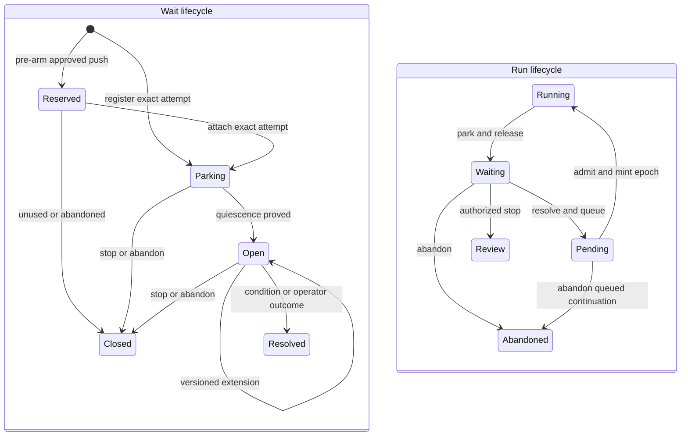
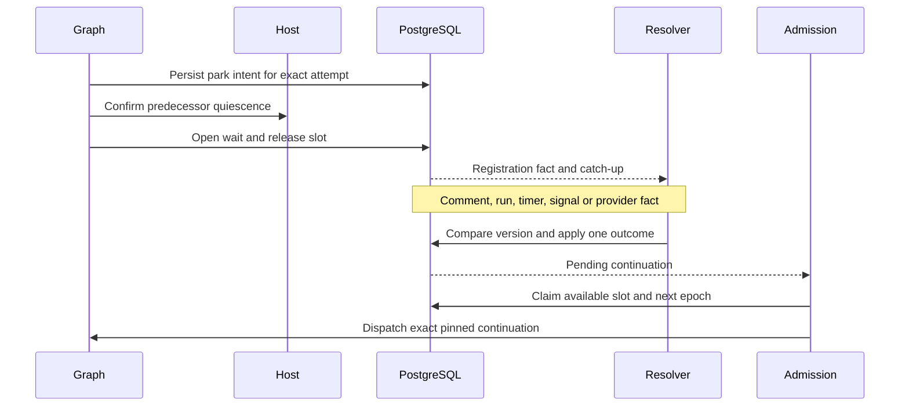

# Durable Flow waits

**Status:** Designed ([ADR-215](../decisions/adr-215.md)).

## Purpose

A project Flow can suspend an exact graph attempt while it awaits a bounded condition. The wait owns the deadline and outcome. Admission owns when execution resumes, and the pinned graph owns where it resumes.

## Domain entities

- `run_waits` holds an occurrence, its owner and condition, the deadline, and its resolution and continuation disposition.
- A delivery stores immutable authenticated intent with a separate application disposition. A wait action records a human intent, reason and resulting version.
- The wait-result artifact records the winning outcome and provenance on the exact node attempt. The [run ERD](../db/runs-domain.md) defines ownership.
- A head binding identifies the workspace generation and assignment epoch or the remote publication generation.

## State machine

## Process flows

### Outcomes and input

| Condition | Eligible input | Compiled outcomes |
| --- | --- | --- |
| Timer | Positive `after` seconds or RFC 3339 `until` | elapsed, timeout, cancelled |
| Comment | A newly visible committed comment on the bound task and optional actor predicate | commented, timeout, cancelled |
| Run | The exact same-project related run | done, failed, review, crashed, abandoned, timeout, cancelled |
| Signal | Declared name, finite outcomes and optional bounded JSON schema and head binding | Declared outcomes, timeout, cancelled, and stale when bound |
| CI | Approved source and exact publication with complete required check set | success, failure, cancelled, timeout, stale |
| PR | Confirmed current PR identity, source head and publication generation | merged, closed, conflict, timeout, cancelled, stale |

Timeout is required and starts when the wait opens. The absolute lifetime ceiling is fixed for the occurrence. The web setting `MAISTER_MAX_WAIT_SECONDS` defaults to 604800. An extension increases the deadline within that ceiling and requires the current version and a reason. On a timer tie, timeout wins. For competing timely event facts use durable source occurrence time and identity. Take the DB clock after locking the wait for signal/action admission. Before sealing timeout, check eligible facts already visible in the transaction. Uncommitted facts and subsequent retries cannot reopen a resolved wait.

A related-run selector names one run. The server verifies the directed task relation or the direct run parent-child relation within the same project. Both top-level and child Review can match. Registration checks existing settlement and catches up once committed, including overlapping source transactions. A comment must first become visible after the registration snapshot. A deleted relation or revoked source loses authority for further application.

### Recovery

| Window | Durable recovery owner |
| --- | --- |
| Park intent committed, host acknowledgement lost | Reconcile the retained host command receipt before releasing the assignment and slot. |
| Delivery committed, HTTP reply or resolver lost | Authenticate again before returning the original receipt. The consumer applies the durable receipt under the wait CAS. |
| Deadline worker unavailable | The scheduler catches up on indexed due rows. Unsupported input is isolated per occurrence. |
| Resolved before scheduler admission | The Pending continuation retains workspace and assigned host. Its queue time starts at resolution. |
| Admission granted before dispatch or during effect | The worker claims the exact wake under its fenced epoch and reconciles any command receipt before retry. |
| Stop or abandon wins before wake | Invalidate the wait or queued continuation and use normal lifecycle cleanup. |
| Released wait needs a workspace observation | Read the exact workspace under the latest released wait epoch. Ask for Git head only. The resolver checks the witness again before applying. |

A validated mismatched head is a stale delivery. An authoritative changed head yields a stale outcome. Capture the head at park. Managed edits emit a change fact. Missing or unverified observations stay pending until deadline. Review and promotion recheck the provenance of evidence if a head or provider attempt changes after the wait has resolved.

Operator access is session-only with `operateWait` for writes. Actions require the original request key, version and reason. Resolve-now can produce any compiled outcome with explicit override provenance. A project token with exact `waits:signal` scope can deliver a signal to the owned run/wait tuple. The wait store records the receipt before accepting the request. Evidence retains the authoritative source and reports payloads as bounded data. Browser invalidation carries identifiers/status only. An ordinary wait adds no Decisions item. Show overdue waits to authorized operators and transfer a timeout escalation to the actual HITL item once it exists.

## Expectations

- W01: SQL MUST require an exact project, run and attempt owner before an open occurrence can be stored.
- W02: The compiler MUST check the feature floor, outcome coverage and bounded rework edges.
- W03: The production deadline job MUST settle timers, expirations and catch-up without extending the ceiling.
- W04: The registered consumer MUST match source identity and visibility for comment and related-run wakes.
- W05: The wait CAS MUST commit at most one first result, evidence row and logical wake across competing contenders.
- W06: The scheduler MUST exclude Waiting from slot count and admit its Pending continuation on its assigned host under a higher epoch.
- W07: Host admissibility MUST fence a released-epoch head read that lacks the exact wait workspace witness.
- W08: Signal ingress MUST replay a content-matched receipt only after rechecking token scope and tuple ownership.
- W09: The action and payload routes MUST enforce session grants and disclosure, and external text MUST stay data through template rendering.
- W10: Run projections MUST keep wait and readmission time outside execution and expose overdue attention once.

## Edge cases

- [CONFIG](../error-taxonomy.md) covers invalid conditions, declarations, malformed signal inputs and incompatible engine floors.
- [NOT_FOUND](../error-taxonomy.md) hides unknown or foreign tuples. [UNAUTHORIZED](../error-taxonomy.md) covers denied token scopes and operator grants.
- [CONFLICT](../error-taxonomy.md) reports changed idempotency content, version mismatch, wrong head or closed occurrence.
- [PRECONDITION](../error-taxonomy.md) reports an unrelated target or an extension beyond the cap.
- [EXECUTOR_UNAVAILABLE](../error-taxonomy.md) leaves a temporarily unavailable host observation bounded by the existing deadline.

## Linked artifacts

- [Flow DSL](../flow-dsl.md) and [graph traversal](flow-graph.md)
- [Run state](runs.md), [admission](task-queue.md) and [execution host](execution-hosts.md)
- [Signal OpenAPI](../api/external/operations.openapi.yaml), [operator OpenAPI](../api/web.openapi.yaml) and [browser changes](../api/async/web-runs.asyncapi.yaml)
- [Publication](workbench-git.md), [readiness](readiness.md) and [execution policy](execution-policy.md)
