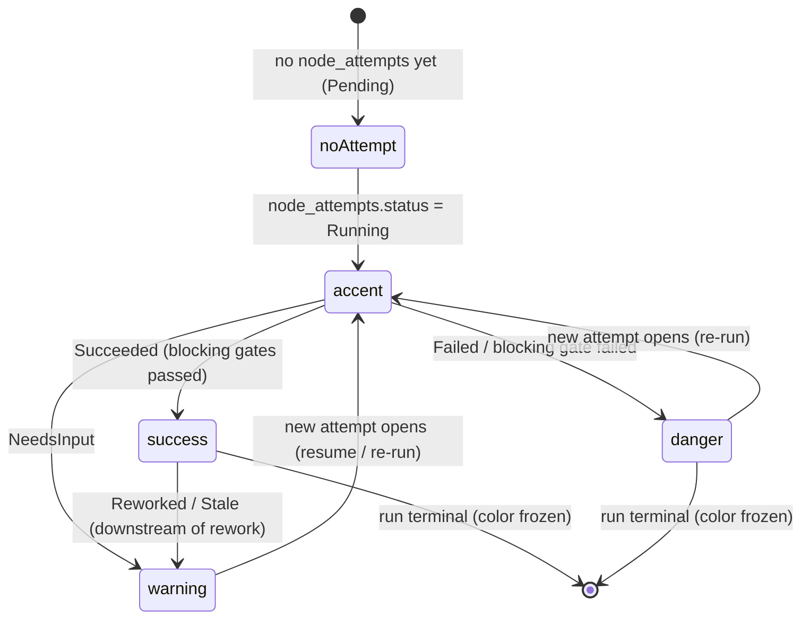
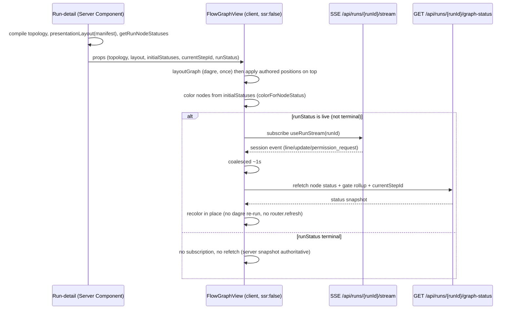
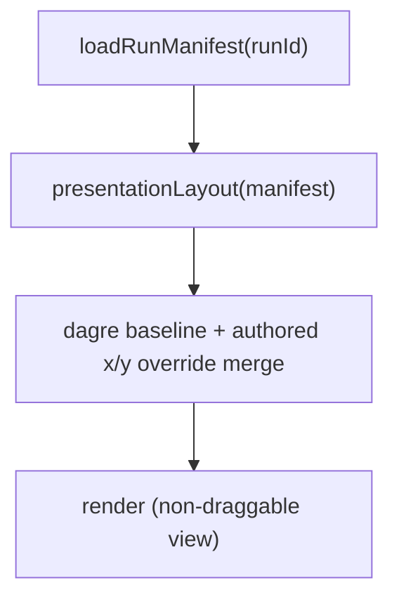
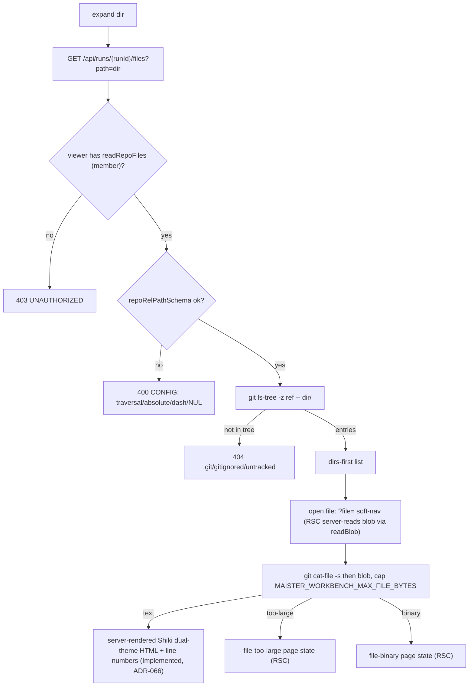
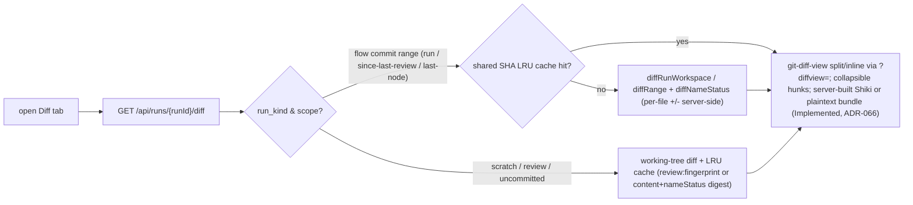

# Workbench visibility domain

> **Status: Implemented.** This file is the contract for the per-run
> **workbench**: a flow-graph VIEW with live node-status coloring, a read-only
> git-tracked file browser, and the base→run diff — all three tracks shipped.
> Three independent tracks:
> **A — flow-graph view** ([ADR-064](../decisions.md#adr-064-authored-flow-graph-layout-in-the-flowyaml-presentation-section),
> [ADR-052](../decisions.md#adr-052-live-node-status-coloring-via-sse-triggered-graph-status-refetch)),
> **B — file-tree** ([ADR-053](../decisions.md#adr-053-workbench-file-tree-git-tracked-only-member-gated-reads)),
> **C — diff** (reuses the review diff). Renderer: [ADR-039](../decisions.md#adr-039-xyflowreact--dagrejsdagre-as-the-evidence-graph-renderer).
> No-polling reaffirms [ADR #1 / ADR-007](../decisions.md#adr-007-sse-pipe-to-disk-for-step-output).

> **Diff rendering upgrade (Implemented, [ADR-066](../decisions.md#adr-066-editor-and-diff-rendering-stack-shiki-git-diff-view-codemirror)).**
> Track B's server-rendered Shiki file view with a `?file=` deep-link **shipped**
> and Track C diff now renders through `@git-diff-view/react` (split/inline via
> `?diffview=`, per-file `+`/`−` counts, server-built Shiki bundle); the `/diff`
> response carries `additions`/`deletions`. The read-only boundary and the
> `readBoard` gate are unchanged. (The authored-Flow CodeMirror editor slice
> remains Designed.)

> **Run detail rework (Implemented).** The workbench stays read-only and now
> renders on the shared run shell for both flow/agent and **scratch** runs.
> Scratch runs surface only the **Files** + **Diff** tabs (no flow timeline or
> evidence graph) and moved from a dialog-owned raw `<pre>` diff to the same
> prepared `RunDiff` renderer — the `/diff` scratch branch returns the same
> `files`/`perFile`/`scope`/`scopes` shape as flow runs (T3.3). A non-empty text
> file opened in the Files pane gets a copy-to-clipboard control, and Markdown
> files render the rich (Mermaid-aware) preview instead of the Shiki source (T4.2).

## Purpose

The **workbench** domain is the run-inspection surface and the shared
secondary run inspector: it makes a run's files, diff, evidence, and timeline
legible without leaving the control plane. Its boundary is **read-only** — it
visualizes the compiled flow graph and colors nodes by live status in the
non-scratch run landing surface (Track A), browses the run/project's
**git-tracked** files (Track B), and renders the selected run-diff scope,
including dirty worktree inspection when explicitly requested (Track C). Node
positions are **authored in the `flow.yaml`
`presentation` section** (ADR-064) and read at render; the view owns **no
write** — it never edits node logic or layout, never mutates run state, and
never reads untracked/working-copy files through the Files source browser.
The execution model it visualizes is [`flow-graph.md`](flow-graph.md); the run
state machine is [`runs.md`](runs.md); the worktree it reads is
[`workspaces.md`](workspaces.md). Lifecycle actions that stop, archive, drop,
or export the visible workbench live in
[`workbench-lifecycle.md`](workbench-lifecycle.md).

## Domain entities

- **Graph topology** — the logic-only graph from `compileManifest(pinnedManifest)`:
  nodes (`id`, `nodeType`, `label`, additive display metadata) + edges
  (`source`, `target`, `outcome`, additive display metadata), with **no x/y**.
  Source: `web/lib/flows/graph/compile.ts` (`FlowGraph`,
  `CompiledNode.transitions`) through `buildGraphTopology`.
- **Authored layout** — entries in the manifest's `presentation.nodes[]`
  (`{ id, x?, y?, width?, height?, color? }`), authored with the flow and shipped
  in the bundle (ADR-064). `presentationLayout(manifest)` projects entries with
  both coordinates into a `nodeId → {x, y}` map; dagre seeds the rest. No DB
  store, no runtime write. Source: `web/lib/flows/graph/presentation-layout.ts`.
- **Node-status snapshot** — per node, the highest-`attempt` `node_attempts.status`
  + a gate rollup over `gate_results.status`, plus `runs.current_step_id`. It
  also carries additive runtime gate-summary counts derived from the same gate
  list. Read model only; no new column. Source: `getRunTimeline`
  (`web/lib/queries/run.ts`) through `getRunNodeStatuses`.
- **Tracked file node** — a one-level `git ls-tree` entry (`name`,
  `type: file|dir`) under a server-resolved `ref`; never a raw `fs` entry.
- **Tracked blob** — a `git cat-file` read result:
  `{kind:"text", content} | {kind:"too-large", size} | {kind:"binary"}`, capped
  at `MAISTER_WORKBENCH_MAX_FILE_BYTES`.
- **Workbench diff** — the server-prepared `files`/`perFile` diff DTO
  (`git diff --name-status` + Shiki-highlighted or zero-Shiki plaintext bundles)
  for any run state, with raw `diff` text included only when `?raw=1` is
  supplied (extends the review surface).

## State machine — node color (view axis, derived)

A node's color is a **pure projection** of its highest-attempt status + gate
rollup; it is not a persisted state. The view recolors on each SSE tick and
freezes on a terminal run.

## Layout resolution (authored, read-only)

Layout is not a runtime persistence axis: positions are **authored in
`flow.yaml`** and read at render (ADR-064). Resolution is a pure merge with no
state to transition:

1. dagre computes the baseline for every node;
2. `presentationLayout(manifest)` overrides position for any node whose
   `presentation` entry declares both `x` and `y`;
3. a `presentation` entry whose `id` is absent from the compiled topology is
   ignored (no phantom node); a node with no entry keeps its dagre seed.

Editing the authored layout (drag-to-arrange) is a flow-editor concern on the
source `flow.yaml`, not a workbench write. **(Designed)** ADR-064 is now
read+write: the Flow Studio flow-graph editor authors the `presentation` section (node
`{id, x, y, width, height, color}`) as part of canvas edits serialized on save.
The workbench read path (rendering the authored layout) is unchanged. See
[`flow-studio.md`](flow-studio.md).

## Process flows

### Graph render + SSE-triggered recolor (no polling)

### Authored layout read (no write)

### Lazy tracked file-tree expand + open

The `…/files` tree expand and the file **open + render** path are both
Implemented (ADR-053 + ADR-066): selecting a file is a `?file=` soft-navigation that
the server component validates (`repoRelPathSchema`), authorizes
(`readRepoFiles`), and reads via `readBlob`, then renders with server-side Shiki
— the standalone `…/files/content` route was retired. The size / binary /
not-found caps and the read-only boundary are unchanged, but an oversized or
binary blob now renders a **page state** (`file-too-large` / `file-binary`) on
the `?file=` RSC path rather than the retired route's HTTP `413` / `415`; a
not-in-tree path is still a `404`.

### Run diff render (Track C)

Flow runs render through `@git-diff-view/react` (Implemented, ADR-066). The
run-detail rework upgrades scratch runs to the same prepared diff DTO and renderer instead
of the dialog-owned raw `pre`. At an open review gate the same diff surface
additionally hosts line-anchored review-comment threads (composer, inline thread
cards, collapsible Outdated list — Implemented, ADR-072); see
[`review-comments.md`](review-comments.md).

### Evidence viewport (Implemented)

Evidence fits after the visible pane and its nodes are measured, and again
after a change to the URL's node, kind or state filters. An unchanged filter
with refreshed data or a changed selection preserves deliberate camera movement,
including when matching nodes disappear and return. An active filter remains
visible and clearable if its last option disappears. Empty results retain filter
controls. A singleton is fitted with a zoom cap
(UX-03C–D).

`evidenceItem` selects one Evidence graph row in the current Run. Verification
links use its stable gate row ID. The selected item appears with the other
filters, and Clear filters removes it. Flow inspector selection keeps using
`node` independently of this exact Evidence target.

### Transcript viewport (Implemented)

Main and child transcripts keep their scroll owners. Earlier history loading,
errors and retries appear at the top boundary. Jump remains inside the
transcript on both axes, including when the transcript enters the viewport near
its bottom edge, and resumes follow-tail. A retained later page and a live message
arrival have distinct announcements. Inserting controls and messages keeps the
visible anchor while the reader is above the tail. An open child peek keeps
automatic parent transcript following from moving the page (UX-09A–B).

## Results, provenance and inspector navigation (Implemented)

- `wb=evidence` opens Results and checks. `evidenceView=graph` opens provenance and existing `kind` or `state` links retain graph filtering. `evidenceItem=gate:<id>` selects the exact check and retains access to its graph context.
- Node, file, tab, review anchor, Git panel, child peek and browser history preserve their existing selectors. An explicit inspector selector controls disclosure. Close restores focus to its trigger.
- At 1440×1000 and 390×844 the reading path remains available with the inspector or Librarian open. In constrained space the inspector may occupy an overlay with a clear return action.

## Compact USER presentation (Designed)

`TranscriptView` derives presentation only; retained messages, HTTP/SSE,
DB schemas, error taxonomy and deployment contracts are unchanged.
`user-message-presentation.ts` owns classification, lossless segmentation and
exact repeats; `user-message.tsx` owns native disclosures and full-copy access.

| Scenario | Required behavior / enforcing check |
| --- | --- |
| Threshold | Close above 2,000 UTF-16 units or 12 logical lines; CRLF counts once and trailing blanks count (presentation tests). |
| Preview | At most four visual lines; Copy stays visible beside native details, metadata and attachments remain outside clipping (component/browser tests). |
| Exact repeat | Complete long USER text alone qualifies; compare exact strings in order, reset at /clear, recompute after pagination/eviction (presentation tests). |
| Skills | Recognize generated heading, exact explanation and contiguous valid entries outside fences; retain original slices, heading and all list lines; malformed lists stay text (reconstruction tests). |
| Disclosure | Closed/open state is view state; nested skills retain openness when the parent closes (browser tests). |
| Bounded content | Closed and URL-open previews never fetch automatically; explicit expand/load/copy uses the supplied authorized same-origin full-content URL, with one shared in-flight request (browser tests). |
| Failures | Network/5xx gets at most two retries with visible localized status; 4xx fails immediately; final errors allow retry and preserve download access; abort on unmount or message replacement (browser tests). |
| Copy | Clipboard receives unmodified full text; only success shows copied feedback, unavailable/rejected writes show localized retryable errors (browser tests). |
| History | Existing initial/latest scrolling, history pagination and custom renderers retain ownership (history regression suite). |

Repeated `transcript-open` query values are JSON tuples
`[1,messageId,section]`, where section is `message` or `skills:<ordinal>`.
Only explicit opens are stored, sorted and deduplicated on writes; malformed
or unknown values are ignored. No content, path or hash enters the tuple.
`use-user-message-expansion.ts` restores via popstate and a same-document
event, using closed SSR snapshots. User toggles replace the current entry,
preserving unrelated query parameters, URL hash and `history.state`; restoration
does not write history. Unloaded IDs remain in the URL. Shared links and
back/forward restore each entry's choices without creating messages or fetching.

## Diff preparation, caching, and bounded git reads (Implemented)

- **Syntax budgets, event-loop yielding, and bundle sanitization (`web/lib/diff/prepare.ts`):**
  Any single file exceeding `maxLineToIgnoreSyntax` (`2,000` changed/syntax
  lines) downgrades individually to a zero-Shiki monochrome plaintext bundle
  (`fileLang: "plaintext"`) without charging the shared cumulative budget or
  starving subsequent smaller files. Remaining files share
  `MAX_TOTAL_SYNTAX_LINES = 8_000`; trailing files beyond that budget also
  downgrade to zero-Shiki monochrome plaintext bundles (`fileLang: "plaintext"`)
  that hydrate in `@git-diff-view/react` with zero client lowlight fallback
  (ADR-066 FINDING G preserved). Preparation processes files in batches of
  `DIFF_YIELD_BATCH_SIZE = 5` (or a `DIFF_YIELD_BUDGET_MS = 16` ms slice) with
  `setEnableBuildTemplate(false)` scoped strictly inside each synchronous batch
  and `setImmediate` yields between batches, and sanitizes bundles in a single
  pass without `JSON.parse(JSON.stringify(...))`.
- **Shared LRU prepared-diff cache (`web/lib/diff/cache.ts`):**
  Shared across `GET /api/runs/{runId}/diff` and `RunDetailLayout` SSR across
  all diff scopes, bounded by `DIFF_CACHE_MAX_BYTES = 32 MiB` total, a `16 MiB`
  single-entry cap on cached `preparedJson` UTF-8 byte length (retaining parsed
  `prepared` objects alongside for SSR hits), and `DIFF_CACHE_MAX_ENTRIES = 256`.
  Commit-range scopes key by `sha:<worktreePath>:<baseSha>:<headSha>`, `review`
  keys by `review:<fingerprint>`, and working-tree scopes (`uncommitted`,
  `scratch`) key by `contentCacheKey` hashing
  `(scopeKey, diff, truncated, nameStatus)` to avoid cross-tenant collisions or
  stale `files[]` on truncated diffs. `requireProjectAction` and
  `assertRunKnowledgeDisclosure` always execute before returning any cached
  entry; `perFile` is serialized at most once per cache miss, and raw `diff` is
  omitted unless `?raw=1` is supplied.
- **Single-spawn bounded `git diff`, `-z` path safety, and `--numstat` inbox summary (`web/lib/worktree.ts`, `web/lib/queries/inbox-context.ts`):**
  `diffRange`, `diffRunWorkspace`, and `diffWorkingTree` invoke `git diff` at
  most once through `streamGitTruncatedTo(..., EXEC_MAX_BUFFER)` (4 MiB),
  returning `{ text, truncated: true }` cleanly on overflow instead of
  re-spawning or throwing on size. `diffNameStatus` and `diffChangeStats` use
  NUL-delimited `-z` output (paired with C-quoted path decoding in
  `web/lib/diff/sections.ts`) so non-ASCII UTF-8 and spaced paths parse
  losslessly. `getInboxCardContext` computes `{ files, additions, deletions }`
  via `diffChangeStats` (`git diff --numstat`) rather than reading the full
  patch.
- **Structured logs:**
  `LOG_LEVEL`-gated `pino` loggers (`worktree`, `diff-prepare`, `diff-cache`,
  `inbox-context`, and `api-run-diff`) emit structured diagnostics with zero
  payload or secret leakage: `DEBUG` on cache hit/miss/evict/oversize, highlight
  counts, yields, and durations; `INFO` on diff truncation or syntax-budget
  plaintext fallback; and `WARN` on `prepare-failed` or graceful fallback.

## Expectations

- Node color MUST reflect the highest-`attempt` `node_attempts.status` plus
  `gate_results.status` rollup for each `node_id`, defaulting to `Pending` when
  no attempt exists.
- Static graph display metadata (`displayLabel`, `nodeTypeLabel`, `nodeRole`,
  `declaredGateSummary`, `edgeRole`) is additive from the pinned manifest while
  compatibility fields (`id`, `nodeType`, `label`, `source`, `target`,
  `outcome`) remain stable; runtime `gateSummary` stays in `…/graph-status`
  with no per-node API calls.
- Graph topology (`compileManifest`) is logic-only with no x/y;
  `presentationLayout(manifest)` overrides only nodes declaring both `x` and
  `y` in `flow.yaml` `presentation` (ADR-064), dagre seeds the rest, and
  unknown `presentation` IDs are ignored without error.
- The flow-graph view is read-only (no drag handlers or layout write route),
  refetches `…/graph-status` ONLY on coalesced SSE event ticks (NEVER on a
  timer), and MUST NOT refetch once `runs.status` is terminal.
- Every git-tracked file read (`…/files` tree route and `?file=` RSC blob read,
  ADR-066) MUST require `readRepoFiles` (min role `member`, refusing `viewer`)
  and validate `?path=` against `repoRelPathSchema` (`400` `CONFIG` on `..`,
  absolute, leading `/` or `-`, or NUL).
- File reads MUST return ONLY git-tracked content via `git ls-tree` / `git
  cat-file` under a server-resolved `ref` (`.git/`, gitignored, `node_modules`,
  and untracked paths surface as `404`), rendering text as server-side Shiki
  dual-theme HTML (0 KB client), blobs over `MAISTER_WORKBENCH_MAX_FILE_BYTES`
  as `file-too-large`, and binary blobs as `file-binary` (never raw bytes or
  HTTP `413`/`415`).
- The workbench diff serves flow (`run` `base..branch`, `since-last-review`,
  `last-node`, `review`, `uncommitted`) and scratch scopes under `readBoard`
  (`viewer`) / `readScratchRun`, adds NO new `runs.status` value, renders via
  `@git-diff-view/react` (`?diffview=`) with server-computed per-file
  `additions`/`deletions`, and MUST omit raw `diff` unless `?raw=1` is supplied.
- `GET /api/runs/{runId}/diff` MUST serialize `perFile` at most once per cache
  miss and share the bounded LRU cache (`lib/diff/cache.ts`: `32 MiB` /
  `16 MiB` / `DIFF_CACHE_MAX_ENTRIES = 256`) while ALWAYS enforcing
  `requireProjectAction` and `assertRunKnowledgeDisclosure` before returning
  cached entries.
- `prepareDiff` MUST downgrade any single file over `maxLineToIgnoreSyntax`
  (`2,000` lines) individually without charging `MAX_TOTAL_SYNTAX_LINES = 8_000`,
  downgrade trailing files past the cumulative budget to zero-Shiki monochrome
  plaintext bundles (`fileLang: "plaintext"`, ADR-066 FINDING G preserved),
  yield via `setImmediate` every 5 files (or `16 ms` slice) with
  `setEnableBuildTemplate(false)` scoped inside each batch, and sanitize
  bundles in a single pass without `JSON.parse(JSON.stringify(...))`.
- Oversized diffs (over `EXEC_MAX_BUFFER` 4 MiB) MUST degrade via a single
  `git diff` spawn (`streamGitTruncatedTo`) to a bounded prefix with
  `truncated: true` (never re-spawning or throwing on size), `getInboxCardContext`
  MUST compute `{ files, additions, deletions }` via `diffChangeStats`
  (`git diff --numstat`), and both workbench and review surfaces MUST show a
  truncation banner with promotion blocked behind explicit acknowledgement when
  `truncated`.

## Edge cases

- **A `presentation` entry for an unknown `nodeId`** (not in the compiled
  topology) → ignored at render (no phantom node), never an error.
- **`…/graph` or `…/graph-status` for a run with no flow / no pinned manifest** → `404`.
- **File path traversal / absolute / leading `-` / NUL** (`repoRelPathSchema` reject) → `400` (`CONFIG`).
- **`.git/config`, a gitignored `.env`, or an untracked file path** → `404` (not in
  the tracked tree; never disclosed).
- **Blob over the size cap** → `file-too-large` page state; **binary blob** →
  `file-binary` page state (RSC `?file=` render; no HTTP `413`/`415` — ADR-066).
- **Cross-project `slug`/`runId`** (caller is not a member of the resource's
  project) → `403` (`UNAUTHORIZED`) via `requireProjectAction` against the
  server-derived project (the app-wide convention); a genuinely unknown
  `runId`/`slug` → `404`.
- **SSE refetch after a run goes terminal** → MUST NOT happen (the view freezes on
  the server snapshot); regression-asserted by the e2e.
- **Legacy run with null `workspaces.base_commit`** → diff base falls back to
  `resolveBaseRef(...)`; a run with no derivable base → `PRECONDITION` (409, the
  existing diff guard). No new `MaisterError` code.
- **Oversized diff** (over `EXEC_MAX_BUFFER`, 4 MiB) → single-spawn `streamGitTruncatedTo`
  kills git cleanly and returns a bounded prefix + `truncated: true` on `…/diff`
  (exact 4 MiB returns `truncated: false`; genuine non-zero git exit throws
  `MaisterError("CONFLICT")`); the review panel blocks promotion until the
  reviewer acknowledges (ADR-066). NOT a `409`/throw on size, NOT a silent partial render.
- **Per-file cap or cumulative syntax budget exceeded** → any single file
  exceeding `maxLineToIgnoreSyntax` (`2,000` changed/syntax lines) downgrades
  individually to a zero-Shiki monochrome plaintext bundle
  (`fileLang: "plaintext"`) without charging the shared budget or starving
  subsequent smaller files; remaining files share `MAX_TOTAL_SYNTAX_LINES = 8_000`
  and trailing files beyond that cumulative budget downgrade to zero-Shiki
  monochrome plaintext bundles (`fileLang: "plaintext"`) that hydrate in
  `@git-diff-view/react` with zero client lowlight fallback; overlapping
  `prepareDiff` calls never corrupt `getEnableBuildTemplate()` across
  `setImmediate` yields (Implemented).
- **Oversize cache entry or `?raw=1` after cached read** → a single diff whose
  `preparedJson` UTF-8 byte length exceeds `16 MiB` bypasses the `32 MiB`
  `preparedJson`-byte-bounded LRU (which retains the corresponding parsed
  `prepared` objects alongside for SSR hits) without evicting healthy entries;
  `?raw=1` reads raw diff text from git while reusing cached `files` and
  `preparedJson` without re-running Shiki (Implemented).

## Review Workspace (Implemented — ADR-138)

### Purpose

The Flow Review Workspace is the single code-review and decision surface for an
open `schema.review === true` gate. It is distinct from the read-only/general
workbench and the final-delivery ReviewPanel.

### Entities

- **Review workspace URL state** — `wb=review`, valid only for a Flow run with
  an open review gate; it selects `scope=review`.
- **Review source** — base-to-working-tree content plus a visible freshness
  statement and opaque fingerprint.
- **Decision rail** — one approve/request-changes control, summary, completed
  gate-chat transcript, feedback-preview dialog, and mutation/error state.

### Process

### Expectations

- Files remain git-tracked only. The review diff may include untracked files as
  diff additions; it does not broaden the Files-pane trust boundary.
- Invalid/non-review/scratch deep links show an explicit unavailable state;
  they never silently substitute a committed-only diff.
- Desktop uses changed-file rail, diff/threads, and a decision rail. On mobile
  the rail collapses below the selected diff while preserving the one decision
  control. Keyboard order is source statement → file rail → diff/thread actions
  → decision rail. Async state uses `aria-live`; refusal moves focus to a
  localized error summary.
- EN and RU use the same source wording, freshness/refusal guidance, resolved
  thread exclusion, and final-delivery distinction.

### Edge cases

- Source changes after preview → refresh-required state; request changes stays
  disabled until a new preview is loaded.
- Removed workspace, unavailable source, or no configured feedback consumer →
  visible unavailable/refusal state, never a blank decision form.

### Linked artifacts

- [ADR-138](../decisions.md#adr-138-flow-review-workspace--complete-working-tree-review-and-verified-rework-feedback-delivery),
  [`review-comments.md`](review-comments.md), [`hitl.md`](hitl.md), and
  [`../screens/runs/workbench.md`](../screens/runs/workbench.md).

## Linked artifacts

- ADRs:
  [ADR-039 renderer](../decisions.md#adr-039-xyflowreact--dagrejsdagre-as-the-evidence-graph-renderer),
  [ADR-064 authored layout](../decisions.md#adr-064-authored-flow-graph-layout-in-the-flowyaml-presentation-section)
  (supersedes [ADR-051](../decisions.md#adr-051-flow-graph-layout-metadata-store-project-scoped-flow_id-keyed)),
  [ADR-052 live coloring](../decisions.md#adr-052-live-node-status-coloring-via-sse-triggered-graph-status-refetch),
  [ADR-053 file-tree](../decisions.md#adr-053-workbench-file-tree-git-tracked-only-member-gated-reads),
  [ADR-066 editor/diff rendering](../decisions.md#adr-066-editor-and-diff-rendering-stack-shiki-git-diff-view-codemirror) (file view + diff Implemented; authored editor Designed).
- API: [`../api/web.openapi.yaml`](../api/web.openapi.yaml) (`…/graph`,
  `…/graph-status`, the `…/files?path=` and `/api/projects/{slug}/files?path=`
  tree routes, and the flow-run `…/diff` case; git-tracked blob reads are the
  `?file=` RSC render path, not an HTTP route).
- Config: [`../configuration.md`](../configuration.md) §Environment variables
  (`MAISTER_WORKBENCH_MAX_FILE_BYTES`).
- Errors: [`../error-taxonomy.md`](../error-taxonomy.md) (`CONFIG` / `PRECONDITION`
  caller rows; no new code).
- RBAC: [`../../web/CLAUDE.md`](../../web/CLAUDE.md) §RBAC model
  (`readRepoFiles`).
- Related: [`flow-graph.md`](flow-graph.md) (execution model the view renders),
  [`runs.md`](runs.md) (run state / diff), [`workspaces.md`](workspaces.md)
  (worktree the tree reads).
- Source (Implemented; layout reworked per ADR-064):
  `web/lib/queries/flow-graph-view.ts`, `web/lib/queries/run-node-status.ts`,
  `web/lib/flows/graph/presentation-layout.ts`,
  `web/lib/board/flow-graph-view-layout.ts`,
  `web/components/board/flow-graph-view.tsx`,
  `web/components/workbench/*`, `web/lib/worktree.ts` (`listTree`/`readBlob`/`diffNameStatus`),
  `web/lib/diff/cache.ts`, `web/lib/diff/sections.ts`, `web/lib/diff/line-index.ts`.

## Child Run peek (Implemented)

See the [navigation contract](run-peek-navigation.md) and [authorized data/live-delivery contract](run-peek-data.md). Existing execution/result lifecycle semantics remain authoritative.
